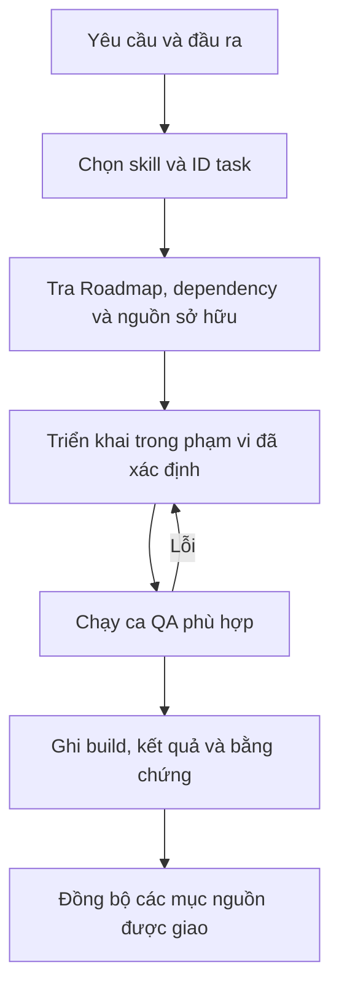

# Hệ thống skill vận hành Ca trực cuối cùng

[AGENTS.md](../../AGENTS.md) chọn skill theo đầu việc. Sáu skill cấp dự án nằm tại `.agents/skills/`. Mỗi skill quy định nguồn cần mở, hợp đồng cần giữ, việc cần làm và bằng chứng cần bàn giao. Nội dung và tiến độ sản xuất tiếp tục được quản lý tại bảy tài liệu Core.

## Điều phối công việc



Với yêu cầu đi qua nhiều khâu, chọn skill theo đầu ra chính. Ví dụ thay vị trí thẻ chuyển An bắt đầu ở level, rồi đối chiếu narrative cho provenance, gameplay cho E11/G02 và QA cho đường lấy lại. Một task triển khai có thể viện dẫn nhiều nguồn. Ghi vị trí chính xác bằng heading Word hoặc tên sheet và ID dòng.

## Bảy nguồn sở hữu

| Nguồn | Dùng để quyết định | Tra nhanh |
| --- | --- | --- |
| [Core 01 Game Design](../01_Game_Design_Document.docx) | Vòng chơi, nguyên tắc tương tác, UX và mục tiêu chất lượng | §2 gameplay, §3 demo, §4 alias và cổng duyệt, phần v2.2 |
| [Core 02 Narrative](../02_Narrative_Bible.docx) | Sự thật trong thế giới, hiểu biết nhân vật, WR, ending | CAN01–07, WR01–08, PT01–05, §4 và phần v2.2 |
| [Core 03 World & Architecture](../03_World_Architecture_Bible.docx) | Hình học R, cao độ, tuyến sử dụng, provenance vật lý và tính thời kỳ | §2–4, Hình 1, §6.1 W-Q01–07, phần v2.2 |
| [Core 04 Level & Chapter](../04_Level_Chapter_Design.docx) | Route và thực thi CH01–08, trigger, checkpoint, take/skip/retry | §1, heading từng chương, phần v2.2, hình kết nối CH01 |
| [Core 05 Art & Audio](../05_Art_Audio_Bible.docx) | Chất liệu, modular kit, lighting, cue/mixer/VO, asset-ready và license | §01–04, modular production, handoff, phần v2.2 |
| [Core 06 Technical Design](../06_Technical_Design_Document.docx) | Module, schema, gate, transaction, save và kiểm kỹ thuật | §01–04, contract v2/v2.2, engine spike, T01–08 |
| [Core 07 Production Database](../07_Production_Database.xlsx) | Dòng dữ liệu theo ID, master Dialogue, lịch sử quyết định, tiến độ và QA | Nhóm sheet theo bảng dưới |

| Việc đang làm | Sheet Core 07 mở theo nhu cầu |
| --- | --- |
| Chọn việc và nghiệm thu | `Roadmap`, `Backlog`, `Decisions`, `Changelog`. `Dashboard` dùng tóm tắt. |
| Luồng chơi và triển khai | `Chapter gates`, `Events`, `Puzzle specs`, `Locations`. |
| Nội dung và kiểm tiết lộ | `Dialogue`, `Patients`, `Timeline`, `Reveal order`, `Plot twists`, `Foreshadowing`, `Payoff`. |
| Kiểm nguồn và độ tin cậy | `Canon checks`, `Narrative QA`, `QA`, `Research`, `Assets`. |

Mã `DOCxx` trong đoạn cũ dùng bảng chuyển đổi Core 01 §4. Chẳng hạn `DOC06` cũ về twist/manh mối đã chuyển sang `07/Plot twists`, `Foreshadowing` và `Payoff`. Core 06 hiện hành là Technical Design.

## Cơ chế nối các skill

- Mỗi manh mối bắt buộc có dấu hiệu trong cảnh, nguồn và vị trí rõ, thao tác cho người chơi suy luận, kết quả cập nhật state và cách lấy lại. R là hiện thực vật lý, B trình bày hệ quả của hồ sơ, M tái hiện một phần quá khứ đã cố định. Tái sử dụng địa hình và landmark R/B. Mọi gói công bố lấy từ chứng cứ vật lý đủ provenance, E08 được đánh dấu nonexport.
- Đường dạy chính là F101/OBS101 ở CH01 → G01 → E11 đủ ba phần và E12 vật lý ở CH02 → G02 và xác thực C01. Điều tra sau đó đi từ tồn tại C02, sự thật về Lan, lối sau bị bịt đến mâu thuẫn phiếu nội bộ. Mỗi bước mở một kết luận hoặc thay đổi giả thuyết của người chơi. Cách áp dụng nghiên cứu của dự án nằm ở `07/Research` R1–R4, R7 và R13.
- Cuối game, G06 mở trước PZ09. PZ09 dùng các mốc đã có để mở M, sau đó mới hoàn tất E08. Năm phản bác PZ10 cần state đã commit trước G07. AN08 dùng xác nhận cuối cho bốn ending. Danh tính C02–11 tác động nội dung tùy chọn, C12 luôn chưa rõ tên, tổng 13 và việc Bảy nộp phần ngoài luôn giữ đúng canon.
- Nhịp đi từ nỗi sợ của không gian quen mà sai lệch, qua An như người dẫn đường, đến thực thể báo trước bằng cue, rồi chuyển thành đối đầu qua chứng cứ. Chọn chase, reset, khoảng lặng và trợ năng theo beat. Test manh mối ở chế độ mute, bàn phím và giảm chuyển động theo Core 04/05 và `07/QA`. Dùng `07/Research` R5–R6 và R8–R10 khi cần truy nguyên quyết định.

## Giải quyết chênh lệch giữa nguồn

1. Đối chiếu Core sở hữu chủ đề, khoản v2.2 mới nhất và DEC/LOCK tương ứng. Dùng trường dữ liệu tường minh, ví dụ Chapter và Context từ Dialogue, khi mã legacy dễ gây hiểu nhầm.
2. Nếu đã có quyết định làm rõ, thực hiện theo quyết định và chỉ ra vị trí văn bản cũ còn lệch. Nếu hai nguồn sở hữu vẫn mâu thuẫn và thay đổi có thể ảnh hưởng canon/gate, ghi nguồn, phương án, ảnh hưởng và tiêu chí kiểm ở dạng đề xuất cho Decisions. Tiếp tục phần có đủ căn cứ.
3. Khi thay đổi được chốt trong phạm vi, cập nhật nơi sở hữu trước. Đồng bộ các tham chiếu bị tác động theo ID, thử bộ kiểm tra liên quan, ghi Changelog, rồi đọc lại nguồn và kiểm diff/dữ liệu trước khi báo xong. Dùng SHA-256 đầu/cuối khi cần đối chiếu nhiều phiên bản.

| Điểm thấy trong bộ v2.2 | Cách vận hành |
| --- | --- |
| Core 04, bảng mở đầu CH03 còn ghi “số tử vong chưa biết” | Core 02 CAN02–03 và `07/Reveal order` CH01/CH03 xác định tri thức công khai từ đầu. Ở CH03, phần còn phải xác thực là liên hệ các mã C với nạn nhân. |
| Một số bảng CH01 dùng “E10 acquired” và đoạn về T07 nhắc mở lại chỉnh phiếu ở CH06 | Dùng Core 06 v2.2, Core 04 CH02 B05 và `DEC-CH06`. CH01 chỉ seed E10a. CH02 cho sửa F101 ở AN02. E10 hoàn chỉnh tại CH06 sau E10b, giữ lịch sử lựa chọn đầu tiên. |
| `Dialogue!A70:F70` có ID `CH01-D16b` và Chapter CH04. `CH04-D06` cũng có guard trong Context. | Dùng Chapter/Context và `LOCK-V22-02` để phát tại CH04 B06 sau H05/PT02. Dùng ID hiện có để truy vết và chạy V22-Q03. |

## Cổng sản xuất

| Mốc | Cần chứng minh theo Core 07 |
| --- | --- |
| M0 | Hoàn thành TASK001/022/023/029. |
| M1 | M0 pass, LOC03 thử qua module thực với F101 ba nhánh, R/B, save và E11/E12. TASK025 nghiệm thu các phần phụ thuộc và blocker. |
| M2 | Vertical slice 20–30 phút, CH01 rút gọn + C01 và cameo scripted. Playtest 6 người mới theo Core 01. Review TASK026–028 trước art lock. |
| M3 | 8 chương greybox, đầy đủ 4 ending, core stealth và critical QA. |
| M4 | Art/VO/audio, trợ năng, hiệu năng và hồ sơ giấy phép theo build. |
| M5 | Regression toàn build, phân phối đúng phạm vi và hết P0. |

Snapshot khi thiết kế hệ thống skill, theo v2.2 ngày 19/11/2026. TASK001 hoàn thành rà soát thiết kế. TASK022, TASK023, TASK029 còn mở. M0 đang chuẩn bị, build game và kết quả QA chưa có trong workspace. Khi vận hành, lấy trạng thái mới từ Roadmap/Backlog và xác minh đầu ra tại chỗ.

| Task M0 | Skill chính | Đầu ra cần chứng minh |
| --- | --- | --- |
| TASK022 | `ctcc-level` | Mặt cắt draft thấy rõ cao độ B1, tuyến kỹ thuật, cửa sau bịt, hướng sân/đường xe và lối khu B độc lập. Đối chiếu Core 03 Hình 1, §3/§6.1, Core 04 §1 và `07/Locations`. Lưu hình, log và duyệt bản draft theo Backlog. |
| TASK023 | `ctcc-art-audio` | Register ảnh theo nguồn, thời kỳ và quyền. Giao bộ reference 2D LOC03, đánh dấu U ở mục thiếu chứng cứ. Phân biệt bằng chứng dùng để tham khảo, mức suy luận và quyền dùng trong game. |
| TASK029 | `ctcc-production` với `ctcc-gameplay` | Ma trận ứng viên về kỹ năng, pipeline/import, license, R/B-collider-nav, save, profiling và build size. Thử scene nhỏ, tạo build chạy được, ghi cấu hình PC sơ bộ và giới hạn đo được. Gắn quyết định chính thức với DEC-V2-04. Dành nghiệm thu module tích hợp và stress swap cho TASK025. |

## Tra cứu trực tiếp

[project_docs.py](project_docs.py) đọc Office Open XML từ bảy file. Dùng Python 3.9 trở lên với thư viện chuẩn. Chạy ở root, trong PowerShell hoặc shell có Python. Mở Word/Excel để xem layout, sơ đồ đính kèm, chú giải và công thức đang tính lại.

```powershell
python docs/agent/project_docs.py status
python docs/agent/project_docs.py status --milestone M1
python docs/agent/project_docs.py task TASK025-B
python docs/agent/project_docs.py doc 04 --outline
python docs/agent/project_docs.py doc 04 --section "CH02 /"
python docs/agent/project_docs.py sheet "Chapter gates" CH02
python docs/agent/project_docs.py sheet Dialogue CH01-D16b
python docs/agent/project_docs.py sheet QA V22-Q03
python docs/agent/project_docs.py check
python docs/agent/project_docs.py hashes
```

`status` đọc trạng thái Roadmap và chọn milestone đầu còn task MUST theo Backlog. Có thể tra milestone cụ thể. Báo sẵn sàng của dependency chỉ xét các dòng Backlog. `check` kiểm file, cấu trúc sheet/ID và đồ thị phụ thuộc. Công thức Excel được hiển thị cùng giá trị lưu sẵn nếu có. Kết quả kiểm nguồn là bằng chứng cho phần rà dữ liệu của V22-Q04. Các phần nghiệm thu trên build hoặc chuyên gia cần bằng chứng tương ứng.

## Bằng chứng bàn giao

Ghi đầu ra vào nơi phù hợp với task và dẫn đường dẫn từ kết quả hoặc dòng tracker khi được giao cập nhật. Mẫu tối thiểu cho một lượt bàn giao:

| Trường | Cần ghi |
| --- | --- |
| Phạm vi | TASK, milestone, đầu ra, điều kiện Pass hiện hành. |
| Nguồn | Phiên bản, heading hoặc sheet + ID, DEC/LOCK liên quan. |
| Thay đổi | File, scene hoặc dòng bị tác động, điểm vào để dùng và điều kiện phục hồi nếu có. |
| Kiểm chứng | ID QA, build/revision, môi trường, bước, kỳ vọng, kết quả thật và bằng chứng. |
| Trạng thái | Ca đã chạy, ca chưa chạy và lý do, issue/dependency còn mở hoặc dấu vết phê duyệt nếu cổng cần. |

Ví dụ “Sửa logic E11 CH02” định tuyến gameplay. Tra `CH02-PU02`, `DEC-CH02` và contract v2.2 Core 06. Thử thiếu `transferNote` phải còn G02 đóng dù E12 đã có, rồi thêm phần còn thiếu từ R và kiểm G02 qua cả A/B/C. Ghi `CH02-Q01/Q02` và `LOG06-Q01` theo build cụ thể.

Ví dụ “Kiểm thoại Lan bị lộ ở CH01” dùng narrative và QA. Đối chiếu `CH01-D16`, `CH01-D16b`, `CH04-D06`, `LOCK-V22-02` và `V22-Q03`. Kiểm cả transcript, menu, skip và load đầu game. Tại CH04 B06 chạy các trạng thái trước/sau H05 và PT02.
