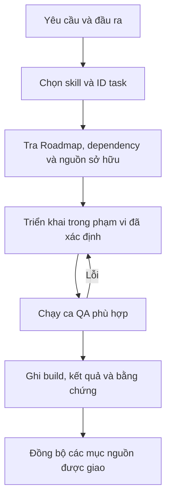

# Hệ thống skill vận hành Ca trực cuối cùng

[AGENTS.md](../../AGENTS.md) chọn skill theo đầu việc. **Core v3.3.1 Final Clean — Design Lock** là nguồn chính thức của dự án. Bản phát hành ngày 24/11/2026 có [ghi chú phát hành](../RELEASE-NOTES.md), [nhật ký thay đổi](../CHANGELOG.md), [kiểm toán canon](../CANON-AUDIT.md) và [mã SHA-256](../SHA256SUMS.txt). Dùng [walkthrough CH01 B01–B08](../ch01r/walkthrough-gameplay-B01-B08-investigation-v1.md) và `DEC-CH01R-04` cho thao tác, cue và phục hồi. Áp dụng `DEC-V331-01` cho LOC01 sau T09.

Trên các nhánh review `codex/npr-01-core-docs` và `codex/npr-01-project-review`, các đường dẫn Core 01–07 bên dưới mở [bộ dự thảo NPR-01](../npr-01/README.md). Đối chiếu canon đã khóa, điều kiện nghiệm thu và bản băm phát hành trên [baseline GitHub `main` tại `3c0b955`](https://github.com/billfan157-pixel/ca-truc-cuoi-cung/tree/3c0b955de95bcf39853c30e2669b2bac24ad969e/docs).

## Điều phối công việc



Với yêu cầu đi qua nhiều khâu, chọn skill theo đầu ra chính. Ví dụ thay vị trí thẻ chuyển An bắt đầu ở level, rồi đối chiếu narrative cho provenance, gameplay cho E11/G02 và QA cho đường lấy lại. Một task triển khai có thể viện dẫn nhiều nguồn. Ghi vị trí chính xác bằng heading Word hoặc tên sheet và ID dòng.

## Bảy nguồn sở hữu

| Nguồn | Dùng để quyết định | Tra nhanh |
| --- | --- | --- |
| [Core 01 Game Design](../01_Game_Design_Document.docx) | Vòng chơi, UX, phạm vi sản phẩm và mục tiêu chất lượng | §2 hệ thống chơi, §3 quản trị sản xuất, §6 hợp đồng trải nghiệm v3.3.1 |
| [Core 02 Narrative](../02_Narrative_Bible.docx) | Canon, tri thức nhân vật, WR, ending và hậu đề | §1.3 CAN01–09, §2 timeline, §3 các chương/ending, §4 nhân vật, §§5–9 |
| [Core 03 World & Architecture](../03_World_Architecture_Bible.docx) | Hình học R, cao độ, tuyến sử dụng, xuất xứ vật chứng và tính thời kỳ | §§3.2–3.6, §6.1 W-Q01–07, §8 liên tục 2005/2012, DEC-WORLD-01 |
| [Core 04 Level & Chapter](../04_Level_Chapter_Design.docx) | Tuyến CH01–08, trigger, checkpoint, take/skip/retry và hậu đề | §1, heading từng chương và phần V3.1–V3.3.1 |
| [Core 05 Art & Audio](../05_Art_Audio_Bible.docx) | Vật liệu, kit, lighting, cue/mixer/VO, asset-ready và license | §§01–04 và phần V3.1–V3.3.1 về vật chứng, ~03:25, PZ10 và thực thể |
| [Core 06 Technical Design](../06_Technical_Design_Document.docx) | Module, schema, gate, giao dịch, save và kiểm kỹ thuật | §§01–04, hợp đồng Save v7 và phần V3.1–V3.3.1 về snapshot, PZ10 và export |
| [Core 07 Production Database](../07_Production_Database.xlsx) | Dữ liệu theo ID, master Dialogue và Evidence Specs, quyết định, tiến độ và QA | Nhóm sheet theo bảng dưới |

| Việc đang làm | Sheet Core 07 mở theo nhu cầu |
| --- | --- |
| Chọn việc và nghiệm thu | `Roadmap`, `Backlog`, `Decisions`, `Changelog`. `Dashboard` dùng tóm tắt. |
| Luồng chơi và triển khai | `Chapter gates`, `Events`, `Puzzle specs`, `Locations`, `Evidence Specs`. |
| Nội dung và kiểm tiết lộ | `Dialogue`, `Patients`, `Timeline`, `Reveal order`, `Plot twists`, `Foreshadowing`, `Payoff`. |
| Đối chiếu quy tắc giữa chương | `Canon Matrix`, `Provenance Matrix`, `PZ10 Matrix`, `Ending Matrix`, `Mystery Matrix`. |
| Kiểm nguồn và độ tin cậy | `Canon checks`, `Narrative QA`, `QA`, `Research`, `Assets`. |

Mã `DOCxx` trong đoạn cũ dùng bảng chuyển đổi Core 01 §4. Chẳng hạn `DOC06` cũ về twist/manh mối đã chuyển sang `07/Plot twists`, `Foreshadowing` và `Payoff`. Core 06 hiện hành là Technical Design.

## Cơ chế nối các skill

- Mỗi manh mối bắt buộc có dấu hiệu trong cảnh, nguồn và vị trí rõ, thao tác cho người chơi suy luận, kết quả cập nhật state và cách lấy lại. R là hiện thực vật lý, B trình bày hệ quả của hồ sơ, M tái hiện một phần quá khứ đã cố định. Tái sử dụng địa hình và landmark R/B. Mọi gói công bố lấy từ chứng cứ vật lý đủ provenance, E08 được đánh dấu nonexport.
- Đường dạy chính là F101/OBS101 ở CH01 → ký A/B hoặc hoàn tất đánh dấu, liên kết và kết luận C → G01 → E11 đủ ba phần và E12 vật lý ở CH02 → G02 và xác thực C01. Điều tra sau đó đi từ tồn tại C02, sự thật về Lan, lối sau bị bịt đến mâu thuẫn phiếu nội bộ. Mỗi bước mở một kết luận hoặc thay đổi giả thuyết của người chơi. Cách áp dụng nghiên cứu của dự án nằm ở `07/Research` R1–R4, R7 và R13.
- Sau G06, PZ09 mở M. Xem hoặc skip đủ ba đoạn M để hoàn tất E08 với transcript tương ứng. G07 đọc năm phản bác PZ10 đã commit qua UI Chất vấn riêng. AN08 xác nhận snapshot cuối cho bốn ending. Hồ sơ ghi 13 thi thể gồm 12 người chết do cháy và một người vô danh chết trước cháy. C12 được chuyển sống lúc 02:50, giữ danh tính chưa xác định và nằm ngoài số thi thể.
- Với END03/04, hoàn tất B02 hoặc fallback AN08 qua xem/skip tự thu liên gốc `PROP-XK12` từ túi Bảy vào manifest nguồn R. Inspect 3D là tùy chọn. Bảy nộp phần ngoài độc lập ở cả bốn ending. Chỉ hậu đề END04 xác nhận S-12 còn sống tại Cơ sở 02 năm 2013.
- Nhịp đi từ nỗi sợ của không gian quen mà sai lệch, qua An như người dẫn đường, đến thực thể báo trước bằng cue, rồi chuyển thành đối đầu qua chứng cứ. Chọn chase, reset, khoảng lặng và trợ năng theo beat. Test manh mối ở chế độ mute, bàn phím và giảm chuyển động theo Core 04/05 và `07/QA`. Dùng `07/Research` R5–R6 và R8–R10 khi cần truy nguyên quyết định.

## Giải quyết chênh lệch giữa nguồn

1. Đối chiếu Core sở hữu chủ đề và dòng `07/Decisions` theo ID. Áp dụng `DEC-V31-01–08`, `DEC-V32-01–05`, `DEC-V33-01–07` và `DEC-V331-01–02` tại các điểm sửa. Tra `V331-DOC01` và Changelog cho các chỉnh sửa cuối. Đọc Chapter và Context từ `Dialogue` khi gặp ID cũ.
2. Nếu skill hoặc tài liệu liên quan đến task có chỉ dẫn mâu thuẫn hay lỗi thời, áp dụng quy định trong [AGENTS.md](../../AGENTS.md#nguồn-và-cách-làm). Dừng task và báo người dùng vị trí nguồn, nội dung bị lệch, căn cứ đối chiếu, ảnh hưởng và phương án xử lý. Chờ người dùng quyết định trước khi tiếp tục.
3. Khi thay đổi được chốt trong phạm vi, cập nhật nơi sở hữu trước. Đồng bộ các tham chiếu bị tác động theo ID, thử bộ kiểm tra liên quan, ghi Changelog, rồi đọc lại nguồn và kiểm diff/dữ liệu trước khi báo xong. Dùng SHA-256 đầu/cuối khi cần đối chiếu nhiều phiên bản.

| Điểm dễ lệch giữa các phiên bản | Cách vận hành |
| --- | --- |
| Tin công bố và phân loại thi thể | CH01 tiếp nhận tin báo 13 tử vong. CH03 xác thực sự tồn tại C02. CH08 dùng E04, E09 và PROP-XK12 để phân loại 13 thi thể và xác lập việc chuyển sống C12. Tra CAN02/CAN08, `07/Canon Matrix` và `Reveal order`. |
| E10 và sửa phiếu | CH01 chỉ seed E10a. CH02 cho sửa F101 ở AN02, giữ firstDecision. E10 hoàn chỉnh sau E10b ở CH06. Tra Core 04 CH02 B05 và DEC-CH06. |
| `CH01-D16b` có Chapter CH04 | Phát tại CH04 B06 sau H05/PT02. Tra guard riêng của `CH04-D06` trong Context. Kiểm V22-Q03 và V31-Q01. |
| Trục thang S1 và cổng phụ LOC01 | S1 trong nhà nối LOC02 ⇄ LOC05 ⇄ LOC07 trong R. Riêng cửa xả sân S1 bị chắn ở R, thông ở M CH05. Sau T09, LOC01 dùng phản hồi chủ quan của Minh. Tra `DEC-V331-01` và `V33-Q05`. |

## Cổng sản xuất

| Mốc | Cần chứng minh theo Core 07 |
| --- | --- |
| M0 | Hoàn thành TASK001/022/023/029. |
| M1 | M0 pass, LOC03 thử qua module thực với F101 ba nhánh, R/B, save và E11/E12. TASK025 nghiệm thu các phần phụ thuộc và blocker. |
| M2 | Vertical slice 20–30 phút, CH01 rút gọn + C01 và cameo scripted. Playtest 6 người mới theo Core 01. Review TASK026–028 trước art lock. |
| M3 | 8 chương greybox, đầy đủ 4 ending, core stealth và critical QA. |
| M4 | Art/VO/audio, trợ năng, hiệu năng và hồ sơ giấy phép theo build. |
| M5 | Regression toàn build, phân phối đúng phạm vi và hết P0. |

Core 07 ghi M0/M1 đã hoàn thành và M2 đang làm. Unity 6.3 LTS `6000.3.28f1`, URP 17.3 và Windows x64 đã chốt theo TASK029/DEC-V2-04. `V331-DOC01` đạt rà tài liệu. Các ca build V30–V33, playtest TASK010 và review TASK026–028 cần bằng chứng riêng. Tra Roadmap/Backlog trước mỗi lượt, đối chiếu đúng tuyến CH01 đầy đủ hoặc M2 rút gọn khi đo thời lượng.

| Task M0 | Skill chính | Đầu ra cần chứng minh |
| --- | --- | --- |
| TASK022 | `ctcc-level` | Mặt cắt draft thấy rõ cao độ B1, tuyến kỹ thuật, cửa sau bịt, hướng sân/đường xe và lối khu B độc lập. Đối chiếu Core 03 Hình 1, §3/§6.1, Core 04 §1 và `07/Locations`. Lưu hình, log và duyệt bản draft theo Backlog. |
| TASK023 | `ctcc-art-audio` | Register ảnh theo nguồn, thời kỳ và quyền. Giao bộ reference 2D LOC03, đánh dấu U ở mục thiếu chứng cứ. Phân biệt bằng chứng dùng để tham khảo, mức suy luận và quyền dùng trong game. |
| TASK029 | `ctcc-production` với `ctcc-gameplay` | Tra [kết quả spike đã hoàn thành](../prototype/engine.md) và quyết định DEC-V2-04. Dùng dữ liệu TASK025 khi truy vết module tích hợp và stress swap. |

## Tra cứu trực tiếp

[project_docs.py](project_docs.py) đọc Office Open XML từ bảy file. Dùng Python 3.9 trở lên với thư viện chuẩn. Chạy ở root, trong PowerShell hoặc shell có Python. Mở Word/Excel để xem layout, sơ đồ đính kèm, chú giải và công thức đang tính lại.

```powershell
python docs/agent/project_docs.py status
python docs/agent/project_docs.py status --milestone M1
python docs/agent/project_docs.py task TASK025-B
python docs/agent/project_docs.py doc 04 --outline
python docs/agent/project_docs.py doc 04 --section "CH02 /"
python docs/agent/project_docs.py sheet "Chapter gates" CH02
python docs/agent/project_docs.py sheet Dialogue CH01-D16b
python docs/agent/project_docs.py sheet "Evidence Specs" "E01-B (AS-05B)"
python docs/agent/project_docs.py sheet "Provenance Matrix" PROP-XK12
python docs/agent/project_docs.py sheet QA V331-DOC01
python docs/agent/project_docs.py check
python docs/agent/project_docs.py hashes
```

`status` đọc Roadmap và chọn milestone đầu còn task MUST theo Backlog. Có thể tra milestone cụ thể. `check` kiểm file, cấu trúc sheet/ID và đồ thị phụ thuộc. Công thức Excel được hiển thị cùng giá trị lưu sẵn nếu có. Đối chiếu kết quả rà nguồn với `V331-DOC01`. So bản kê SHA-256 phát hành với tệp tại revision phát hành. `hashes` in mã của các tệp đang mở trên nhánh hiện tại.

## Bằng chứng bàn giao

Ghi đầu ra vào nơi phù hợp với task và dẫn đường dẫn từ kết quả hoặc dòng tracker khi được giao cập nhật. Mẫu tối thiểu cho một lượt bàn giao:

| Trường | Cần ghi |
| --- | --- |
| Phạm vi | TASK, milestone, đầu ra, điều kiện Pass hiện hành. |
| Nguồn | Phiên bản, heading hoặc sheet + ID, DEC/LOCK liên quan. |
| Thay đổi | File, scene hoặc dòng bị tác động, điểm vào để dùng và điều kiện phục hồi nếu có. |
| Kiểm chứng | ID QA, build/revision, môi trường, bước, kỳ vọng, kết quả thật và bằng chứng. |
| Trạng thái | Ca đã chạy, ca chưa chạy và lý do, issue/dependency còn mở hoặc dấu vết phê duyệt nếu cổng cần. |

Ví dụ “Sửa logic E11 CH02” định tuyến gameplay. Tra `CH02-PU02`, `DEC-CH02` và hợp đồng Core 06. Thử thiếu `transferNote` phải còn G02 đóng dù E12 đã có, rồi thêm phần còn thiếu từ R và kiểm G02 qua cả A/B/C. Ghi `CH02-Q01/Q02` và `LOG06-Q01` theo build cụ thể.

Ví dụ “Kiểm thoại Lan bị lộ ở CH01” dùng narrative và QA. Đối chiếu `CH01-D16`, `CH01-D16b`, `CH04-D06`, `LOCK-V22-02` và `V22-Q03`. Kiểm cả transcript, menu, skip và load đầu game. Tại CH04 B06 chạy các trạng thái trước/sau H05 và PT02.
