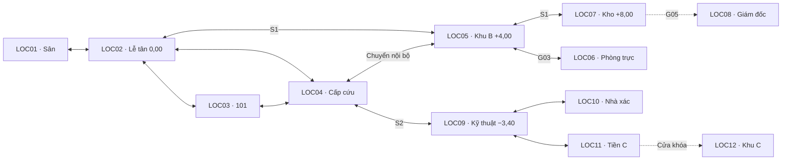

# An Sinh · Mặt cắt và chương trình không gian M3.1

Các số đo theo mét, với Y là cao độ Unity. An Sinh là bệnh viện hư cấu. Cao độ, lối đi và cửa dùng để phối hợp level, art và collision. TASK026–028 vẫn mở.

| Cao độ | Không gian | Mốc định hướng và giới hạn chơi |
| --- | --- | --- |
| +8,00 · Tầng 3 | LOC07 Kho, LOC08 Phòng giám đốc | Bàn đọc AN03, kệ bằng mã, phòng họp và bàn radio. Phòng giám đốc có vỏ greybox sau cửa G05. |
| +4,00 · Tầng 2 | LOC05 Khu B, LOC06 Phòng trực | AP06 ở sân thang, cầu nối phía tây, trạm điều dưỡng, hành lang có G03 và AP07, hồ sơ và băng họp ở AN04. |
| ±0,00 · Trệt | LOC01 Cổng sân, LOC02 Lễ tân, LOC03 Phòng 101 và kho giường, LOC04 Cấp cứu | Giữ hai lối Cấp cứu từ bản trước. Lễ tân đi đến khu B qua S1. Cấp cứu có lối lên khu B và lối kỹ thuật xuống B1. |
| −3,40 · B1 | LOC09 Kỹ thuật, LOC10 Nhà xác, LOC11 Tiền C, LOC12 Khu C | Bảng tải và AP08 phía trước tủ khô AP09. LOC11 dẫn đến cửa khóa ngoài, LOC12 là vỏ greybox với 12 giường và vết cửa sau bị xây kín. |

Mép mái +11,70 được suy ra từ sàn tầng 3, cao thông thủy 3,30 và bản sàn 0,20. Điểm vách ngoài ở phòng giám đốc và Khu C đã đặt trong greybox. Tuyến tắt LOC08→02, đường xe dịch vụ bên ngoài và cảnh sau G04 còn trong phạm vi các chương tiếp theo. Không thêm kết nối thực địa LOC12→02 cho lớp R.

Mặt bằng dựng từ [layout.json](../../../prototype/layout.json) và [mã authoring tầng trên, tầng hầm](../../../../Prototype/Assets/CTCC/Editor/HospitalAuthoring.Expansion.cs). Mặt bằng dùng chung cho R và B. Đoạn M dùng riêng ánh sáng và đạo cụ tại bàn đọc.

## Căn cứ thiết kế

| Nguồn | Quan sát | Quyết định tại An Sinh |
| --- | --- | --- |
| [Trung tâm Lưu trữ Quốc gia I, đồ án bệnh viện Bạch Mai](https://luutru.gov.vn/benh-vien-bach-mai-trong-do-an-quy-hoach-cua-nguoi-phap-264-vtlt.htm) | Hồ sơ phân biệt điều trị, hành chính, công trình phụ và nguồn nước. Vị trí và gió mùa nóng được cân nhắc khi chọn đất. | Giữ sân công cộng, trục nhân viên và trục kỹ thuật đọc được bằng mặt bằng. Dùng nguyên lý phân luồng, cửa sổ và dải có mái che vào hư cấu của An Sinh. |
| [JICA, khảo sát hiện trạng Chợ Rẫy, chương 3](https://openjicareport.jica.go.jp/pdf/11079696_01.pdf) | Khảo sát trực tiếp một bệnh viện tích lũy công trình, thiết bị và công năng qua nhiều giai đoạn. | Tránh áp một ngôn ngữ thiết kế lên toàn bệnh viện. Vỏ cũ, thép sơn, thiết bị bổ sung và thiết kế hồ sơ có thể mang vết của các đợt cải tạo khác nhau. |
| [VSQI, hồ sơ TCVN 4470:1995](https://tieuchuan.vsqi.gov.vn/tieuchuan/view?sohieu=TCVN+4470%3A1995) và Core 03 R16–17 | Tiêu chuẩn lịch sử áp dụng cho thiết kế mới và cải tạo bệnh viện đa khoa. Kích thước greybox lấy từ Core 03. | Trục cáng giữ bề rộng, trạm đọc và kệ không đặt vào cửa. Khu C và tầng hầm là giả định hư cấu cần duyệt. |
| [Bộ Y tế, Quy chế bệnh viện 1997](https://vbpl.moj.gov.vn/TW/Pages/vbpq-toanvan.aspx?ItemID=26135&dvid=13) | Hồ sơ bệnh án gắn với hoàn chỉnh và bàn giao hành chính sau chuyển viện, ra viện hoặc tử vong. | Phân vai giữa sổ bàn giao E03 ở kho, sổ trực và băng họp LOC06, bản sao E04/E07 có danh mục ở tủ khô LOC10. Tủ khô nâng chân khỏi sàn. |
| [WHO, thông gió tự nhiên trong cơ sở y tế](https://www.who.int/publications/i/item/9789241547857) | Mở cửa có tác dụng phụ thuộc đường không khí, phương thức sử dụng và vận hành. Công bố sau mốc 2005. | Chỉ dùng giải thích vật lý cho cửa chớp, quạt trần và các dải sáng. Quy cách cửa cụ thể là thiết kế hư cấu. |
| [NPS, Preservation Brief 15](https://www.nps.gov/orgs/1739/upload/preservation-brief-15-concrete.pdf) | Nước và độ ẩm ảnh hưởng lớp bảo vệ và ăn mòn thép. Bong, rỗ và nứt phụ thuộc điều kiện bề mặt. | Ưu tiên rỉ ở chân tủ, đường gấp và mép tay nắm, mòn tập trung ở mũi bậc. Mức ẩm và lịch cải tạo cần TASK026/027. |

Ảnh và tài liệu lưu trữ dùng làm tham chiếu. Các mẫu bậc, xe thuốc, tủ khô và bảng tải là mesh riêng của An Sinh, dùng bảng vật liệu nội bộ. Đo đạc thiết bị ở bệnh viện Việt Nam và kiểm lịch sử các hiện vật cụ thể vẫn cần chuyên gia.
