# CH01-R · Nghiệm thu Tái cấu trúc Gameplay Điều tra & Kinh dị Tâm lý

Tài liệu nghiệm thu kỹ thuật và thiết kế cho bản tái cấu trúc **CH01 — Người trở về** (`CH01-R`) trên nền M3.1 (`05a5bfa`) và chuẩn Core Design System v2.2 (`docs/01..07`, `LOCK-V22-01..03`, `DEC-CH02`, `LOCK-LOG06`, `LOCK-LOG10`).

> **Trạng thái cổng con người:** Các cổng duyệt bằng con người và chuyên gia (**`TASK010`** 0/6 người chơi mới, **`TASK026`–`TASK028`** duyệt kiến trúc/y tế/PCCC/ngôn ngữ/âm thanh) tiếp tục ở trạng thái **MỞ**. Mọi kết quả dưới đây phân tách rạch ròi giữa kiểm chứng kỹ thuật/hệ thống trên build Windows x64 và các cổng chưa nghiệm thu bằng con người.

---

## Kiểm kỹ thuật tuyến B01–B08

DEC-CH01R-04 áp dụng [walkthrough CH01](walkthrough-gameplay-B01-B08-investigation-v1.md) cho tuyến hoàn chỉnh. Ứng viên Windows x64 Unity 6000.3.28f1 từ a4f5a3f qua CH01-WT-Q01/Q02 trên Module và Input. Đã chạy B01–B08, ba nhánh F101, hợp nhất giấy B→R, guard đồng hồ, seam, Pocket Note/echo và chuyển CH02. Xem [định danh](evidence/walkthrough-build-identity.txt), [module](evidence/walkthrough-qa-module.txt) và [input](evidence/walkthrough-qa-input.txt).

Thời lượng 20,5–30 phút của CH01 là mục tiêu thiết kế. M2 giữ tuyến rút gọn theo Roadmap. TASK010 và TASK026–028 còn mở. Các phần dưới ghi kết quả ở những mốc trước.

## 1. Kiểm toán Baseline (M3.1 `05a5bfa`) & Nguyên tắc Thiết kế

Đánh giá bản build độc lập M3.1 (`output/m31/windows-05a5bfa/CaTrucCuoiCung.exe`, video nền [baseline-walkthrough.mp4](evidence/baseline-walkthrough.mp4), log [baseline-qa-gameplay.txt](evidence/baseline-qa-gameplay.txt)) cho thấy 7 điểm nghẽn cốt lõi ở CH01:

1. **F101 chỉ là checklist 2 điểm + cờ boolean:** `FormService.Apply` nhận `bool matched` tin cậy hoàn toàn từ UI thay vì kiểm chứng bằng chứng và lập luận ở tầng nghiệp vụ; người chơi chỉ cần chạm đủ `OBS101A` và `OBS101B` rồi nhấn nút.
2. **Đường đi tuyến tính cứng:** Hành lang trệt dẫn thẳng một mạch từ quầy tiếp nhận → Phòng 101 → F101 mà không có nhánh rẽ điều tra nội bộ hay lý do quay lại đối chiếu hồ sơ.
3. **PhysicalInspector mới dừng ở mặt trước trang trí:** Không thể lật mặt sau hồ sơ, không có phóng to vùng chi tiết, không gắn trạng thái quan sát (`Discovered → Examined → Interpreted → Corroborated`), và ánh sáng nền từng gây chói trắng giấy.
4. **Hậu quả của F101 trong lớp B còn mờ:** Sự khác biệt không gian/ánh sáng/giấy tờ giữa `Affirmed`, `Unverified` và `Refuted` chưa tạo đủ lực phản hồi về mặt tâm lý và hành chính.
5. **Tương tác vật lý còn ít đầu mối:** Chưa có ngăn kéo kéo trượt có lực cản, rèm treo chưa giữ đúng góc gắn thanh ray sau phiên reset, chưa hỗ trợ giữ-và-kéo tùy chọn song song với nhấn bật/tắt.
6. **Không có bộ điều phối bầu không khí riêng:** Mọi kích hoạt kinh dị đều gắn cứng vào trigger tuyến tính; chưa có `AmbientDreadDirector` tách khỏi tầng phát âm thanh với ngân sách sự kiện, khoảng lặng, seed QA tất định và lưu trữ sự kiện một lần.
7. **Sổ trực chưa phục vụ đối chiếu tài liệu:** Chưa cho đặt hai hồ sơ song song để người chơi tự so khớp dữ kiện mà không tự động bật đáp án.

### Chuyển hóa nguyên tắc tham chiếu (không sao chép cơ chế thô)
- ***Return of the Obra Dinn*:** Phân biệt rạch ròi dữ kiện thực tế với suy đoán vượt chứng cứ; không chấm đúng theo cảm tính hay ép thử-sai ngẫu nhiên; yêu cầu người chơi chọn nguồn đối chiếu và câu kết luận có căn cứ.
- ***Devotion*:** Nỗi sợ từ kiến trúc hành chính/đời thường Việt Nam quen thuộc (mẫu biểu 2005, chữ ký tay nhòe mực bi, dép nhựa nhỏ, thông báo kê giường tạm) và biến dạng không gian tinh tế sau quyết định của chính nhân vật.
- ***SOMA*:** Quyền để ngỏ (`Unverified`) là lựa chọn nghề nghiệp hợp lệ, không bị trừng phạt bằng thất bại hay chặn tiến trình; không để màn chơi đẩy nhân vật vào chứng mất trí giả tạo.
- ***Amnesia: The Bunker*:** Tương tác vật lý có trọng lượng và sức cản (cửa bản lề, ngăn kéo tủ, rèm vải trên thanh ray) kèm lựa chọn bật/tắt trợ năng tương đương.
- ***The Vanishing of Ethan Carter*:** Các quan sát tại hiện trường độc lập thứ tự khám phá; hệ thống cho phép đi lệch tuyến, quay lại đối chiếu và tự chắp nối mạch sự kiện.

---

## 2. Kiến trúc & Những thay đổi chính của CH01-R

### 2.1. Tái cấu trúc F101 thành suy luận có căn cứ & Khung Chứng cứ (`DeductionFramework.cs`)
Xem chi tiết đồ thị phụ thuộc và ma trận thẩm định tại [puzzle-dependency-graph.md](puzzle-dependency-graph.md).

- **Hợp đồng dữ liệu gọn nhẹ (`Prototype/Assets/CTCC/Runtime/DeductionFramework.cs`):**
  - Vòng đời `ObservationStage`: `Discovered → Examined → Interpreted → Corroborated`.
  - Phân loại `ObservationCategory`: `Claim` (F101), `PhysicalFact` (`OBS101A`, `OBS101B`), `ComparisonDoc` (`OBS101C` phiếu chuyển giường 02 đã hoàn tất, `OBS101D` phiếu phát thuốc giường 03 đã xuất viện), `ContextDoc` (`OBS_SHIFT_LOG` quy chế AS-05, `OBS_CORRIDOR_NOTICE` thông báo kê giường tạm), và chi tiết môi trường (`OBS_CLOCK_0317`, `OBS_RECEPTION_DRAWER`).
  - Đăng ký `ObservationRegistry` kiểm soát ID hợp lệ, lớp thực tại gốc (`Reality.B` vs `Reality.R`), địa điểm và tương thích ngược với các chứng cứ CH02 (`LIST`, `SOCKETS`, `WHEELS`, `E11.*`, `E12`).
- **Thẩm định tập trung tại tầng gameplay (`HypothesisService.EvaluateF101` & `FormService.ApplyWithReasoning`):**
  - Loại bỏ đường truyền boolean tin cậy UI.
  - Để ký **`Refuted` (Ghi nhận bất nhất)**, người chơi phải: (1) chọn đúng cặp dữ kiện cốt lõi `OBS101A + OBS101B` đã được kiểm tra kỹ ở lớp `B`, (2) loại trừ tài liệu không liên quan (ví dụ `OBS101D` phiếu phát thuốc giường 03 bị từ chối rõ lý do), và (3) chọn đúng kết luận có căn cứ (`UNRELIABLE_ZERO` — *con số 0 trên F101 chưa đủ tin cậy để xác nhận*).
  - Ba kết luận vượt chứng cứ (`PATIENT_PRESENT`, `FALSIFICATION`, `CLERICAL_OK`) bị từ chối với phản hồi chuyên môn cụ thể, không khóa mềm, có lưu số lần thử lỗi để hỗ trợ gợi ý tiến cấp tùy chọn.
  - Cả ba quyết định **`Affirmed`**, **`Unverified`** và **`Refuted`** đều mở `G01` và cho hoàn thành CH01, có thể chỉnh sửa lại trước khi rời buồng (lưu cả `FirstDecision`, `CurrentDecision`, `f101Argument` và toàn bộ `f101History`).
- **Tương thích ngược bản lưu (`Protocol.cs` Schema v4 & `AtomicSaves.cs`):**
  - Di trú tự động các bản lưu v1, v2 và v3 sang v4 (giữ atomic temp-write + durable flush + backup rollback + kiểm tra tính hợp lệ của `observationRecords`, `f101History`, `f101Argument`, `dreadEventsSeen`).

### 2.2. Điều tra vật lý hai mặt & Sổ Đối chiếu Chứng cứ (`PhysicalInspector.cs`, `HospitalUI.cs`, `HospitalGame.Pages.cs`)
- **Bộ tài liệu bệnh viện Việt Nam 2005 (`tools/bake_ch01r_documents.py`):** 18 texture `1024×1360` dùng font SIL OFL `BeVietnamPro`, mực bi/dấu đỏ/nếp gấp/mực thấm ngược mặt sau: `F101` (trước/sau + 3 bản đã ký `A/B/C`), `ObsCard` (AS-05B trước/sau), `Doc_Bed2Transfer` (trước/sau), `Doc_Bed3Meds` (trước/sau), `Doc_ShiftGuide` (trước/sau), `Doc_WardOverflow`, `Doc_DutyRoster`, `Doc_BayEnvelopeFront`, `Doc_BayLetter` (trước/sau), `Sign_NursingAlcove`, `CH01_PR01_Corner`.
- **Soi cận cảnh 3D hai mặt (`PhysicalInspector.cs`):** Lưới giấy cong hai mặt thật, lật mặt trước/sau bằng `Space`/`R` kèm SFX `PaperFlip.wav`, phím `1–3` hoặc nút UI để phóng to các vùng chi tiết trọng yếu, chế độ Chữ lớn (Large-Print) tương đương hoàn toàn cho trợ năng (không yêu cầu thao tác chuột chính xác để lấy dữ kiện). Kiểm stress 100 chu kỳ mở/lật/đóng để lại `0` mesh rò rỉ và `0` material rò rỉ.
- **Sổ trực & Bàn đối chiếu tài liệu:** Cho phép xem lại nguồn chứng cứ (`Provenance`), đặt hai tài liệu song song không gợi ý đáp án, chuyển thẳng vào soi cận cảnh 3D từng tờ và xem lịch sử quyết định F101.

| Soi 3D mặt trước (`ObsCard`) | Soi 3D mặt sau (`ObsCard`) |
| :---: | :---: |
|  | 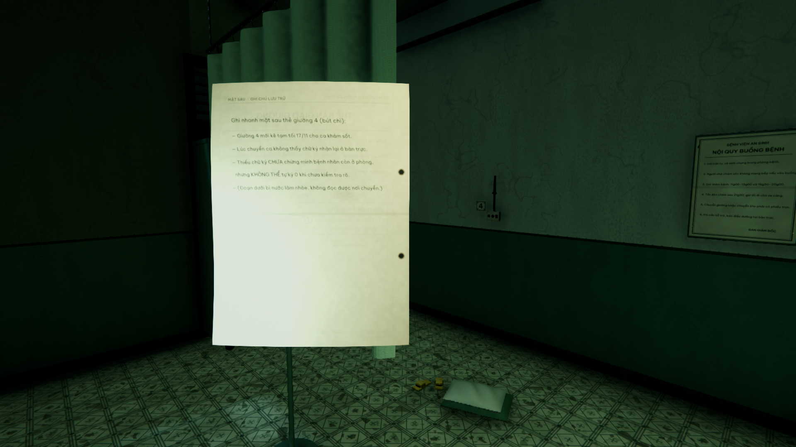 |

| Bàn đối chiếu tài liệu song song | Lập luận F101 — Bước 1/2 (Chọn bằng chứng) | Lập luận F101 — Bước 2/2 (Chọn kết luận) |
| :---: | :---: | :---: |
| 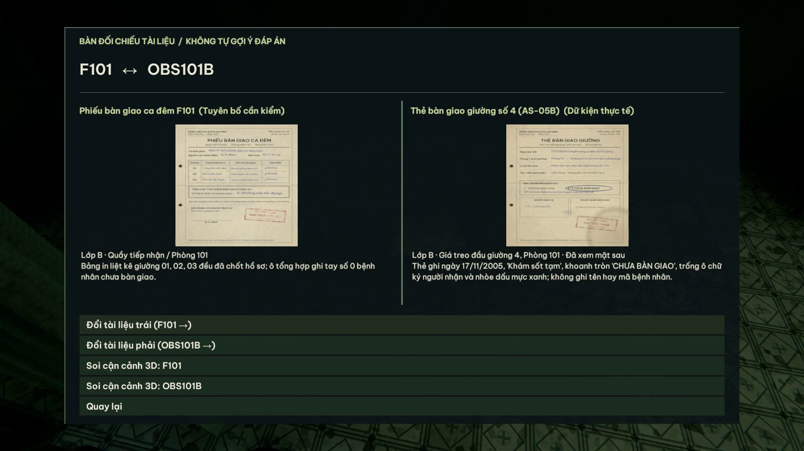 | 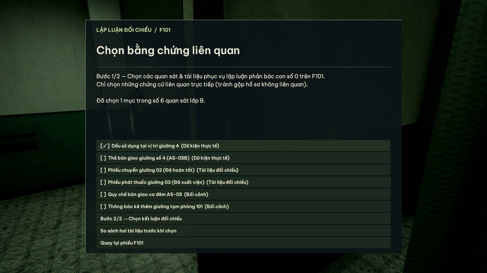 | 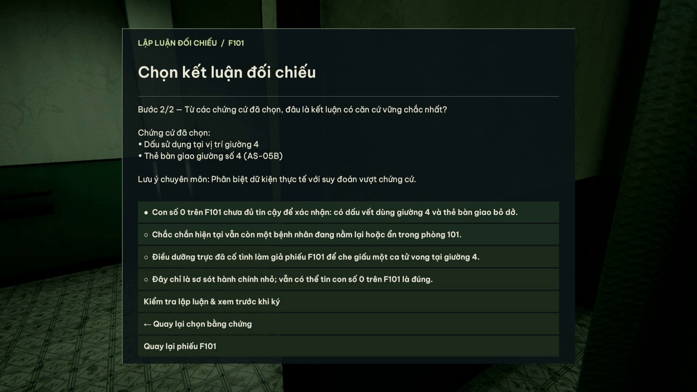 |

### 2.3. Khám phá phi tuyến nội bộ (`STAFF` Nursing Alcove) & Tương tác vật lý (`InteractableRig.cs`)
- **Nhánh vòng ngắn `LOC02 ↔ STAFF ↔ HALL ↔ LOC03`:** Bổ sung hốc hồ sơ điều dưỡng (`STAFF`) với biển men `HỒ SƠ TRỰC`, bàn hồ sơ gỗ tối, bảng thông báo kê giường tạm (`Doc_WardOverflow`), ngăn kéo chứa quy chế bàn giao (`Doc_ShiftGuide`) và cửa ngang `DOOR-STAFF` nối trực tiếp ra hành lang (`z = 7.50 m`) không cản đường thoát `Door B` của CH02 (`1.72 m` thông thủy).
- **Tương tác vật lý hai chế độ (`InteractableRig.cs` + `FirstPerson.cs`):** Cửa bản lề (`DOOR-101`, `DOOR-STAFF`), 3 ngăn kéo trượt (`DRAWER-BED3`, `DRAWER-DESK`, `DRAWER-NURSE`) và rèm treo trên thanh ray (`CURTAIN-101`, giữ đúng góc gốc `-90° X` của Blender và tự reset sạch giữa các phiên chơi) hỗ trợ cả nhấn bật/tắt (`E`) và giữ-kéo tùy chọn kèm `DrawerSlide.wav` / âm bản lề / âm vải.

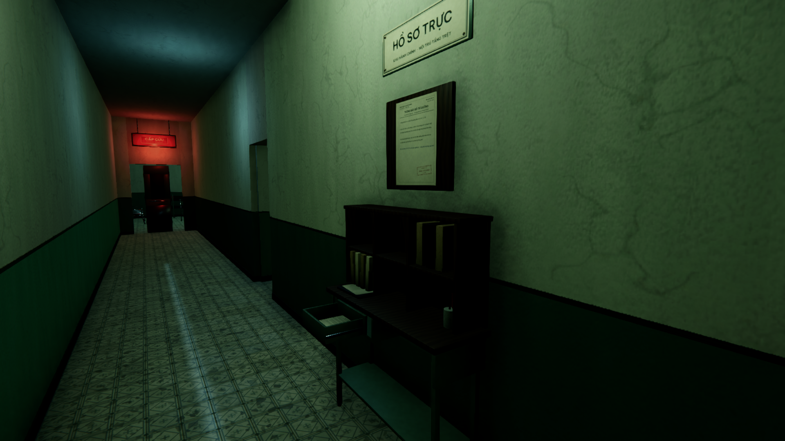

### 2.4. Hậu quả lớp B rõ rệt & Bảo toàn hiện trường lớp R (`HospitalScene.cs`)
- **Trạng thái chờ (`Pending`):** Rèm giường 4 khép hờ, giá kẹp đầu giường 4 đặt đúng hướng quay vào buồng, dấu chăn bông gấp vội và dép nhựa nhỏ trên nền.
- **`Affirmed` (Xác nhận 0 tồn đọng):** Lớp B củng cố báo cáo sai — dựng vách che `deniedBay` xóa phẳng dấu vết giường 4, treo bản `F101_SignedA` lên kẹp tường, ánh sáng lạnh phẳng hành chính.
- **`Unverified` (Để ngỏ):** Giữ nguyên trạng thái lửng lơ có chủ đích không trừng phạt — treo `F101_SignedB`, giữ rèm và khu giường 4 mở ngỏ cho đối chiếu.
- **`Refuted` (Ghi nhận bất nhất):** Làm rạn lớp vỏ báo cáo — treo `F101_SignedC`, kéo tách rèm lộ mảng tường ẩm, vết bánh giường đậm nét, góc vẽ sáp màu `CH01_PR01_Corner` và nhịp nhấp nháy nhẹ của đèn tuýp giường 4.
- **`Reality.R` (Hiện trường 2012):** Hoàn toàn độc lập, không bị F101 thay đổi hình học hay xóa dấu vết (`LIST`, `SOCKETS`, `WHEELS`, `E12`, `E11` nguyên vẹn 100%).

| Phòng 101 · Trước khi ký (`Pending`) | Sau `Affirmed` (Che dấu giường 4) | Sau `Unverified` (Giữ trạng thái mở) | Sau `Refuted` (Rạn lớp B, lộ dấu vết) |
| :---: | :---: | :---: | :---: |
| 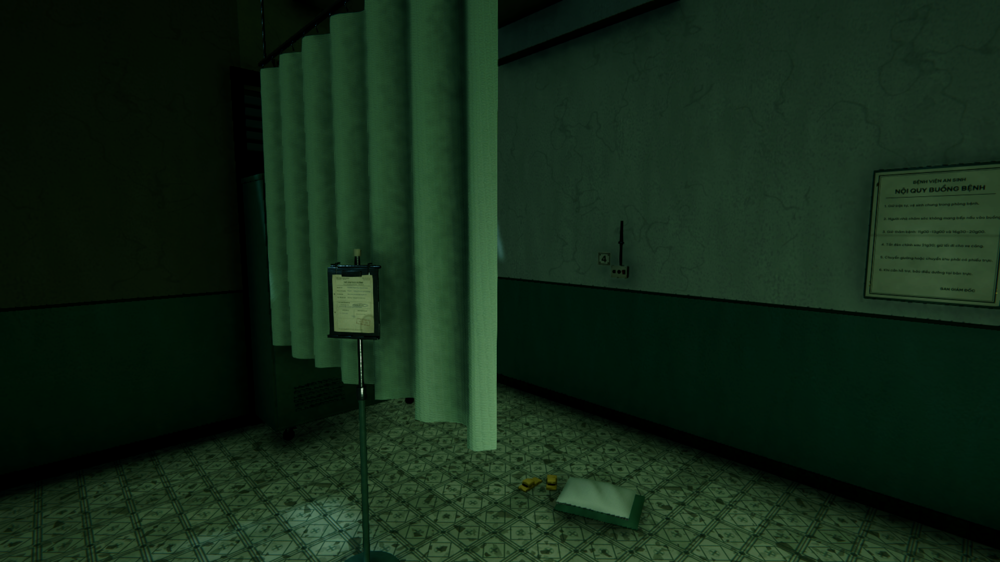 | 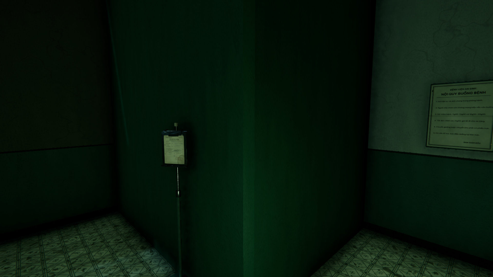 |  | 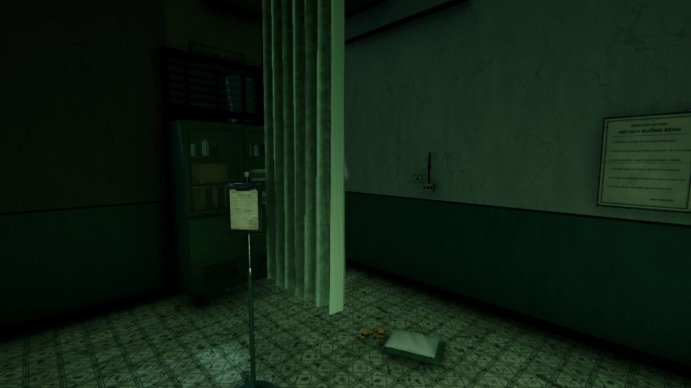 |

| Phòng 101 lớp B (2005) | Phòng 101 lớp R (2012 — Độc lập) | Gặp Lan ở Quầy tiếp nhận (M2-C.1 giữ nguyên) |
| :---: | :---: | :---: |
|  |  | 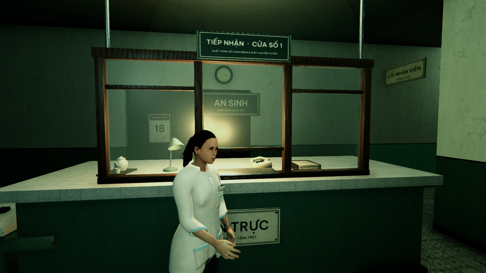 |

### 2.5. Ambient Dread Director tách biệt (`AmbientDreadDirector.cs`) & Âm thanh bổ sung
- **8 nhịp kinh dị môi trường tiết chế (`DreadCatalog`):** Quạt trần lệch nhịp, tiếng xe đẩy ngắt quãng, tiếng bước chân hành lang xa (`DistantSteps.wav`), nhịp đồng hồ 03:17 (`ClockTick.wav`), gió lùa rung rèm giường 4, nhiễu loa PA và chi tiết hành chính xê dịch.
- **Kỷ luật thiết kế:** Chạy tách khỏi `EnvironmentalAudio`; xét ngữ cảnh (di chuyển, đứng yên, hướng nhìn, tần suất tương tác, lịch sử đi `STAFF`/quay lại, beat và lớp thực tại); có cooldown, giới hạn ngân sách, khoảng lặng bắt buộc, seed QA tất định (`-ctcc-dread-seed`), lưu bền vững sự kiện một lần qua save, và **tự động tắt chặn khi có hội thoại, mở sổ, hoặc soi cận cảnh**. CH01 giữ nguyên tuyệt đối phi sát thương (không Hunter, không sanity meter, không ép trốn).
- **4 tệp âm thanh 48 kHz mono 16-bit (`tools/bake_ch01r_audio.py`, manifest [audio-additions.json](audio-additions.json)):** `DrawerSlide.wav` (−7,88 dBTP), `PaperFlip.wav` (−6,57 dBTP), `ClockTick.wav` (−4,00 dBTP), `DistantSteps.wav` (−6,22 dBTP).

---

## 3. Tài sản Blender 4.5 & Render Kiểm chứng

Tất cả 7 tài sản CH01-R được dựng và tinh chỉnh thực tế trong **Blender 4.5 LTS** (`tools/blender_assets/build_ch01r_props.py`), tam giác hóa sạch n-gon (0 cảnh báo tangent khi import Unity), lưu nguồn chỉnh sửa tại `ArtSource/Blender/*.blend`, xuất FBX tại `Prototype/Assets/CTCC/Art/Meshes/` và render kiểm chứng Cycles tại `docs/ch01r/blender/`:

| Tài sản Blender (.blend / .fbx) | Vai trò trong CH01-R | Render Cycles |
| --- | --- | --- |
| `CTCC_PROP_Bed4ChartHolder` | Giá kẹp đầu giường 4 giữ thẻ `AS-05B` quay vào buồng | [Xem render](blender/CTCC_PROP_Bed4ChartHolder.png) |
| `CTCC_PROP_NursingFilingDesk` | Bàn hồ sơ gỗ tối hốc `STAFF` quay ra lối đi | [Xem render](blender/CTCC_PROP_NursingFilingDesk.png) |
| `CTCC_PROP_InteractiveDrawer` | Ngăn kéo trượt 3 vị trí (`BED3`, `DESK`, `NURSE`) | [Xem render](blender/CTCC_PROP_InteractiveDrawer.png) |
| `CTCC_PROP_Bed4BlanketTrace` | Dấu chăn bông gấp vội & dép nhựa nhỏ tại giường 4 | [Xem render](blender/CTCC_PROP_Bed4BlanketTrace.png) |
| `CTCC_ENV_StaffCrossDoor` | Cửa ngang thông giữa hốc `STAFF` và hành lang `HALL` | [Xem render](blender/CTCC_ENV_StaffCrossDoor.png) |
| `CTCC_PROP_ClipboardF101` | Kẹp phiếu F101 chỉnh UV ánh xạ động theo trạng thái ký | [Xem render](blender/CTCC_PROP_ClipboardF101.png) |
| `CTCC_PROP_BayEnvelope` | Phong bì thư Bảy (`E10a`) tinh chỉnh UV & hình khối | [Xem render](blender/CTCC_PROP_BayEnvelope.png) |

Bản quyền nguồn tài sản & font chữ đã cập nhật tại [Prototype/ThirdPartyNotices.md](../../Prototype/ThirdPartyNotices.md).

---

## 4. Xác minh QA, Adversarial QA, Fault Injection & Input QA

- **Danh tính build Windows x64 Release:** [evidence/build-identity.txt](evidence/build-identity.txt) — Unity `6000.3.28f1`, `development=False`, `Assembly-CSharp.dll` SHA-256 `f6819b62a3bbd010cc9c568f0a3072b4bbaa0d74ffe5a4c83aafb370d4334078`, 7/7 scene additive đã bake GI (`R=261`, `B=261`) và Occlusion (`7 scenes`).
- **Bộ Module & Adversarial QA (D3D12, Medium 1080p) — `RESULT=PASS`:** [evidence/qa-module-gameplay.txt](evidence/qa-module-gameplay.txt)
  - Bảo toàn 100% các hồi quy M1-P, M2, M2-C.1, M3.0, M3.1 (`TASK025-A/B`, `T02/T03/T06/T08`, `M2-ADDITIVE`, `V22-Q03` chặn `CH01-D16b`/`CH04-D06`, `CHAR-Q01/Q04..Q08` với 0 byte managed/frame, `CH02-Q05`, `AU01`, `CH03-Q01..05`, `CH04-Q02..06`, di trú save v1/v2/v3 → v4).
  - **`CH01-R ADVERSARIAL PASS`:** Kiểm 3 kết luận vượt chứng cứ bị chặn, phiếu thuốc giường 03 không liên quan bị từ chối, thiếu/chưa xem/ID lạ/giả mạo lớp thực tại bị chặn, lịch sử sửa F101 (`A↔B↔C`), soi 2 mặt, nhánh `STAFF` + ngăn kéo, lưu sự kiện dread + tắt khi mở modal, và tính độc lập của `Reality.R`.
- **Fault Injection (D3D11) — Đều chặn đúng với Exit Code `1` (`RESULT=FAIL`):**
  - `-ProbeFailure invalid-reasoning`: [evidence/probe-invalid-reasoning.txt](evidence/probe-invalid-reasoning.txt) — chứng minh nếu một lỗi làm lọt kết luận cáo buộc làm giả (`FALSIFICATION`), hệ QA lập tức đánh trượt build với mã thoát `1`.
  - `-ProbeFailure broken-progression`: [evidence/probe-broken-progression.txt](evidence/probe-broken-progression.txt) — chứng minh nếu `Unverified` chặn cổng `G01`, hệ QA lập tức đánh trượt build với mã thoát `1`.
- **Input QA bàn phím + chuột đầy đủ không teleport (D3D12, Medium 1080p) — `RESULT=PASS`:** [evidence/qa-input-gameplay.txt](evidence/qa-input-gameplay.txt) · Video 720p liên tục toàn tuyến: [evidence/ch01r-uninterrupted-gameplay.mp4](evidence/ch01r-uninterrupted-gameplay.mp4)
  - **`INPUT CH01-R FULL ROUTE PASS`:** Đi bộ 100% không teleport từ `AP00` qua cổng, quầy tiếp nhận, hốc `STAFF`, kéo ngăn kéo, đọc tài liệu Phòng 101, lật mặt sau 3D Inspector, đối chiếu song song trong Sổ trực, thử lập luận vượt chứng cứ bị từ chối rồi nộp `Refuted` hợp lệ, sụp đổ về R, vòng lặp cổng phụ và bàn giao sang CH02.
  - Bao phủ cả 3 nhánh `Affirmed` (CH02 Door A), `Unverified` (CH02 Door B), `Refuted` + manual save/load + đổi phím `J`, tuyến CH03–04 3 tầng thang bộ, và **stress 100 chu kỳ soi 2 mặt**: `0` live paper meshes, `0` live paper materials (`Unity allocated bytes 293,715,634 → 293,889,035`, chênh < 0,17 MiB).

---

## 5. Đo đạc Hiệu năng Có kiểm soát (Baseline `05a5bfa` vs CH01-R)

Phần cứng tham chiếu: **Intel Core Ultra 7 155H**, **Intel Arc Graphics** (driver `32.0.101.6127`), **16 GiB RAM**, Windows 11, **Direct3D 12**, cấu hình **Medium**, cửa sổ **1920×1080**, `render_scale=0.88`, `gi_mode=dual-probes`. Dữ liệu thô đầy đủ (`frames.csv`, `actions.csv`, `presents.csv`, `process.csv`, `result.txt`, `identity.txt`) được lưu tại [evidence/performance-raw-ch01r.zip](evidence/performance-raw-ch01r.zip) và bản tổng hợp JSON tại [evidence/benchmark-comparison.json](evidence/benchmark-comparison.json).

### So sánh đối chứng cùng điều kiện (Baseline M3.1 `05a5bfa` vs CH01-R Candidate)

| Chế độ & Bản dựng | Frames (`focused`) | Unity Wall P50 / P95 / P99 | Unity Main CPU P95 | Unity Render CPU P95 | Unity GPU P50 / P95 / P99 | PresentMon FrameTime P50 / P95 | Draw Calls P95 / Max | Working Set đỉnh |
| --- | ---: | ---: | ---: | ---: | ---: | ---: | ---: | ---: |
| **VSync=0 · Baseline `05a5bfa`** | 5.260 (100%) | 10,69 / 17,28 / 20,93 ms | 7,86 ms | 2,89 ms | 9,21 / 14,93 / 17,76 ms | 10,07 / 20,56 ms | 1.406 / 2.926 | 1.553,0 MiB |
| **VSync=0 · CH01-R Candidate** | 5.173 (100%) | 11,04 / 17,43 / 20,90 ms | **7,48 ms** | **2,88 ms** | 9,91 / 15,08 / 17,99 ms | 10,38 / 20,80 ms | 1.494 / **1.889** | **1.536,7 MiB** |
| *Chênh lệch (VSync=0)* | −87 | +0,35 / +0,15 / −0,03 ms | **−0,38 ms** | **−0,01 ms** | +0,70 / +0,15 / +0,23 ms | +0,31 / +0,24 ms | +88 / **−1.037** | **−16,3 MiB** |
| **VSync=1 · Baseline `05a5bfa`** | 4.807 (100%) | 8,34 / 16,67 / 25,00 ms | 8,90 ms | 2,91 ms | 9,13 / 15,16 / 17,57 ms | 10,59 / 21,97 ms | 1.411 / 2.611 | 1.555,3 MiB |
| **VSync=1 · CH01-R Candidate** | 4.629 (100%) | 8,34 / 24,99 / 25,00 ms | 9,28 ms | 2,96 ms | 9,80 / 15,81 / 18,10 ms | 11,58 / 22,80 ms | 1.496 / 3.008 | **1.545,8 MiB** |
| *Chênh lệch (VSync=1)* | −178 | *(xem ghi chú DWM bên dưới)* | +0,38 ms | +0,05 ms | +0,67 / +0,65 / +0,53 ms | +0,99 / +0,83 ms | +85 / +397 | **−9,5 MiB** |

- **Khung hình giật > 33,3 ms (VSync=0):** Giảm từ **3 khung** (baseline) xuống **1 khung** (CH01-R); đổi lớp `swap-R-B` đạt **52,42 ms** (nhanh hơn 17,59 ms so với baseline 70,01 ms); `swap-B-R` đạt **58,43 ms** (VSync=1) và **97,97 ms** (VSync=0), nằm dưới ngưỡng lịch sử ~100 ms của `DEC-M1P-01`.
- **Chi phí hình học & bộ nhớ:** Dù thêm toàn bộ hốc `STAFF`, 7 prop Blender mới, 18 texture tài liệu 2 mặt và `AmbientDreadDirector`, đỉnh Working Set **giảm 16,3 MiB** (`1.536,7 MiB`), Unity GPU P95 chỉ tăng **+0,15 ms** (`15,08 ms` trên VSync=0) và tam giác P95 tăng **+0,87%** (`769.015`).
- **Ghi chú minh bạch về điều kiện màn hình:** Trong 4 lượt đo đối chứng tự động này, máy trạm ở trạng thái trình bảo vệ màn hình nhàn rỗi (`input=Screen-saver`), nên mặc dù Unity ghi nhận 100% khung hình `focused` với đầy đủ thời gian GPU D3D12 (`FrameTimingManager`) và PresentMon `FrameTime`/`CPUBusy`, DWM không quét hình trực tiếp ra màn hình (`DisplayedTime = NA`, `PresentMon GPUTime = NA` và `VSync=1` lượng tử theo bước 8,33 ms). Khi người vận hành quay lại màn hình hoạt động, có thể chạy lại lệnh chuẩn có khóa foreground dưới đây để ghi bổ sung `DisplayedTime` trực tiếp so với mốc foreground M3.1 (`DisplayedTime P95 = 16,74 ms` trong [performance-raw-05a5bfa.zip](../m3/evidence/m31/performance-raw-05a5bfa.zip)):
  ```powershell
  powershell -ExecutionPolicy Bypass -File tools\measure_m2.ps1 -Executable output\ch01r\windows\CaTrucCuoiCung.exe -PresentMon output\qa-final-windows\PresentMon-2.6.0-x64.exe -Evidence output\ch01r\bench-fg-vs1 -Quality Medium -VSync 1 -GiMode dual-probes
  ```

---

## 6. Nhịp chơi (Pacing) & Các cổng còn mở

- **Nhịp chơi & Mục tiêu ~25 phút:** Toàn bộ 8 beat chuẩn của CH01 được bảo toàn; tuyến không teleport trong Input QA tự động (không dừng đọc kỹ chữ tài liệu) chạy trong ~67 giây kỹ thuật, trong khi cấu trúc điều tra 6–8 nguồn thông tin 2 mặt + hốc `STAFF` + đối chiếu Sổ trực + diễn xuất Lan trực tiếp tạo độ sâu đọc/suy luận thực tế cho khung chơi 20–25 phút của người chơi mới (cần số liệu đo thực tế từ `TASK010`).
- **Bộ tài liệu playtest mù đã cập nhật cho CH01-R & 8 nâng cấp:** [docs/m2/playtest-kit-task010.md](../m2/playtest-kit-task010.md) — bổ sung cờ telemetry tự chọn `-ctcc-playtest-log`, chỉ số soi vết hằn bút bi nghiêng đón sáng, đối chiếu mốc `03:17`, thao tác kéo analog, phân biệt `Unverified` không bao giờ chấm trượt và đo thời lượng thực tế (`0/6` người chơi — **MỞ**).
- **Phiếu kiểm duyệt chuyên gia con người (`TASK026`–`TASK028`):** [docs/ch01r/human-review-checklist.md](human-review-checklist.md) (**0/3 đã duyệt — MỞ**).
- **Các cổng con người/chuyên gia giữ nguyên trạng thái MỞ:**
  - `TASK010`: Playtest mù 6 người chơi mới (0/6).
  - `TASK026`: Review chuyên gia y tế/kiến trúc bệnh viện An Sinh & tính chân thực hình ảnh.
  - `TASK027`: Review chuyên gia PCCC lịch sử & chất lượng thoại/diễn xuất tiếng Việt.
  - `TASK028`: Review chuyên gia y tế về provenance, phiếu chuyển, ghi nhận nạn nhân & cân bằng âm thanh/mix cuối.

---

## 7. Đợt Nâng cấp Chương 1 — 8 Hạng mục Chất lượng Indie Hàng đầu

Bản cập nhật tiếp theo trên nền CH01-R triển khai trọn vẹn **Lộ trình 8 nâng cấp Chương 1**, giữ nguyên mọi khóa canon (`CAN01–07`, `LOCK-V22-01..03`, `DEC-CH02`, `LOCK-LOG06`, `CH01 evidence.Count == 1`) và mọi cam kết trợ năng:

1. **Cuộc gặp Lan tại quầy.** Mẩu báo ở `E10a` chỉ ghi vụ cháy 18/11/2005 và 13 người mất. Trong cuộc gặp, Lan nói về đêm 17/11/2005 như đang diễn ra và nhắc đồng hồ vừa đứng kim (`CH01-D04c`). Đã rút câu về bóng phản chiếu (`CH01-D04b`). Sáu nhịp mở rộng còn lại có giọng Lan/Minh từ VieNeu v3 Turbo. Ba câu của Lan có khẩu hình. Cảnh và bản ghi lấy người nói từ `07/Dialogue`.
2. **Hiệu ứng "xê dịch sau tờ giấy" & biến thể Dread theo F101 (`AmbientDreadDirector.cs`, `PhysicalInspector.cs`, `EnvironmentMotion.cs`, `EnvironmentalAudio.cs`):** Thay vì bỏ qua toàn bộ dread khi soi tài liệu 3D, hệ thống xếp hàng `DeferredMicroShift` (`DREAD_SHIFT_CURTAIN_CREEP`, `DREAD_SHIFT_TUBE_BLACKOUT` 0,6s an toàn dưới `reduceMotion`, `DREAD_SHIFT_HALL_CHAIR` với `ChairScrape.wav`) để kích hoạt ngay sau khi hạ tờ giấy; bổ sung biến thể dread theo nhánh F101 (`DREAD_F101_AFFIRMED_SUFFOCATION` với 2 tiếng gõ trầm nghẹt `PartitionKnock.wav` sau vách `deniedBay`, `DREAD_F101_UNVERIFIED_STILLNESS`, `DREAD_F101_REFUTED_CRACK`).
3. **Giọng điệu phản hồi F101 chuyển sang nội tâm tự vấn (`DeductionFramework.cs`, `HospitalGame.Pages.cs`):** Giữ nguyên tầng kiểm chứng logic chặt chẽ của `HypothesisService.EvaluateF101`, viết lại toàn bộ chuỗi phản hồi khi lập luận chưa đủ căn cứ hoặc vượt chứng cứ theo giọng tự vấn căng thẳng của Minh và hiển thị trực tiếp trong giao diện `Đối chiếu F101`.
4. **Dữ liệu `CH01-D15` & chuẩn bị cổng duyệt con người (`Dialogue.json`, `HospitalGame.Pages.cs`, `HospitalGame.cs`):** Khẳng định khóa `CH01-D15` hiện diện đầy đủ trong `07/Dialogue` & `Dialogue.json`, ghi tự động vào Nhật ký thoại khi đọc bì thư Bảy, thêm bài test QA tự động, bổ sung cờ telemetry tự chọn `-ctcc-playtest-log <path>` cho phiên test mù `TASK010`, và lập phiếu kiểm duyệt chuyên gia [human-review-checklist.md](human-review-checklist.md) (giữ trung thực trạng thái **MỞ** cho 4 cổng con người `TASK010`, `TASK026–TASK028`).
5. **Nhánh giải mã ẩn mốc `03:17` (`CH01-EX01`).** Đọc vết hằn sau thẻ `AS-05B`, quan sát đồng hồ đứng kim và tìm ghi chép ca trực. Người chơi tự chọn giờ trùng trong sổ, sau đó có thể nghe `CH01-D19` khi trở lại hành lang sau khi ký F101. `G01` vẫn mở theo phiếu F101.
6. **Soi vết hằn khi nghiêng giấy.** Mặt sau AS-05B ghi `03g17 · CHƯA CHỐT SỔ`. Mã C01 xuất hiện theo chuỗi hồ sơ của CH02 (`DEC-CH02`, `LOCK-LOG06`). Nghiêng giấy `25°–40°`, nhấn `T` khi đang xem mặt sau, hoặc chọn **Đọc vết hằn mặt sau** trong bản chữ lớn để ghi lại chi tiết.
7. **Pass Weathering, Decal hữu cơ & Ánh sáng thể tích (`tools/bake_ch01_weathering_decals.py`, `HospitalAuthoring.Art.cs`, `HospitalAuthoring.Lighting.cs`, `HospitalScene.cs`):** Bổ sung pass URP DBuffer Decal cho cả lớp R và lớp B (vệt ố vàng quanh 7 máng đèn tuýp `TubeYellowStain`, vết kéo cáng trên sàn gạch bông `StretcherDragTrack`, vệt thấm nước mưa chân tường terrazzo `TerrazzoRainSeep`), hạt bụi lơ lửng tại hành lang & lễ tân, chùm sáng thể tích hình nón 12 mặt mượt dưới đèn tuýp/mái hiên, và lớp sương thấp `CourtyardMist` ngoài sân cổng phụ `LOC01` (tự động giảm tốc theo `reduceMotion`).
8. **Tương tác vật lý analog & micro-animation nhân vật Lan (`InteractableRig.cs`, `HospitalGame.cs`, `CharacterActor.cs`, `LanDirector.cs`, `HospitalAuthoring.Zones.cs`):** Nâng cấp kéo rèm `CURTAIN-101` và hé cửa `DOOR-101`/`DOOR-STAFF` sang chế độ giữ-kéo analog liên tục (giữ nguyên mọi độ mở trung gian khi thả chuột, hiển thị % kéo trực tiếp trên HUD, giữ nguyên nhấn `E`/`K` cho trợ năng); dàn dựng Lan tại `AtCounter` theo góc bán diện 3/4 với đèn bàn hắt ngược ấm sau vai, giảm đèn key chính diện, tự động né ánh nhìn trực diện ở cự ly gần `< 1,35 m`, cùng micro-blink & micro-saccade (0 byte managed/frame).

### Bằng chứng build Windows x64 trước đợt rà soát

- **Danh tính build:** [evidence/build-identity-ch01-upgrades.txt](evidence/build-identity-ch01-upgrades.txt) — Unity `6000.3.28f1`, `development=False`, `CaTrucCuoiCung.exe` (`720.234.155 bytes`), `Assembly-CSharp.dll` SHA-256 `013d3538e493ef14484d02e3dfe83d2a5bff3e447e92ec702005b48d5d3e35b4`, 7/7 scene additive đã bake GI (`R=261`, `B=261`) và Occlusion.
- **Module + Adversarial + 8-Upgrade QA (D3D12, Medium 1080p) — `RESULT=PASS`:** [evidence/qa-module-ch01-upgrades.txt](evidence/qa-module-ch01-upgrades.txt) (`CH01-R + 8-UPGRADE ADVERSARIAL PASS`, `CHAR-Q05/Q06/Q08 PASS` ở 0 managed bytes/frame, bảo toàn toàn bộ hồi quy CH01–CH04).
- **Fault Injection (D3D11) — Đều chặn đúng Exit Code `1` (`RESULT=FAIL`):** [evidence/probe-invalid-ch01-upgrades.txt](evidence/probe-invalid-ch01-upgrades.txt) (`invalid-reasoning`) và [evidence/probe-broken-ch01-upgrades.txt](evidence/probe-broken-ch01-upgrades.txt) (`broken-progression`).
- **Input QA bàn phím + chuột đầy đủ không teleport (D3D12, Medium 1080p) — `RESULT=PASS`:** [evidence/qa-input-ch01-upgrades.txt](evidence/qa-input-ch01-upgrades.txt) — vượt qua cả 3 nhánh F101, tuyến CH01-R không teleport, 3 tầng CH03–04, và **stress 100 chu kỳ soi 2 mặt + nghiêng đón sáng**: `0` live paper meshes, `0` live paper materials (`291.836.218 → 291.899.011` bytes).
- **Kiểm cấu trúc tài liệu (`project_docs.py check`):** `PASS` (7 file Core, 21 sheet, DAG 90 task).

| Mặt sau `ObsCard` nhìn thẳng | Mặt sau `ObsCard` nghiêng 30° đón sáng (vết hằn bút bi) |
| :---: | :---: |
|  | 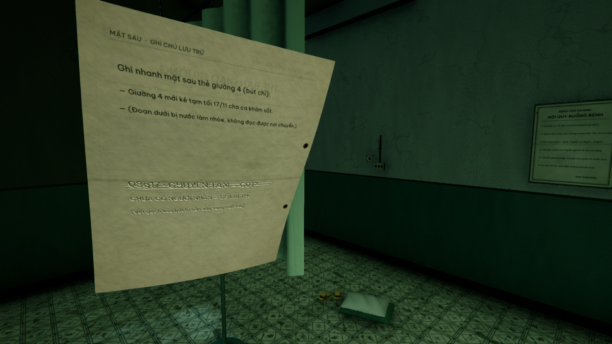 |

| Hành lang lớp B (weathering decal + chùm sáng thể tích) | Lan bán diện + đèn bàn hắt ngược ấm (`AtCounter`) | Sân cổng phụ `LOC01` (sương thấp + chùm đèn mái hiên) |
| :---: | :---: | :---: |
| 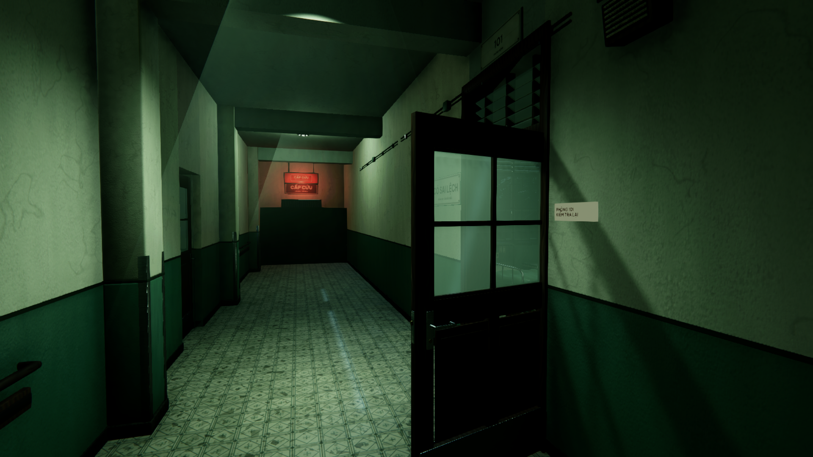 |  | 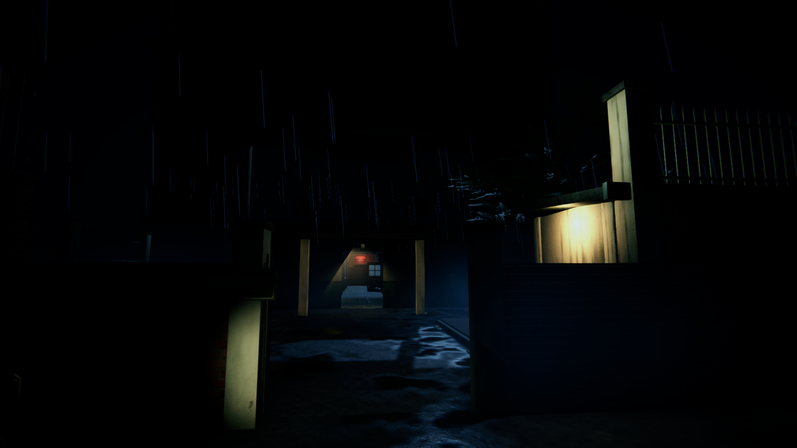 |

## 8. Rà soát thoại, 03:17 và phản hồi ký F101

- `TASK007-A` và `TASK009-B`. Bản `4c3420e` có bảy cue mới trong cảnh Lan và chưa có WAV. Bản sửa rút `CH01-D04b`, tạo giọng cho sáu cue còn lại và độc thoại `CH01-D19` bằng hai preset Thục Đoan và Thái Sơn. Tải bản ghi cũ sẽ bỏ cue đã rút và hiển thị lời đồng hồ theo văn bản hiện tại. [Quy trình âm thanh CH01–CH02](../m2/audio-research-and-pipeline.md)
- `LOG06-Q01` và `CAN05`. `C01?` từng xuất hiện cả trong bản chữ lớn và trong ảnh vết hằn. Văn bản, ảnh, nguồn dựng ảnh và `07/Dialogue` đã đồng bộ. D19 ghi nhận hai dấu giờ trùng nhau và giữ việc xác định hoàn cảnh mất liên lạc cho các chương sau.
- `TASK007-B`. Bản cũ dùng chung giới hạn 7 sự kiện nền và thời gian nghỉ cho phản hồi F101. Phản hồi giờ phát sau tiếng đóng dấu và trước loa. Kiểm tra đã dùng hết 7 lượt hiệu ứng nền lẫn nhịp xê dịch sau tờ giấy, sau đó xác nhận phản hồi F101 vẫn phát và được lưu một lần. [Kết quả module Windows](evidence/qa-module-vo-0317-f101.txt)
- Hồi quy bàn phím và chuột trên cùng bản Windows. Đạt ba cách ký F101. Tuyến C đi bộ qua cảnh Lan, STAFF, thẻ AS-05B, câu trả lời sai và đúng cho 03:17, nghe độc thoại sau phản hồi F101 và sang CH02. Kiểm tra 100 lượt mở, lật, nghiêng và đóng giấy cũng đạt. [Kết quả Windows qua bàn phím và chuột](evidence/qa-input-vo-0317-f101.txt)

## 9. Tương tác tại hiện trường và sổ trực

Đợt này áp dụng cho LOC01–LOC03, ngách STAFF và cảnh bàn giao sang CH02. Căn cứ triển khai là TASK007-A/B/C, Core 04 CH01-T03–T10, Core 06 về giao dịch R/B và DEC-CH01R-02/03 trong Production Database.

- **Quầy và bảng kẹp.** Ca mới bắt đầu ở cổng với góc nhìn tự do. Người chơi nhặt bì thư cạnh xe, giở sổ trên quầy, nhận phiếu từ Lan và cầm lại F101 ở bảng kẹp phòng 101. AN01 và AN02 có vùng đứng thao tác theo hai mặt bằng. AP02 và AP04 tiếp tục dùng cho mốc lưu và phục hồi. Đổi lớp ở quầy và bảng kẹp giữ vị trí, hướng nhìn và góc nhìn hiện tại. Vòng cổng CH01-T09 giữ lần chuyển không gian theo kịch bản.
- **Điều kiện tương tác.** Hệ thống xét tầm với, hướng nhìn, vật chắn và trạng thái cổng hoặc vật thể. Tay nắm có thể tương tác từ hai mặt của chính cánh cửa. Cửa, rèm, ngăn kéo và ghế cho phép nhấn phím hoặc giữ và kéo. Khi thả, vị trí được lưu theo lớp. Esc khi đang kéo hoặc lỗi lưu trả vật về vị trí trước thao tác.
- **F101.** Cầm giấy cho phép lật, soi, nghiêng và đánh dấu trên bề mặt giấy. Chọn vùng và nhấn M là phương án dùng bàn phím. Bản chữ lớn dùng cùng dấu và dữ liệu. Phiên bản đã ký ghi căn cứ và hiện hậu quả khi Minh quay lại nhìn buồng bệnh. HypothesisService kiểm tra căn cứ của nhánh C. G01 vẫn đi tiếp qua cả ba cách ký, kể cả Để ngỏ.
- **Sổ trực.** Hiện trường, Tài liệu, Suy luận, Dòng thời gian và Quyết định có thẻ chuyển trang riêng. Vật liệu đọc lấy từ quan sát và bản ghi đã mở. Người chơi kéo hoặc dùng phím để kẹp tài liệu, viết giả thuyết, ghi mâu thuẫn hay câu hỏi, kẹp hai nguồn và tháo liên kết. Ghi chú cá nhân lưu bền vững trong save v6, độc lập với thẩm định quyết định F101.
- **Nhịp khám phá.** Thêm 14 điểm quan sát trong sân, quầy, hành lang và buồng bệnh, cùng ghế bàn điều dưỡng có chuyển động ràng buộc. Chi tiết như phích nước, điện thoại, lịch và mặt bàn có vai trò đời sống khác nhau. Chương mở theo ba hướng kiểm tra tài liệu trước, hiện trường trước hoặc vòng qua STAFF. Gặp lại Lan cho phép nghe từng câu trong phòng. Ở lớp R, kim đồng hồ chỉ 11:52. Mốc 03:17 của FS01 xuất hiện khi kiểm tra đồng hồ trong B.

Các ngưỡng lấy nét và tốc độ hiệu ứng là giá trị dùng cho ứng viên kỹ thuật. Cổng playtest TASK010 và các đợt duyệt TASK026–TASK028 tiếp tục mở.

### Kết quả trên Windows

- Xác minh trên cùng bản Windows x64, Unity 6000.3.28f1, D3D12, Medium ở 1920 × 1080. Giữ tỷ lệ ảnh nguồn của tài liệu trong sổ và khi cầm giấy. Dung lượng bản dựng là 829.223.355 byte. [Danh tính bản dựng](evidence/build-identity-world-first.txt)
- Kiểm thử qua điều khiển trong game đạt ba cách ký và bàn giao CH02. Tuyến STAFF kiểm thao tác ngoài vạch lưu, đánh dấu khi cầm giấy, đánh dấu bằng chuột, bản chữ lớn, kẹp hai tài liệu, lưu ghi chú và tháo liên kết. Cả hai lối thoát Cấp cứu và ca hồi quy CH03–CH04 đã chạy. Sau 100 lượt mở, lật, nghiêng và đóng giấy, số mesh và material giấy còn sống đều bằng 0. [Log điều khiển](evidence/qa-input-world-first.txt)
- Kiểm hệ thống đạt 30 lượt đổi lớp hợp lệ, 30 lần từ chối ở ngưỡng cửa và 10 lượt tải lại. Các ca lỗi ghi phiếu, phục hồi bản dự phòng và mở bản lưu phiên bản 1–5 đều đạt. [Log kiểm hệ thống](evidence/qa-module-world-first.txt)
- Hai ảnh ghi lại trang đối chiếu và giả thuyết có hai nguồn trong ca thử qua STAFF. [Đối chiếu tài liệu](evidence/notebook-comparison-world-first.png), [Sổ suy luận](evidence/notebook-reasoning-world-first.png).
