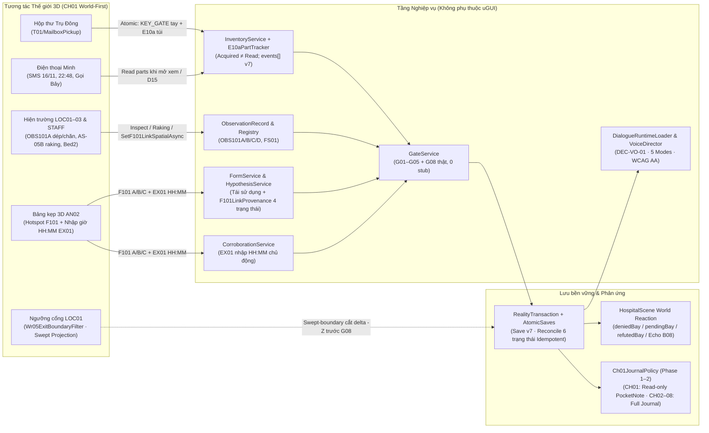

# CTCC — CH01 REBIRTH III · PHASE 0: Source Audit & Reconstruction Plan

- **Ngày kiểm toán:** `2026-11-26` *(Cập nhật Rev 1.1 sau rà soát kỹ thuật 6 điểm `4.1–4.6` của Chủ dự án)*
- **Vai trò:** Lead Gameplay Engineer & Technical Game Designer
- **Phạm vi Phase 0:** Kiểm toán toàn diện nguồn thẩm quyền, mã nguồn, scene/asset, kiểm chứng thực nghiệm baseline và lập lộ trình tái xây dựng CH01 theo mô hình **Task-driven World-first Horror** (Core v3.6.2). **Chưa chỉnh sửa bất kỳ mã gameplay production hay scene nào trong Phase 0.**
- **Nguồn thẩm quyền duy nhất (Single Source of Truth):** `Core_v3.6.2_Documentation_Consolidation.zip` — đã xác minh khớp byte-for-byte **12/12 tệp** với thư mục `docs/` và **11/11 mã SHA-256** với [`docs/SHA256SUMS.txt`](../SHA256SUMS.txt). **Core 04 (`docs/04_Level_Chapter_Design.docx` — CH01 / Walkthrough B01–B08)** là nguồn walkthrough duy nhất; không tạo lại `CH01-WALKTHROUGH.md`. Áp dụng **`DEC-V36-CH01-01`** và **`DEC-V361-CH01-01`**; **`DEC-V36-CH01-02`** (Task 02 hard gate) giữ trạng thái chờ duyệt.
- **Git Baseline:** Nhánh `main` @ `91ca10e70d3bba7445630dec91b6439301762168` (working tree sạch `100%` trước báo cáo này).
- **Nhật ký chỉnh sửa Rev 1.1:** Đã kiểm chứng trực tiếp trong mã nguồn và điều chỉnh toàn diện 6 điểm kỹ thuật: **(4.1)** Sửa lỗi P0 softlock migration Save v7 bằng bộ phân loại 6 trạng thái idempotent (không dựa đơn lẻ vào `Has("E10a")`); **(4.2)** Tách rõ *Narrative Route* vs *Adversarial Route* (`0/4` part) & quy tắc xác nhận đọc SMS; **(4.3)** Loại bỏ hoàn toàn đáp án nhiễu lộ timeline tương lai (`02:50 / 03:05 / 07:40`) khỏi `EX01`, chuyển sang trường nhập giờ/phút `HH:MM` tự xác lập; **(4.4)** Đưa `Ch01JournalPolicy` vào ngay **Phase 1–2** để khóa sạch lối tắt Journal trước khi đánh giá B01–B05; **(4.5)** Bảo vệ provenance liên kết F101 ở tầng backend (4 trạng thái provenance, vá lỗ hổng `annotationVersion == 0`, bảo toàn save cũ đã commit và luồng sửa CH02); **(4.6)** Chuyển `WR05` sang thuật toán **swept-boundary / phép chiếu displacement**, xóa bỏ `"G08 stub"` và tách trung thực unit test logic khỏi kiểm chứng E2E `G08` (`Chưa test — chờ CH08`).

---

## 1. Tóm tắt điều hành (Executive Summary)

Qua kiểm toán tĩnh toàn bộ 53 tệp Runtime C#, 12 tệp Editor authoring, 9 scene additive, dữ liệu `Dialogue.json`, kho âm thanh/mô hình Blender và chạy kiểm chứng trực tiếp trên ứng viên Windows x64 gần nhất (`output/ch01-art-production/windows/CaTrucCuoiCung.exe`), dự án đang có **nền tảng kỹ thuật vững chắc nhưng độ lệch thiết kế lớn ở tầng trình bày và hợp đồng đầu vào của CH01** so với Core v3.6.2:

1. **Nền tảng tái sử dụng tốt (~65% hệ thống lõi):**
   - Pipeline dựng build Unity `6000.3.28f1` + URP `17.3.0` Forward+ + D3D12 ổn định; kiểm chứng live trên candidate gần nhất đạt **33/33 Module QA PASS** và **17/17 Player Input QA PASS** (không teleport, stress 100 chu kỳ `0` mesh/`0` material rò rỉ).
   - Backend thẩm định logic **`FormService`** ([`Protocol.cs`](../../Prototype/Assets/CTCC/Runtime/Protocol.cs)), **`HypothesisService.EvaluateF101`** & **`F101Annotations`** ([`DeductionFramework.cs`](../../Prototype/Assets/CTCC/Runtime/DeductionFramework.cs)), giao dịch nguyên tử **`RealityTransaction`**, và lưu bền vững **`AtomicSaves` (Save Schema v7)** tách sạch hoàn toàn khỏi `UnityEngine.UI` — tái sử dụng trực tiếp dưới bảng kẹp 3D `AN02`.
   - Mỹ thuật kiến trúc `LOC01–LOC04`, `HALL`, `STAFF`, hệ thống đèn/probe R–B (`399/399` probes), rig & 3 clip ngồi viết của Lan (`CTCC_CHR_Lan.fbx`, 29 blendshapes, lip-sync 30 Hz) và `AmbientDreadDirector` đạt chuẩn sản xuất.

2. **15 khoảng cách cốt lõi (GAP) phải giải quyết trong CH01 Rebirth III:**
   - **B01 / T01 / T02 / E10a:** `Investigation.New()` vẫn seed sẵn `"E10a"` vào `evidence` ngay từ frame 0; `AtomicSaves.Valid()` cấm `evidence.Count == 0` ở CH01; không có **hộp thư sắt ngoài trụ cổng** (E10a đang nằm trên túi vải dưới đất cạnh xe máy); không có **prop/UI điện thoại di động** (SMS bị chôn trong Tab 4/5 của bì thư, lại sai giờ `22g54` thay vì `22:48`); `T02` (`Casework.OpenGate` + `WorldUseResolver`) vẫn khóa cứng theo `E10a.SMSRead` thay vì chỉ yêu cầu đúng `KEY_GATE` nhận atomic từ hộp thư; chưa có tách bạch 4 trạng thái *Thu nhận / Inspect / Đọc từng part / Xác thực*.
   - **B04 / OBS101A (`DEC-V361-CH01-01` bị vi phạm trực tiếp tại 5 điểm):** Layer B hiện vẫn vẽ decal vết bánh giường (`FourthBedReportTrace_B`, `RefutedBed4SharpWheels`), đổi tên `OBS101A` thành `"Dấu bánh giường"`, nhắc `"Vết bánh giường"` trong thông báo từ chối (`DeductionFramework.cs:326,338,826`), và đặt bảng số ổ cắm `Socket1..Socket4` (gồm `Socket4`) ở nhóm `permanent` lộ ngay trong CH01 B (trong khi `DEC-V361-CH01-01` khóa cứng `OBS101A` ở B **chỉ gồm dép/chăn**; vết bánh và ổ cắm đánh số thuộc CH02 R/`PZ01`).
   - **B05 / F101 & EX01:** ~90% thao tác F101 vẫn nằm trong modal 2 cột 2D uGUI (`HospitalUI.F101` dùng chung khung `ShowNotebook`), chưa phải camera cúi trên bảng kẹp 3D có hotspot thấy phòng ngoại vi. Ở tầng backend, `F101Annotations` chưa lưu provenance của liên kết (`SetF101LinkAsync` nhận mọi caller giống nhau) và `HypothesisService.EvaluateF101` (`DeductionFramework.cs:836`) có lỗ hổng `annotationVersion != 0` cho phép bỏ qua kiểm tra annotation/link nếu truyền `annotationVersion == 0`. `EX01` (`03:17`) bị khóa cứng vào trang `JournalTab.Timeline` — nếu tắt gameplay Journal ở CH01 thì `EX01` và `CH01-D19` không thể giải được.
   - **Zero Mandatory Journal ở CH01:** Journal 5 tab vẫn là đường bắt buộc cho `EX01`, so sánh tài liệu (`COMPARE_*`), và là nút gọi ở `AN01`/Backpack/caption cổng; nhưng may mắn là toàn bộ puzzle `PZ01–PZ07` của CH02–CH05 **không phụ thuộc Journal**, nên triển khai `Ch01JournalPolicy` ngay từ **Phase 1–2** để khóa sạch lối tắt Journal ở CH01 là hoàn toàn an toàn cho CH02–CH08.
   - **B07 / WR05 & Sequence Break:** Cổng sau `T09` đang dùng **`seamBlocker` (BoxCollider tàng hình)** + **ép lùi `NudgeWithinScene`** + **caption nhắc `"Pocket Note → Nhật ký điều tra"`** — trái trực tiếp hợp đồng `DEC-V361-CH01-01` (cần bộ lọc **swept-boundary / phép chiếu displacement** lên mặt phẳng ngưỡng ngay trước `CharacterController.Move()` trong `FirstPerson.Update()` để chặn cả bước sprint `0,189 m/frame` ở FPS thấp, không collider tàng hình, không ép lùi/camera, không nhắc Journal; đồng thời vá lỗ hổng bypass khi đang ở Layer B trong CH02).
   - **B08 Echo:** Hiện chỉ hiển thị text mờ trong 2D Backpack (`P_BAG08_ECHO`), chưa có biểu hiện nhận thức trong không gian tại `LOC02 R`.
   - **Cross-Chapter `CH05-D08` & `H08` Recovery:** `CH05-D08` chưa kiểm điều kiện đã đọc `publicReportSummary` (và còn phát nhầm qua `voice.Speak()`); bàn `LOC08 R` chưa có slot đặt gói `E10a`/điện thoại để đọc bù trước `H08`.
   - **`DEC-VO-01` & Loader (`TASK031-A/B`):** Dù commit `91ca10e` đã thêm `PresentLine` bước đầu, loader vẫn bỏ qua `designRevision`, `ch01WorldFirst`, `ambientBarks`, `pocketNoteText`, `stageDirection`, `timecodeCard`; `SilentThoughtSubtitle` đang dùng sai màu `#D9D4C3` và **tắt scrim** (vi phạm WCAG AA `#F4F1E8` + scrim `#101414` alpha `0.56` + `HighContrastThoughtBox` `0.80` + `ThoughtReadDurationScale`); còn **8 điểm rò `voice.Speak()`** ở CH02–CH05 + 1 điểm trong `LanDirector.cs:723`; **9 tệp WAV cấm** vẫn nằm trong build (`HospitalAuthoring.Lighting.cs:830-838`); và `CH01-OBJ01..06` không hiện trên HUD.
   - **Hiệu năng Phòng 101 (`TASK031-D`):** Benchmark 100% foreground live (`4.916` khung) đạt toàn tuyến `GPU P95 = 15,04 ms`, nhưng **`room-entry-R-torch` vọt lên `GPU P95 = 20,02 ms` / `Wall P95 = 20,20 ms`** (vượt ngưỡng `16,6 ms`), và `room-entry-B` sát trần `16,05 ms`.

3. **Kiến nghị triển khai:** Thực thi theo đúng 4 Phase có cổng thoát đo lường được (`Phase 1` Foundation & B01–B03 → `Phase 2` B04–B05/F101 3D/EX01 → `Phase 3` B06–B08/WR05/Cross-chapter → `Phase 4` QA `V36-CH01-Q01..Q08`, `VO-SILENT-Q01`, tối ưu `TASK031-D` và đóng gói Windows candidate), sau khi chủ dự án chốt 7 quyết định/điểm mở tại **Mục 9**.

---

## 2. Cơ sở kỹ thuật & Xác minh thực nghiệm (Technical Baseline)

### 2.1 Xác minh Bộ nguồn Core v3.6.2
- Đối chiếu trực tiếp `C:\Users\phanb\Downloads\Core_v3.6.2_Documentation_Consolidation.zip` với `docs/`: **12/12 tệp trùng khớp SHA-256 tuyệt đối** (gồm 7 tệp Core `01..07`, `CANON-AUDIT.md`, `CHANGELOG.md`, `RELEASE-NOTES.md`, `SHA256SUMS.txt`, `dialogue_silent_exploration_runtime.json`).
- Xác minh `docs/SHA256SUMS.txt`: **11/11 mã SHA-256 `True`**.
- `python docs/agent/project_docs.py check`: **PASS** — 7 tệp Core, 28 sheet, DAG 100 task (M0 `4/4`, M1 `21/21`, M2 `0/22` đang mở gồm `TASK007-A/B/C`, `TASK008`, `TASK009`, `TASK010`, `TASK026–028`, `TASK031-A/B/D`; 150 QA, 76 Decisions).
- Không tồn tại tệp `GEMINI.md` trong repo; đã đọc đầy đủ `AGENTS.md`, `docs/agent/README.md`, `docs/INDEX.md`, `README.md`, `Prototype/ThirdPartyNotices.md`, `docs/m2/design-lock-errata.md` và toàn bộ 6 skill `.agents/skills/ctcc-*/SKILL.md`. *(Phát hiện 3 dòng lệch v3.6 vs v3.6.1 trong 3 tệp skill — xem Mục 9, Quyết định D2.)*

### 2.2 Git, Toolchain & Build Pipeline
| Hạng mục | Thực tế xác minh trong Repository | Nguồn tham chiếu |
| --- | --- | --- |
| **Git HEAD & Branch** | `main` (`origin/main`) @ `91ca10e70d3bba7445630dec91b6439301762168`, working tree sạch | `git status`, `git log -n 15` |
| **Chuỗi commit gần nhất** | `3b86968` (merge M3.3 CH05) → `d7b76f0` (CH01 Art) → `ae13256` (merge CH01 Art + v3.3.2) → `91ca10e` (Core v3.6.2 docs + đồng bộ bước đầu `DEC-VO-01` trên 6 tệp Runtime + `Dialogue.json`) | `git show --stat 91ca10e`, `ae13256`, `d7b76f0` |
| **Ứng viên Windows gần nhất** | `output/ch01-art-production/windows/CaTrucCuoiCung.exe` (`exe` SHA-256 `fbd073ca59c4...`, `Assembly-CSharp.dll` SHA-256 `c1a301e4daea...`, `development=False`). **Lưu ý quan trọng:** Binary này được dựng từ `399ec65` + bộ CH01 Art (tương đương `d7b76f0`/`ae13256`), **trước commit `91ca10e`** (nên chưa chứa phần `PresentLine` mới của `91ca10e`). | `output/ch01-art-production/windows/build-identity.txt` |
| **Unity & Render Pipeline** | Unity `6000.3.28f1 (8f082d2fe476)` (đã cài tại `%USERPROFILE%\Unity\Editors\6000.3.28f1\Editor\Unity.exe`), URP `17.3.0` (Forward+), `com.unity.inputsystem 1.20.1`, `com.unity.ai.navigation 2.0.16`, `com.unity.ugui 2.0.0`, `com.unity.test-framework 1.6.0` | `Prototype/ProjectSettings/ProjectVersion.txt`, `Prototype/Packages/manifest.json` |
| **Build & QA Pipeline** | ASCII junction `C:\CTCC-Unity-Workspace` (`True`), `tools/build_m2.ps1` (hỗ trợ `-SkipGenerate`, clean env cho Unity Bee), `tools/verify_windows.ps1` (Module QA, Player Input QA, 9 failure probes), `tools/measure_m2.ps1` (`PresentMon-2.6.0-x64.exe`), `tools/sync_production_data.py`, Blender 4.5.10 LTS scripts tại `tools/blender_assets/` | `tools/*.ps1`, `tools/sync_production_data.py` |
| **Save Schema** | `Investigation.Schema = 7`, `MinSupportedSchema = 1`. Ghi nguyên tử `.tmp` + `FileStream.Flush(true)` + xác thực lại + `File.Replace` tạo `.bak` + SHA-256 checksum + `.lock` retry; migration tự động v1–v6 → v7; 2 slot `auto.json` & `manual.json`. | `Prototype/Assets/CTCC/Runtime/Protocol.cs:83-84`, `AtomicSaves.cs:15-345` |

### 2.3 Danh mục Báo cáo Lịch sử Thực sự Tồn tại
- **CH01-R (trước v3.6):** [`docs/ch01r/acceptance.md`](acceptance.md), [`docs/ch01r/puzzle-dependency-graph.md`](puzzle-dependency-graph.md), [`docs/ch01r/audio-additions.json`](audio-additions.json), [`docs/ch01r/art-production.md`](art-production.md).
- **CH01 Rebirth II (đã lưu trữ):** [`docs/archive/ch01-history/rebirth-ii/rebirth-ii-f101-journal.md`](../archive/ch01-history/rebirth-ii/rebirth-ii-f101-journal.md) (Prompt 1: F101 & sổ 5 mục), [`docs/archive/ch01-history/rebirth-ii/rebirth-ii-world.md`](../archive/ch01-history/rebirth-ii/rebirth-ii-world.md) (Prompt 2: thế giới & 14 điểm quan sát).
- **Walkthrough rời cũ (đã lưu trữ, không dùng làm chuẩn):** [`docs/archive/ch01-history/walkthrough-gameplay-B01-B08-investigation-v1.md`](../archive/ch01-history/walkthrough-gameplay-B01-B08-investigation-v1.md).
- **M2 Vertical Slice:** [`docs/m2/m2-final-candidate-report.md`](../m2/m2-final-candidate-report.md) (ứng viên `c459aba` còn nguyên vẹn tại `output/m2-final/m2-final-cand-c459aba/`), [`docs/m2/m2c-acceptance.md`](../m2/m2c-acceptance.md), [`docs/m2/m2c1-acceptance.md`](../m2/m2c1-acceptance.md), [`docs/m2/playtest-kit-task010.md`](../m2/playtest-kit-task010.md) (`0/6`), [`docs/m2/specialist-review-dossiers.md`](../m2/specialist-review-dossiers.md) (`0/3`).
- **M3 & Campus:** [`docs/campus/an-sinh-full-campus-expansion-report.md`](../campus/an-sinh-full-campus-expansion-report.md), [`docs/m3/m31-acceptance.md`](../m3/m31-acceptance.md) (`05a5bfa`), [`docs/m3/m32-implementation-and-acceptance-report.md`](../m3/m32-implementation-and-acceptance-report.md) (`c90a2eb`, còn nguyên tại `output/m3.2/`), [`docs/m3/m33-phase-a-audit-and-test-plan.md`](../m3/m33-phase-a-audit-and-test-plan.md) (CH05 `TASK013-A/B/C`).

### 2.4 Kết quả Kiểm chứng Thực nghiệm Live trên Candidate Hiện hành (Phase 0 Baseline)
Chạy trực tiếp trên `output/ch01-art-production/windows/CaTrucCuoiCung.exe` (`D3D12`, `1920×1080`, `Medium`, `render_scale=0.88`, `dual-probes`, xuất kết quả vào thư mục tách biệt ngoài working tree để không làm bẩn repo):

1. **Live Module QA (`verify_windows.ps1`):** **`33/33 PASS`** (`RESULT=PASS`, exit code `0`) — bao phủ `TASK025-A/B`, `T08`/`T08 deferred`, `M2-ADDITIVE`, `V22-Q03`, `CHAR-Q01/04/05/06/07/08`, `CH02-Q05`, `AU01`, `T06`, `TASK04-05 STAFF`, `TASK03 F101`, `CH01-R ADVERSARIAL`, `CH01 WALKTHROUGH & PROPOSAL V1.1`, `TASK007/008/009-C`, `TASK011-A..E`, `CH03-Q01..05`, `CH04-Q01..06`, `CH05-Q01..05`, `V33-Q05`, `WORLD-Q03/04`, `W-Q02/03`.
2. **Live Player Input QA CH01–CH02 (`run-ch01-input.ps1`, không teleport):** **`17/17 PASS`** (`RESULT=PASS`, exit code `0`) — chạy trọn vẹn 3 nhánh F101 `Affirmed` / `Unverified` / `Refuted`, save-lock rollback + retry, `STAFF`, `EX01`, Journal 100%/130%, 100 chu kỳ mở/đóng sổ & bảng kẹp (`222 → 222` RectTransforms), 100 chu kỳ soi giấy 2 mặt + soi xiên (`0` mesh/`0` material rò, managed `311,58 → 312,03 MB`), bàn giao CH02 Door A/B + manual save/load, và chụp **31 ảnh 1080p thực tế** (đã đối chiếu trực quan `loc01-exterior-R.png`, `walkthrough-e10a-letter.png`, `walkthrough-lan-cinematic.png`, `f101-draft-100.png`, `timeline-0317-pins.png`, `ch01r-bed4-pending-B.png`, `room-101-after-Affirmed.png`, `room-101-after-Refuted.png`, `walkthrough-b08-echo.png`).
   - *Lưu ý minh bạch:* Bộ Input QA tự động kiểm chứng khả năng đi bộ vật lý và hoạt động UI hiện hành (bản trước v3.6), **không đại diện cho trải nghiệm người chơi mới (`TASK010`)** và chưa có ca kiểm `V36-CH01-Q01..Q08` / `VO-SILENT-Q01`.
3. **Live Performance 1080p Medium (`run-benchmark.ps1`, D3D12, `VSync=0`, `60 Hz`, Intel Core Ultra 7 155H / Intel Arc Graphics, `4.916/4.916` khung foreground `100%`):**

| Phân đoạn đo (1080p Medium, `render_scale=0.88`) | Số khung (`focused`) | GPU P50 (ms) | GPU P95 (ms) | Main CPU P95 (ms) | Wall P95 (ms) | Đánh giá ngưỡng `≤ 16,67 ms` |
| --- | ---: | ---: | ---: | ---: | ---: | --- |
| **Toàn tuyến CH01–CH02 (`ALL`)** | `4.916 (100%)` | `11,62` | **`15,04`** | `6,98` | `15,38` | **Đạt** (`30/4.916` khung GPU > 16,67 ms; P99 GPU `16,19 ms`) |
| `gate-R` (LOC01 cổng) | `100` | `12,62` | `14,88` | `6,74` | `15,42` | Đạt |
| `approach-R` (LOC01 sân) | `365` | `11,97` | `14,08` | `6,71` | `15,25` | Đạt |
| `swap-R-B` (AN01 chuyển lớp) | `28` | `13,30` | `16,80` | `16,94` | `34,73` | Swap action `76,67 ms` (< 100 ms) |
| `lan-reception-B` (LOC02 Lan) | `418` | `11,79` | `13,61` | `7,20` | `15,06` | Đạt |
| `hall-B` (Hành lang B) | `197` | `12,32` | `14,21` | `6,83` | `14,72` | Đạt |
| `room-entry-B` (Vào Phòng 101 B) | `57` | `13,29` | **`16,05`** | `8,81` | `16,46` | **Sát ngưỡng** (chỉ dư `0,62 ms`) |
| `submit-F101-B` (Ký F101) | `40` | `11,14` | `12,09` | `6,75` | `12,61` | Đạt (`49,93 ms` commit) |
| `swap-B-R` (Collapse về R) | `30` | `13,82` | `16,44` | `10,22` | `29,13` | Swap action `62,30 ms` (< 100 ms) |
| `handoff-and-load` (CP04 + load) | `36` | `13,07` | `14,02` | `6,96` | `14,19` | Load action `69,10 ms` |
| **`room-entry-R-torch` (Vào 101 R + đèn pin)** | `48` | `15,48` | **`20,02`** | `7,54` | **`20,20`** | **VƯỢT NGƯỠNG (`TASK031-D` mở)** |
| `room-cross-R-torch` (Đi qua 101 R) | `153` | `12,29` | `13,61` | `6,54` | `13,89` | Đạt |

- **Bộ nhớ & Draw Calls toàn tuyến:** `Draws P95/Max = 2.017 / 2.913`, `Tris P95 = 723.494`, `Peak Working Set = 1.794,9 MiB`, `Peak Private = 1.906,4 MiB`, `Unity Allocated Max = 291,2 MiB`, `Active Mips = 281,3 MiB`.
- **Blocker đo PresentMon trong phiên tự động:** Khi gọi `tools/measure_m2.ps1` kèm `PresentMon-2.6.0-x64.exe`, script dừng ở dòng 33 (`"The Windows benchmark player did not acquire foreground focus."`) do kiểm tra tức thời `IsForegroundProcess` bị cửa sổ nền chặn trước khi cửa sổ Unity hoàn tất tạo handle (trong khi `run-benchmark.ps1` retry focus trong 18s nên đạt `100%` foreground). Số liệu đối chiếu PresentMon 60 Hz gần nhất từ hồ sơ lưu trữ: `c459aba` (`GPUTime P95 = 13,74–13,88 ms`, `DisplayedTime P95 = 16,73–16,75 ms`) và `c90a2eb` (`GPUTime P95 = 14,21–16,31 ms`, `DisplayedTime P95 = 16,74–16,75 ms`).

---

## 3. Ma trận Triển khai CH01 Hiện hành (Existing CH01 Implementation Matrix)

### 3.1 Ma trận Luồng Beat B01–B08 & State Machine
Runtime **không có enum `S0..S8`**; tiến trình dùng `Investigation.events`, `chapter`, `layer`, và `checkpoint` (`SafeCheckpoints.Pad` tại [`Protocol.cs:582-611`](../../Prototype/Assets/CTCC/Runtime/Protocol.cs#L582-L611)):

| Beat | Trigger / Điểm vào Code | Trạng thái & Cờ đã Commit | Checkpoint / Safe Pad | Sai lệch đáng chú ý so với Core v3.6.2 |
| --- | --- | --- | --- | --- |
| **Start (`T01`)** | `HospitalGame.Begin` ([`Pages.cs:46-70`](../../Prototype/Assets/CTCC/Runtime/HospitalGame.Pages.cs#L46-L70)) → `Investigation.New()` ([`Protocol.cs:255-262`](../../Prototype/Assets/CTCC/Runtime/Protocol.cs#L255-L262)) | `evidence=["E10a"]`, `events=["CH01-T01"]`, `backpack=[FLASHLIGHT]`, `layer=R` | `CH01-CP00` (`AP00`) | **Seed sẵn `E10a` vào `evidence` từ frame 0**; chưa có hộp thư/điện thoại. |
| **B01 (`E10a`)** | `Use("E10a")` trên túi vải cạnh xe → `Letter()` ([`Pages.cs:223-458`](../../Prototype/Assets/CTCC/Runtime/HospitalGame.Pages.cs#L223-L458)) → `Casework.InspectE10aLayerAsync` | `E10A_ENVELOPE`, `viewedFlags` (`FLAP`, `LAN_LETTER`, `NEWSPAPER`, `BAY_SMS`, `KEYS_EXTRACTED`), `E10a.SMSRead`, `KEY_GATE`, `KEY_WING_C`; đóng mở `PresentLine("CH01-D01")` | `CH01-CP00` (`AP00`) | Không có nhận gói atomic tại hộp thư; SMS hẹn/hoãn không tách sang điện thoại; không có 4 part ID (`letter`, `signedAppointment`, `postponementSMS`, `publicReportSummary`). |
| **B01 (`T02`)** | `Use("GATE-CONG")` → `TryUnlockOuterGate` ([`World.cs:283-319`](../../Prototype/Assets/CTCC/Runtime/HospitalGame.World.cs#L283-L319)) → `Casework.OpenGateAsync` ([`Casework.cs:172-190`](../../Prototype/Assets/CTCC/Runtime/Casework.cs#L172-L190)) | `CH01-T02`, mở `outerGate`, cất `KEY_GATE`, hẹn `DREAD_B01_SIGN_KNOCK` (+3,4s) | `CH01-S1` (`AP01`) | **Khóa cứng theo `E10a.SMSRead`** tại cả `WorldUseResolver` (`BackpackFramework.cs:1151`) và `Casework.OpenGate` (`Casework.cs:167,174`). |
| **B02 (Sân/Kính)** | `HospitalGame.Update` ([`HospitalGame.cs:433-439`](../../Prototype/Assets/CTCC/Runtime/HospitalGame.cs#L433-L439)), `LanDirector.TickBehindGlassAnomaly` ([`LanDirector.cs:227-278`](../../Prototype/Assets/CTCC/Runtime/LanDirector.cs#L227-L278)) | `PresentLine("CH01-D02")` (im lặng), `DREAD_B02_GLASS_STUDIED` nếu nhìn kính ≥ 0,95s | `CH01-S1` (`AP01`) | `heardLobbySilhouette` là biến phiên không reset/khôi phục khi `LoadAsync` (`Pages.cs:118-120`). |
| **B03 (`T03`)** | `Use("AN01")` → `Hub()` ([`HospitalGame.cs:1055-1079`](../../Prototype/Assets/CTCC/Runtime/HospitalGame.cs#L1055-L1079)) → `Casework.PrepareHub` (`Casework.cs:210-217`) | `layer = B`, `CH01-T03` | `CH01-CP01` (`AP02`) | Khớp; cần tách `Use("AN01")` khỏi fallback mở `Journal()` khi `!NeedsHub()` ở CH01. |
| **B03 (`T04` Lan)** | `TickAtCounterRecognition` ([`LanDirector.cs:280-344`](../../Prototype/Assets/CTCC/Runtime/LanDirector.cs#L280-L344)) → `Use("LAN_TALK")` → `StartCinematicEncounter` | `CH01-LAN-NOTICED` → `CH01-T04`; Skip giữ đủ transcript (`LanDirector.cs:611-617`); optional `D08/D09/D16` | `CH01-CP01` (`AP02`) | Khớp tốt (nhận biết riêng, Minh tự bấm thoại, skip giữ transcript, tách `T05`). Cần sửa nhánh fallback `LanDirector.cs:723` gọi `voice.Speak()` trên `D03b/D07b`. |
| **B03 (`T05` BOARD)** | `Use("BOARD")` → `InspectBoardBeforeAccept` ([`Pages.cs:460-500`](../../Prototype/Assets/CTCC/Runtime/HospitalGame.Pages.cs#L460-L500)) → `Casework.BoardAsync` | `CH01-T05`, `OBS101_F101 (Discovered)`, `BOARD_ASSIGNMENT`, hé `DOOR-101` (`0.13f`), gọi `CH01-D06` | `CH01-CP01` (`AP02`) | Khớp; kiểm tra `CH01-D06` có thuộc đối thoại B03 trước khi rời quầy. |
| **B04 (`T06` & Điều tra)** | Ngưỡng `feet.x > 5.82f` ([`HospitalGame.cs:466-473`](../../Prototype/Assets/CTCC/Runtime/HospitalGame.cs#L466-L473)) → `EnterRoomAsync`; `STAFF`, `OBS101C/D/A/B`, `EX01` | `CH01-T06`, `ObservationRecord` (`Discovered→Examined→Interpreted`), `CH01-D17/D18`, `FS01`, `CH01-EX01` | `CH01-CP02` (`AP04`) | **`OBS101A` vẫn gắn vết bánh & ổ cắm #4 lộ ở B**; `EX01` bị khóa trong `JournalTab.Timeline`; `OBS101C` (Task 02) chưa có đường dẫn tự nhiên từ quy trình kiểm phòng. |
| **B05 (`T07` / `G01`)** | `Use("F101")` → `WorldF101` → `Form()` ([`HospitalGame.F101.cs:19-319`](../../Prototype/Assets/CTCC/Runtime/HospitalGame.F101.cs#L19-L319)) → `SubmitF101DetailedAsync` → `FormService.ApplyWithReasoning` | `CH01-T07`, `FS02`, `f101.{firstDecision,current,revision}`, `f101History`, `G01=true`, `PA01..03` → `PresentLine(D10/11/12)`, `CH01-D19` sau `T07+EX01` | `CH01-CP02` (`AP04`) | **~90% là modal 2D 2 cột** thay vì bảng kẹp 3D hotspot thấy phòng ngoại vi; vẫn cho nối 2 giấy trong UI thay vì bắt buộc đối chứng hiện trường tại hốc giường 4. |
| **B06 (`T08`)** | `Use("AN01")` → `Casework.PrepareHub` (`Casework.cs:218-226`) → `ReconcileLayerBoundToMemory` | `layer = R`, `CH01-T08`, thu hồi giấy B về `MemoryRef`, chốt cửa cổng `b07GateLatched=true`, `PresentLine("CH01-D13",1,"B06")` | `CH01-CP03` (`AP02`) | **Sai `b07GateLatched=true` đóng lại cổng sau B→R** (Core 04: *"Sau B→R cổng không tự khóa"*); `playedHe04CorridorCut` không reset trên `LoadAsync`. |
| **B07 (`T09` / `WR05`)** | `Use("SEAM")` / kéo LMB (`>=0.45f`) → `RunB07PeakGateSeam` ([`World.cs:358-377`](../../Prototype/Assets/CTCC/Runtime/HospitalGame.World.cs#L358-L377)) → `OutsideAttemptAsync` | `CH01-T09`, warp về `AP01`, `PresentLine("CH01-D14",1,"B07")`, bật `seamBlocker` | `CH01-S7` (`AP01`) | **Dùng collider vô hình `seamBlocker` + ép lùi `NudgeWithinScene` + nhắc Journal**; có lỗ hổng bypass Layer B khi sang CH02; chưa có `loopUsed` tách bạch rõ. |
| **B08 (`T10`)** | `Use("AN01")` → `Casework.PrepareHub` (`Casework.cs:227-236`) | `chapter = "CH02"`, `layer = R`, `CH01-T10`, `G01=true`, `G02=false`, gọi `CH02-D01` | `CH01-CP04` (`AP02`) | **Không có Echo nhận thức tại `LOC02 R`** (chỉ có text mờ trong 2D Backpack); `CH02-D01` gọi `voice.Speak` sai mode `VO_REACTION_SFX`. |
| **Hints (`T11`)** | `UpdateProgressiveHints` ([`HospitalGame.cs:716-752`](../../Prototype/Assets/CTCC/Runtime/HospitalGame.cs#L716-L752)) | Timer 60/120/180s (runtime-only, không persist) | — | Copy gợi ý vẫn chỉ *"túi vải cạnh xe máy"*; `RefreshObjective` khóa cứng chữ `"Người trở về"` ở CH01 không đọc `CH01-OBJ01..06`. |

### 3.2 Tổng quan Kiến trúc Subsystem Hiện hành
- **Interaction & Physics:** `FirstPerson.cs` (`Radius=0.35 m`, `Height=1.75 m`, sprint `4.2 m/s`, crouch `1.2 m/s`, không jump) + `SceneTarget.cs` (`Reach=2.60 m`, `frontOnly`) + `InteractableRig.cs` (hỗ trợ cả click toggle và analog hold-drag cho `DOOR-101`, `DOOR-STAFF`, `CURTAIN-101`, `CHAIR-STAFF`, `DRAWER-BED3/DESK/NURSE`, `GATE-CONG`).
- **Inventory & Backpack:** `BackpackFramework.cs` (3 ngăn `Tools`, `Papers`, `PocketNote`; 4 Quick-Slots; `ReconcileLayerBoundToMemory`) + `BackpackStage3D.cs` + `HandItemPresenter.cs` (`Held_GateKey`, `Held_WingCKey`, `Held_Paper` + 4 bề mặt đặt giấy `AN02_CLIP`, `STAFF_DESK`, `RECEPTION_SLOT`, `WARD101_TABLE`). Lưu ý `E10A_ENVELOPE` đang đặt `CanPlace = false` (chặn đặt lên bàn `LOC08` cho H08).
- **3D Inspector:** `PhysicalInspector.cs` hỗ trợ lật 2 mặt (`Space`/`R`), zoom (`Q`/`Z`/scroll), soi xiên raking light (`25°–40°` hoặc `[T]`, shader `CTCC/InspectPaperRaking`), đánh dấu 1 nét mực mặt trước (`Right-Click` hoặc `[1-3]+[M]`). Chưa hỗ trợ left-click hotspot đa vùng cho bảng kẹp 3D, chưa hỗ trợ xem điện thoại/mẩu báo 3D tách biệt.
- **Dialogue & Audio:** `VoiceDirector.cs` + `HospitalGame.cs` (`PresentLine` mới từ `91ca10e`) + `HospitalUI.cs` (`CaptionStyled`) + `EnvironmentalAudio.cs`. Đã có khung `DialoguePresentationMode`, nhưng chưa đọc đủ metadata JSON v3.6.2, chưa đạt WCAG AA scrim/duration scale, và còn rò 8 dòng `voice.Speak()` ngoài CH01 + 1 dòng trong `LanDirector.cs`.

---

## 4. Kiểm toán Scene, Topology & Asset (Scene / Asset Audit)

### 4.1 Không gian, Cao độ, Safe Pad & Streaming
| Khu vực | Tọa độ World (X, Z, Y) | Kích thước (m) | Safe Pads / Cửa / Streaming | Trạng thái kiểm toán |
| --- | --- | --- | --- | --- |
| **`LOC01`** (Cổng/Sân) | `x∈[-5, 13]`, `z∈[-20, -8]`, đường tiếp cận `z∈[-26.6, -19.4]`, `y=0` | `18 × 12` | `AP00 (4, 0.015, -22.2)`, `AP01 (4, 0.015, -18.0)`; `GATE-CONG` `(4,0,-20)` `w=2.40 m`, xoay `-101°` **vào trong `+Z`** | Boot additive. Trụ cổng Đông `(5.36, 1.05, -20.0)` trống mặt Nam, lý tưởng cho Hộp thư. |
| **`LOC02`** (Lễ tân) | `x∈[-1, 9]`, `z∈[-8, 0]`, `y=0` | `10 × 8 × 3.6` | `AP02 (4, 0.015, -3.3)`, `AP03 (6.55, 0.015, -4.1)`; `ENTRY` `(4,0,-8)` `w=1.8 m`; `S1` mở ở R (`DEC-V331-01`/`design-lock-errata.md`) | Boot additive. Kính `CTCC/ReceptionGlazing` R/B, Lan rig & 3 clip ngồi viết tốt. Thiếu Echo B08 tại R. |
| **`HALL`** (Hành lang) | `x∈[2.5, 5.5]`, `z∈[0, 16]`, `y=0` | `3.0 × 16 × 3.6` | `DOOR-STAFF (2.36,0,7.03)` `w=0.94 m`; `DOOR-101 (5.60,0,4.15)` `w=1.20 m`; `HE01_TrolleyShadow` sau kính cấp cứu | Boot additive (`LOC03_Ward101`). Cần sửa nhãn `f101CorridorSlip` B: `"CHỜ XÁC NHẬN"` → `"CHỜ KIỂM TRA"` và bỏ trùng `statusA/B/C`. |
| **`STAFF`** (Hốc điều dưỡng) | `x∈[-1.0, 1.1]`, `z∈[0, 16]`, `y=0` | `2.1 × 16 × 3.6` | Hành lang thông thủy `1,74 m` (đã sửa `CHAIR-STAFF` tại `c459aba`); bàn hồ sơ `(0.92,0,3.65)`, `DRAWER-NURSE`, `OBS_CORRIDOR_NOTICE` | Boot additive (`LOC03_Ward101`). Khớp thiết kế tùy chọn B04. |
| **`LOC03`** (Phòng 101) | `x∈[5.7, 13.7]`, `z∈[2, 8]`, `y=0` | `8.0 × 6.0 × 3.6` | `AP04 (6.52, 0.015, 4.93)`; 3 giường + rèm `CURTAIN-101` + `Bed4ChartHolder (11.35,0,4.48)` + `F101 (5.72,1.37,5.50)` + `deniedBay` | Boot additive. **Cần gỡ vết bánh B & ẩn `Socket4` ở B (`DEC-V361-CH01-01`).** |
| **`LOC04`** (Cấp cứu) | `x∈[-1, 9]`, `z∈[16, 22]`, `y=0` | `10 × 6 × 3.6` | `AP05 (4, 0.015, 19.7)`; 2 cửa `GATE-CAPCUU/B` khóa cứng trước `G02` | Boot additive. Ranh giới CH01 sạch, không sequence break. |
| **`LOC08`** (Giám đốc F3) | `x∈[3.5, 8.5]`, `z∈[29.5, 35.5]`, `y=8.0` | `5.0 × 6.0 × 3.3` | `AP11 (5.20, 8.015, 32.30)`; bàn `LOC08 · CH05 Handoff Desk (6.85, 8.0, 32.3)`, mặt bàn `y=8.88 m` trống `~0,75 × 1,15 m` | Streamed (`LOC05_ArchiveWing`). Đủ diện tích gắn anchor đặt gói `E10a` + điện thoại cho H08 recovery. |

### 4.2 Khảo sát Vị trí & Thông số Hộp thư Sắt Ngoài Cổng (Tạo mới)
- **Tọa độ đề xuất tối ưu:** Gắn flush vào **mặt Nam (phía ngoài đường) Trụ cổng Đông** tại **`(5.36, 1.12, -20.17)`** hướng `-Z`:
  - Kích thước hộp thư: `0,26 m (R) × 0,34 m (C) × 0,14 m (S)` → chiếm vùng `x∈[5.23, 5.49]`, `y∈[0.95, 1.29]`, `z∈[-20.31, -20.17]`.
  - **Nằm trọn trong bề rộng trụ Đông** `x∈[5.20, 5.52]` (dư 3 cm hai bên → không bao giờ vướng capsule `r=0.35 m` khi đi qua cổng `x∈[2.80, 5.20]`).
  - **An toàn tuyệt đối khỏi cung quét `GATE-CONG`:** Cánh cổng quét `-101°` hoàn toàn về phía sân (`z > -20.0`), trong khi hộp thư nằm ở `z ≤ -20.17` (ngoài vùng khóa 100%, cách cánh cổng đóng `13 cm`).
  - **Không đụng biển/trigger lân cận:** Dưới `Sign_NightGate` (`yMin = 1.38 m`, không có `SceneTarget`) `9 cm`; trên decal ẩm chân trụ (`yMax = 0.75 m`) `20 cm`; cách trigger `CH01_DEMOLITION` `0.69 m` và `GATE-CONG` `0.68 m`.
  - **Tầm nhìn & Tầm với từ `AP00 (4.0, 0.015, -22.2)`:** Khoảng cách mắt tới tâm hộp thư = **`2,44 m` (`≤ SceneTarget.Reach 2,60 m`)**, lệch `+34,8°` bên phải tâm nhìn (nằm gọn trong hFOV `93,8°` và được chiếu trực tiếp bởi `Street wash`, đèn chốt bảo vệ và chùm đèn xe máy), ngay sát chốt cổng `x=5.20` tạo nhịp hành động tự nhiên *Mở hộp thư → Cầm chìa cổng trên tay → Mở cổng phụ*.
  - **Collider & Pivot:** `BoxCollider` (`Layer 9 Solid`) kích thước `(0.26, 0.34, 0.14)`; `SceneTarget` (`Layer 8 Interact`, **`frontOnly = true`**, `forward = -Z`) tránh tương tác xuyên trụ từ trong sân; nắp có bản lề cơ khí quay ra `-Z` để lộ **chìa cổng + giấy nhắn ở ngoài phong bì chống ẩm `E10a`**.
- **Gỡ bỏ bố trí cũ:** Xóa túi vải `CTCC_PROP_PatientBag` + `CTCC_PROP_BayEnvelope` ở `(3.17, 0.0, -21.44)` ([`HospitalAuthoring.Art.cs:1588-1590`](../../Prototype/Assets/CTCC/Editor/HospitalAuthoring.Art.cs#L1588-L1590)).

### 4.3 Kiểm toán Audio & VO (Đối chiếu `DEC-VO-01`)
- **VO hợp lệ đã có (17/17 WAV CH01):** Lan 9 dòng (`D03, D03c, D04c, D05, D05c, D07, D08, D09, D16`), Minh 3 dòng đối thoại B03 (`D04, D05b, D06`) + 1 gọi khẽ (`D13`), Loa PA 4 dòng (`PA01..04`).
- **VO cấm bởi `DEC-VO-01` nhưng còn trên đĩa & bị nạp vào build (9 WAV CH01):** `CH01-D01, D02, D03b, D07b, D10, D11, D12, D14, D19` (cộng 4 WAV ngoài CH01: `CH02-D02`, `CH03-D01/D02/D04`). `HospitalAuthoring.Lighting.cs:830-838` đang import toàn bộ `.wav` mà không lọc theo trường `needsVO` trong `Dialogue.json`.
- **Foley / SFX còn thiếu cho CH01 Rebirth III (6 nhóm):**
  1. `CH01_MailboxLatch.wav` & `CH01_MailboxLidCreak.wav` (lẫy sắt & nắp hộp thư rỉ).
  2. `CH01_PhoneSmsChime.wav` & `CH01_PhoneRingNoAnswer.wav` (tin nhắn đến / gọi Bảy đổ chuông không bắt máy).
  3. `CH01_MailboxPackagePickup.wav` (chìa kim loại + phong bì chống ẩm nhận atomic).
  4. `CH01_ExitBoundaryHum.wav` (âm ù trầm êm cho `WR05` thay thế `EmergencyHum` gắt) + nhịp thở khẽ cho `D14`.
  5. `CH01_Clock0317_EEGHum.wav` (tín hiệu `FS22` máy điện não cực nhẹ tại đồng hồ `03:17` ở Layer B).
  6. `CH01_B08EchoWhisper.wav` (âm giấy/dư âm rất nhẹ tùy chọn cho Echo B08 ở `LOC02 R`).

### 4.4 Bảng Phân loại Toàn bộ Asset & Hệ thống
| Nhóm | Hạng mục / Hệ thống | Phân loại | Tệp / Vị trí | Lý do |
| --- | --- | --- | --- | --- |
| **Scene & Topology** | Khung phòng `LOC01–04`, `HALL`, `STAFF`, `STORE`, `AP00–05`, `layout.json` | **Giữ nguyên** | `docs/prototype/layout.json`, `Editor/HospitalAuthoring.cs` | Đạt kích thước, clearance cáng & safe pad Core 03. |
| **Scene & Topology** | Bàn `LOC08 · CH05 Handoff Desk` | **Chỉnh sửa** | `Editor/HospitalAuthoring.Expansion.cs:66-70` | Thêm 2 slot vật lý đặt gói `E10a` + Điện thoại phục hồi `H08`. |
| **LOC01 Props** | Hộp thư sắt cũ (`CTCC_PROP_GateMailbox`) + nắp bản lề + móc chìa | **Tạo mới** | `tools/blender_assets/`, `Editor/HospitalAuthoring.Zones.cs`, `Runtime/InteractableRig.cs` | Core v3.6.2 `T01`/`T02` gắn trụ cổng Đông `(5.36, 1.12, -20.17)`. |
| **LOC01 Props** | Túi vải & bì thư đặt đất `(3.17, 0, -21.44)` | **Thay thế** | `Editor/HospitalAuthoring.Art.cs:1505,1589-1590` | Thay bằng gói `E10a` + chìa/giấy nhắn trong hộp thư. |
| **LOC01 Props** | Điện thoại di động 3D (`CTCC_PROP_MinhPhone`) + giao diện SMS/Gọi | **Tạo mới** | `tools/blender_assets/`, `Runtime/HandItemPresenter.cs`, `Runtime/HospitalUI.*` | Cần cho B01 (SMS hẹn 16/11, SMS hoãn 22:48, gọi Bảy không nghe) & H08. |
| **LOC01 Props** | Gói tài liệu `E10a` tách rời (Bì chống ẩm, Giấy nhắn ngoài bì, Thư Lan riêng, Mẩu báo 11/2005 riêng, Chìa C cũ có nhãn `"đã thay khóa"`) | **Chỉnh sửa / Tạo mới** | `tools/bake_ch01r_documents.py`, `Editor/HospitalAuthoring.Art.cs` | `Doc_BayLetter` hiện gộp 4 nội dung vào 1 tờ & sai giờ `22g54` (phải `22:48`); Tab báo/SMS đang fallback về `Doc_BayEnvelopeFront`. |
| **LOC01 Props** | Xe máy, Cổng phụ, Chốt bảo vệ, Biển phá dỡ, Mưa/Sương/Gợn nước | **Giữ nguyên** | `Editor/HospitalAuthoring.Zones.cs`, `.Ch01Art.cs` | Đã hiệu chỉnh ánh sáng, shader và hiệu năng tốt. |
| **LOC02 & Lan** | Quầy lễ tân, Kính `ReceptionGlazing`, `AN01`, `BOARD`, Lan rig & 3 clip ngồi, Lip-sync 30 Hz, Ánh sáng Lan | **Giữ nguyên** | `CTCC_CHR_Lan.fbx`, `HospitalAuthoring.LanReception.cs`, `CharacterActor.cs` | Đạt chuẩn mỹ thuật; chỉ sửa `LanDirector.cs:723` không gọi `Speak()` cho `D03b/D07b`. |
| **LOC02** | Đồng hồ `03:17` (`CTCC_PROP_WallClock`) | **Chỉnh sửa** | `AmbientDreadDirector.cs:553`, `HospitalGame.cs:448`, `EnvironmentalAudio.cs` | Sửa tọa độ sai `(1.2, 2.0, -5.8) → (-0.99, 2.74, -3.26)` + thêm FS22 EEG hum. |
| **LOC02** | Echo nhận thức B08 tại `LOC02 R` | **Tạo mới** | `Editor/HospitalAuthoring.Zones.cs`, `Runtime/HospitalScene.cs`, `ZoneRegion.cs` | Hiện chưa có bề mặt/dư ảnh nhận thức cạnh quầy ở `LOC02 R`. |
| **HALL / STAFF** | `HE01_TrolleyShadow`, `DOOR-STAFF`, `DOOR-101`, `PA Speaker`, `NursingFilingDesk`, `DRAWER-NURSE`, `CHAIR-STAFF`, `Doc_WardOverflow`, `Doc_ShiftGuide` | **Giữ nguyên** | `Editor/HospitalAuthoring.Art.cs`, `.Zones.cs` | Đã kiểm chứng clearance & analog drag. |
| **HALL** | Biển trạng thái ngoài cửa 101 (`f101CorridorSlip` + `statusA/B/C`) | **Chỉnh sửa** | `Runtime/HospitalScene.cs:1141-1194`, `Editor/HospitalAuthoring.Art.cs:1592-1600` | Chuẩn hóa nhánh B sang `"CHỜ KIỂM TRA"`, bỏ trùng giữa plaque tĩnh và slip runtime. |
| **LOC03 Ward 101** | 3 giường, `OBS101C` (`Doc_Bed2Transfer`), `OBS101D`, `CURTAIN-101`, `Bed4ChartHolder`/`AS-05B`, `deniedBay`, `CH01_PR01_Corner`, `PedalBin`, `Thermos` | **Giữ nguyên** | `Editor/HospitalAuthoring.Art.cs`, `Ch01PedalBin.cs`, `Ch01FieldObjects.cs` | Giữ nguyên vật thể và raking-light `ObsCard`. |
| **LOC03 Bed 4** | `OBS101A` (`FourthBedReportTrace_B`, `RefutedBed4SharpWheels`) & `Socket1..4` | **Chỉnh sửa** | `HospitalAuthoring.Art.cs:1142,1244,1424`, `.RebirthTwo.cs:184-194`, `DeductionFramework.cs:326,338` | Gỡ toàn bộ vết bánh khỏi Layer B; chỉ giữ dép/chăn cho `OBS101A`; dời `Socket4` (và số ổ cắm) sang chỉ hiện ở Layer R (`real`). |
| **Gameplay UI** | Modal F101 2 cột uGUI (`HospitalUI.F101.cs`) | **Thay thế** (tại CH01) | `HospitalGame.F101.cs`, `HospitalUI.F101.cs` | Thay bằng `An02Clipboard3DController` (camera nhìn mặt giấy 3D thấy phòng + hotspot + Large-Print/keyboard); giữ backend `FormService`/`HypothesisService`. |
| **Gameplay UI** | `JournalTab.Timeline` cho `EX01` | **Thay thế** (tại CH01) | `HospitalGame.Timeline.cs`, `HospitalUI.Timeline.cs` | Chuyển tương tác chọn mốc `03:17` sang vùng ghi chú vật lý trên `AN02`; giữ read-only/tương thích save. |
| **Gameplay UI** | Journal 5 tab (`HospitalGame.Journal.cs`, `HospitalUI.Journal.cs`) | **Chỉnh sửa** (Gate theo chapter) | `HospitalGame.cs`, `HospitalGame.Backpack.cs`, `HospitalGame.Pages.cs` | Vô hiệu hóa lối vào Journal gameplay ở CH01 (giữ read-only Pocket Note + Transcript); giữ nguyên 100% ở CH02–CH08. |
| **Gameplay Core** | `Protocol.cs`, `AtomicSaves.cs`, `Casework.cs`, `DeductionFramework.cs`, `BackpackFramework.cs`, `FirstPerson.cs`, `VoiceDirector.cs`, `HospitalUI.cs` | **Chỉnh sửa** | `Prototype/Assets/CTCC/Runtime/*.cs` | Cập nhật T01/T02/E10a atomic, 4-part read flags, WR05 velocity filter, DEC-VO-01 WCAG AA/duration scale/loader, `CH05-D08` guard. |
| **Audio** | 17 WAV VO hợp lệ CH01 + 33 SFX `Art/Audio/` + 12 SFX `Resources/CTCC/` | **Giữ nguyên** | `Prototype/Assets/CTCC/Art/Audio/`, `Resources/CTCC/` | Đúng chuẩn `DEC-VO-01` & giấy phép sạch (`ThirdPartyNotices.md`). |
| **Audio** | 9 WAV VO cấm CH01 (+4 ngoài CH01) & bộ lọc `Lighting.cs` | **Thay thế / Gỡ khỏi build** | `Art/Audio/VO/`, `Editor/HospitalAuthoring.Lighting.cs:830-838` | Lọc import theo `Dialogue.json` `needsVO == true`. |
| **Audio** | 6 nhóm SFX foley mới (Hộp thư, Điện thoại, Nhận gói, WR05 hum, FS22 EEG, Echo B08) | **Tạo mới** | `tools/bake_ch01_rebirth3_audio.py`, `Art/Resources/CTCC/` | Tổng hợp sạch NumPy 48 kHz mono 16-bit PCM (không phụ thuộc sample ngoài). |

---

## 5. Phân tích Khoảng cách (Gap Analysis Matrix)

| GAP ID | Yêu cầu Core v3.6.2 (`DEC-V36/V361/VO-01`) | Triển khai Hiện hành (File/Symbol) | Khoảng cách (Gap) | Thay đổi Đề xuất | Phụ thuộc | Ca Nghiệm thu (QA) |
| --- | --- | --- | --- | --- | --- | --- |
| **GAP-R3-01** | **T01 seed fixture, không cấp sẵn E10a**; nhận gói atomic tại hộp thư ngoài cổng (chìa cổng vào tay, bì chống ẩm + giấy nhắn vào ba lô, **không auto-read**). | `Protocol.cs:258` (`Investigation.New()` add `"E10a"`); `AtomicSaves.cs:260,271` buộc `evidence.Count==1 && Has("E10a")`; `E10a` đặt trên túi vải cạnh xe (`Art.cs:1589`). | Không có hộp thư; `E10a` tự có từ frame 0; `Letter()` cần chuyển tab + bấm nút mới lấy chìa; `ReadLetter()` legacy auto-mark tất cả. | Dựng `CTCC_PROP_GateMailbox` tại `(5.36,1.12,-20.17)`; `New()` không add `"E10a"`; mở rộng `AtomicSaves.Valid()` cho phép CH01 `S0` `evidence.Count==0` trước `CH01-MAILBOX-PICKUP`; thêm `Casework.TakeMailboxPackageAsync()` cấp atomic `E10a` + `E10A_ENVELOPE` + `KEY_GATE` (equip tay) + `KEY_WING_C` + giấy nhắn mà **0 part read**. | `Protocol.cs`, `AtomicSaves.cs`, `Casework.cs`, `BackpackFramework.cs`, Blender mailbox | `V36-CH01-Q01`, `CH01-Q12` |
| **GAP-R3-02** | **T02 mở cổng chỉ cần `S0 + đúng KEY_GATE đã nhận`**, không gate `SMSRead` hay `E10aComplete`; từ chối `KEY_WING_C`; cổng giữ mở sau `T02` và sau `T08`. | `Casework.cs:167,174` & `BackpackFramework.cs:1151` hard-gate `E10a.SMSRead`; `Casework.cs:186` tự cấp `KEY_GATE` nếu thiếu; `RealityTransaction.cs:251` đóng lại cổng (`b07GateLatched=true`) sau `T08`. | Chặn người chơi mở cổng nếu chưa bấm xác nhận SMS; `Casework` không kiểm thực sự đã có `KEY_GATE`; cổng tự đóng sau `T08`. | Sửa `WorldUseResolver` & `Casework.OpenGate/Async` yêu cầu `HasPhysical(GateKey)` + reject `KEY_WING_C`, **gỡ bỏ hoàn toàn điều kiện `E10a.SMSRead`**; giữ `outerGate` mở sau `T02` & sau `T08` (chỉ đóng tạm trong hiệu ứng seam `T09` nếu giữ). | `GAP-R3-01` | `V36-CH01-Q01`, `CH01-Q12` |
| **GAP-R3-03** | **Tách 4 mức tri thức `E10a`** (Thu nhận / Inspect / Đọc từng part `letter`, `signedAppointment`, `postponementSMS`, `publicReportSummary` / Xác thực) + **Điện thoại di động** (SMS hẹn 16/11, SMS hoãn `22:48`, gọi Bảy không nghe). | Chỉ có `E10a.SMSRead` và `viewedFlags` rời rạc; không có prop/UI điện thoại; `Doc_BayLetter` in dồn 4 nội dung và sai giờ `22g54`; báo & SMS dùng chung `Doc_BayEnvelopeFront`. | Không phân biệt đã nhận vs đã đọc mẩu báo/thư/giấy nhắn; không gọi điện được cho Bảy ở B01 Task 02; sai canon giờ SMS (`22g54` vs `22:48`). | Thêm 4 cờ đọc độc lập trong `events[]` (`E10a.Part.letter`, `E10a.Part.signedAppointment`, `E10a.Part.postponementSMS`, `E10a.Part.publicReportSummary`); quy tắc tri thức minh bạch: thông báo đến/nhắc SMS mặc định khi spawn **không** tự đánh dấu đã đọc, chỉ khi người chơi chủ động mở xem nội dung SMS/giấy mới xác lập cờ part tương ứng (tuyệt đối không can thiệp cờ đọc để ép pass test); dựng prop/UI `MinhPhone` đọc SMS 16/11 + 22:48 & gọi Bảy; tách texture 3D riêng cho Thư Lan, Mẩu báo 11/2005, Giấy nhắn ngoài bì. | `GAP-R3-01`, `tools/bake_ch01r_documents.py` | `V36-CH01-Q01` *(Narrative & Adversarial)*, `V36-CH01-Q08`, `CH01-Q14` |
| **GAP-R3-04** | **`OBS101A` ở Layer B chỉ gồm dép & chăn** (`DEC-V361-CH01-01`); dấu bánh xe & ổ cắm đánh số 1–4 chỉ dành cho CH02 R (`PZ01`). | `Art.cs:1424,1244` đặt `FourthBedReportTrace_B` & `RefutedBed4SharpWheels` ở B; `RebirthTwo.cs:187-194` đặt `OBS101A` lên vết bánh; `Art.cs:1142-1145` đặt `Socket1..4` ở `permanent`; `DeductionFramework.cs:326,338,826` nhắc vết bánh. | Lộ trực tiếp manh mối CH02 (`WHEELS`, `SOCKETS`) ngay trong CH01 Layer B, vi phạm `V36-AUD-01`. | Xóa decal vết bánh khỏi `report` & `refutedBay`; định vị lại `OBS101A` chỉ gồm `Bed4CottonTrace` (chăn) + `Bed4RubberTrace` (dép); sửa `HospitalScene.CanSeeWardChange` & 3 chuỗi copy `DeductionFramework.cs:326,338,826`; chuyển `Socket4` (và bảng số 1–4) từ `permanent` sang `real`. | Scene rebuild (`LOC03_Ward101`), `HospitalScene.cs` | `V36-CH01-Q02`, `CH02-Q01`, `LOG06-Q01` |
| **GAP-R3-05** | **Task 02 (Hồ sơ thường giường 02 `OBS101C`):** dẫn dắt tự nhiên, **mặc định không hard gate** (`DEC-V36-CH01-02` chờ duyệt); A/B không cần OBS. | `OBS101C` đặt tại đuôi giường 02 (`Art.cs:1629`), hiện là tài liệu so sánh thụ động không có dẫn hướng ngữ cảnh. | Người chơi mới dễ bỏ qua mẫu đối chứng chuẩn của giường 02; cần phương án dẫn dắt tự nhiên mà không chặn A/B. | Giữ `task02HardGate = false` theo mặc định; bổ sung affordance thị giác/tương tác tự nhiên tại giường 02 (nhầm thẻ tự sửa, học cấu trúc ô người nhận đã ký); thêm flag cấu hình nội bộ riêng cho nhánh prototype thử nghiệm `DEC-V36-CH01-02`. | `HospitalGame.Pages.cs`, `HospitalAuthoring.Art.cs` | `V36-CH01-Q02`, `CH01-Q01/Q02` |
| **GAP-R3-06** | **F101 trên bảng kẹp 3D `AN02`** (camera nhìn mặt giấy thấy phòng ngoại vi, hotspot mark 0 / ô nhận / A-B-C / ký + preview + confirm lần 2, **không modal 2 cột**, Large-Print & keyboard parity; tái sử dụng backend; **bảo vệ provenance link hiện trường ngay ở backend**, không phá save cũ hay luồng sửa CH02). | ~90% chạy qua modal 2 cột `HospitalUI.F101` + `ShowNotebook(..., clipboard:true)`; `Casework.SetF101LinkAsync` (`Casework.cs:436-447`) không phân biệt nguồn gọi UI vs hiện trường; `F101Annotations` không có provenance; `HypothesisService.EvaluateF101` (`DeductionFramework.cs:836`) bỏ qua check annotation/link khi `annotationVersion == 0`; `DeductionFramework.cs:844,846` nhắc `"trang Đối chiếu"`. | Phá vỡ tính World-first; người chơi bị tách khỏi không gian phòng 101; nếu chỉ khóa nút UI thì route cũ/lệnh gọi service/draft save cũ hoặc `annotationVersion == 0` vẫn có thể bypass bước đối chứng tại giường 4. | Tái sử dụng 100% `FormService`, `HypothesisService`, `F101Annotations`, `F101Draft`, `Casework.SubmitF101DetailedAsync`; xây `An02Clipboard3DController` (camera nhìn bảng kẹp 3D + room peripheral view + 3D UV hotspot + `Tab/Shift+Tab/Enter/E/Esc` + Large-Print); bổ sung mô hình backend **`F101LinkProvenance` 4 trạng thái** (`SpatialFieldVerified`, `LegacyUi`, `Unverified`, `LegacyCommittedSave`), tách `SetF101LinkSpatialAsync` (tự kiểm `Layer B` + vị trí `playerFeet` tại hốc giường 4 + cầm `AS-05B` → ghi `CH01-F101-LINK-SPATIAL`) khỏi `SetF101LinkFromUiAsync` (từ chối ở CH01, chỉ cho phép ở CH02), tách **`EvaluateF101LiveCommit`** (cấm `annotationVersion == 0` & bắt buộc `SpatialFieldVerified` ở CH01) khỏi **`ValidPersistedF101`** (bảo toàn 100% save legacy đã commit & luồng sửa phiếu CH02); sửa 2 câu thông báo lỗi trong `DeductionFramework.cs:844,846`. | `PhysicalInspector.cs`, `Casework.cs`, `DeductionFramework.cs`, `F101Draft.cs` | `V36-CH01-Q02`, `V36-CH01-Q05`, `V36-CH01-Q06`, `CH01-Q01..Q04`, `CH01-Q10`, probe `v36-f101-unverified-link` |
| **GAP-R3-07** | **Khả năng sửa `A→B→C`** trước `T08` và ở CH02 (`A→B` mở lại hốc giường 4 để điều tra C, không tự cấp OBS, `firstDecision` bất biến, kiểm `AP04` an toàn). | `A→B` mở lại `deniedBay` & `CURTAIN-101` không auto-grant OBS; nhưng ở nhánh `A`, `Bed4ChartHolder`/`OBS101B` nhô ra `8 cm` trước vách `deniedBay` vẫn cho cầm; `AtRequiredPlace` cho phép ký ngoài `AP04` nhưng vẫn check `CheckpointClear(AP04)`. | `OBS101B` vẫn tương tác được dù vách `deniedBay` đã đóng che hốc giường 4; cần kiểm tường minh khi người chơi đứng sâu trong hốc rồi ký sửa. | Đồng bộ ẩn/chặn `OBS101B` + `Bed4ChartHolder` khi `deniedBay` kích hoạt (theo D5); giữ kiểm tra vùng an toàn ngoài hốc trước khi dựng `deniedBay`; bổ sung ca QA `V36-CH01-Q05` kiểm trọn chuỗi `A→B→C` trước `T08` và sau `T10` (CH02). | `HospitalScene.cs`, `HospitalGame.cs`, `Casework.cs` | `V36-CH01-Q05`, `CH01-Q04`, `CH01-Q05` |
| **GAP-R3-08** | **Loại bỏ hoàn toàn gameplay Journal trong CH01** (Pocket Note chỉ đọc lại tùy chọn), **triển khai ngay từ Phase 1–2** để khóa sạch đường tắt cũ khi đánh giá B01–B05, **không phá CH02–CH08**. | `Tab/J → Backpack` có 3 nút mở `DrawJournal`; `AN01` khi `!NeedsHub()` rơi vào `Journal()`; `COMPARE_*` mở `DrawJournal(Documents)`; `TranscriptPage` Back trả về `Journal()`. CH02–CH05 `PZ01..07` **0 phụ thuộc Journal**. | CH01 vẫn lộ và buộc dùng Journal 5 tab cho `EX01`, đối chiếu và sửa F101; nếu để tới Phase 3 mới khóa sẽ còn đường tắt cũ trong quá trình nghiệm thu Phase 1–2. | Triển khai `Ch01JournalPolicy` theo 3 bước: **Phase 1** xây policy phân quyền theo chapter và khóa các đường vào Journal không cần thiết ở B01–B03 (`Tab/J` → read-only Pocket Note, `TranscriptPage` Back → Backpack, `AN01` không fallback sang `Journal()`); **Phase 2** chuyển F101 & EX01 lên 3D `AN02` và **hoàn tất khóa 100% gameplay Journal trong CH01** (gỡ `CompareFromForm`, `COMPARE_*`, `JournalTab.Timeline` edit trong CH01); **Phase 3** kiểm tra lại toàn bộ B06–B08 và tương thích liên chương CH02–CH08. | `GAP-R3-06`, `GAP-R3-09` | `V36-CH01-Q06`, `V36-CH01-Q08` |
| **GAP-R3-09** | **`EX01` (`03:17`) chủ động xác lập đúng mốc trên bề mặt vật lý tại `AN02`**, không tự giải, **không đưa đáp án nhiễu lấy từ timeline chương sau**, không cần Journal; sửa tọa độ đồng hồ & thêm FS22 EEG hum. | `EX01` chỉ giải được trong `HospitalGame.Timeline.cs` (`JournalTab.Timeline`); `AmbientDreadDirector.cs:553` & `HospitalGame.cs:448` dùng sai tọa độ đồng hồ `(1.2, 2.0, -5.8)`; chưa có âm FS22. | Tắt Journal ở CH01 sẽ làm chết hoàn toàn `EX01` và `CH01-D19`; âm thanh đồng hồ phát sai vị trí 3D; mọi danh sách trắc nghiệm dùng các mốc như `02:50 / 03:05 / 07:40` sẽ làm lộ timeline chương sau. | Gắn vùng ghi chú ngoại lệ vật lý trên mép bảng kẹp `AN02` dạng **trường nhập giờ/phút `HH:MM` tự do (`00:00–23:59`, 4 chữ số điều chỉnh / nhập số bằng chuột & bàn phím + Large-Print 130%, khởi đầu trung tính `--:--`, không có đáp án cố định từ timeline chương sau)**: người chơi tự xác lập `03:17` sau khi đã kiểm đủ 3 nguồn theo thứ tự tự do → backend xác thực đủ 3 nguồn + đúng `"03:17"` qua `Casework.CrossCheck0317ExceptionAsync()`; sửa tọa độ đồng hồ về `(-0.99, 2.74, -3.26)` + thêm `CH01_Clock0317_EEGHum.wav`. | `GAP-R3-06`, `CorroborationService` | `V36-CH01-Q03`, probe `v36-ex01-autosolve` |
| **GAP-R3-10** | **`WR05` sau `T09`:** seam đúng 1 lần; trước `G08` thử vượt ngưỡng lại: Minh tự dừng bên trong bằng **swept-boundary / phép chiếu displacement** trong `FirstPerson.Update()` (không collider vô hình, không ép lùi/camera, không relock, không nhắc Journal), ù nhẹ + `"Tìm lối ra."`, lùi/ngang/xoay tự do, thả phím reset phản hồi; bỏ giới hạn khi `G08` thật hợp lệ (**không dùng G08 stub giả**). | `HospitalAuthoring.cs:681` dựng collider vô hình `seamBlocker`; `HospitalGame.World.cs:333-356` dùng `NudgeWithinScene` ép lùi + caption nhắc `"Pocket Note → Nhật ký điều tra"`; `FirstPerson.cs:240-248,319-323` có bước sprint tối đa `4,2 × 0,045 = 0,189 m/frame`; `IsDepartureDeferred()` bỏ sót `Reality.B` ở CH02; chưa check `G08`. | Trái trực tiếp hợp đồng `DEC-V361-CH01-01`; kiểm điểm tĩnh trước frame có thể bị xuyên ngưỡng khi displacement lớn ở FPS thấp; có lỗ hổng sequence break khi sang Layer B ở CH02. | Bỏ `seamBlocker` khỏi trạng thái post-T09; cài bộ lọc **`Wr05ExitBoundaryFilter`** dùng **swept-segment intersection & phép chiếu displacement lên mặt phẳng ngưỡng `z = -19,95`** (`x ∈ [2,45; 5,55]` tính cả bán kính capsule `0,35 m`) ngay trong `FirstPerson.Update()` trước `capsule.Move(delta)`: khi `Happened("CH01-T09") && !GateService.G08(state)` (cả R & B), cắt đoạn vượt biên `delta.z = zLimit - start.z` (hoặc `0` khi đứng sát mép), giữ tự do `±X`/`+Z`/xoay nhìn, phát `CH01_ExitBoundaryHum` + `"Tìm lối ra."`, reset ngay khi thả input; dùng `GateService.G08(state)` thật (`chapter == "CH08" && Happened("G08.opened")`, **không stub giả**). | `FirstPerson.cs`, `HospitalGame.World.cs`, `HospitalScene.cs`, `Protocol.cs` | `V36-CH01-Q07`, `CH01-Q08`, `V33-Q05`, unit test thuần `Wr05ExitBoundaryFilter` *(G08 E2E ghi `Chưa test — chờ CH08`)* |
| **GAP-R3-11** | **B08 Echo nhận thức tại `LOC02 R`:** tùy chọn cạnh quầy theo nhánh A (khoanh 0) / B (dấu chờ) / C (dấu sai lệch), chỉ nhận thức, không vật chất/evidence; `T10` giở `AN01` sang CH02 không cần Journal. | Chỉ có `P_BAG08_ECHO` trong UI Backpack 2D; `LOC02 R` không có đối tượng/hiệu ứng Echo. | Người chơi không mở Backpack sẽ không bao giờ thấy Echo B08; trái mô tả Core 04 B08 (*"Echo tùy chọn cạnh quầy"*). | Tạo bề mặt/dư ảnh nhận thức không collider cạnh khay kính quầy `LOC02 R` (shader `ApparitionSoft` fade dịu, tôn trọng `reduceMotion`), đổi họa tiết theo `f101.current` (A/B/C), chỉ hiện sau `CH01-T09` trước `CH01-T10`, không cấp evidence/observation. | `ZoneRegion.cs`, `HospitalScene.cs`, `HospitalAuthoring.Zones.cs` | `V36-CH01-Q07`, `CH01-Q13` |
| **GAP-R3-12** | **`CH05-D08` guard (`publicReportSummary` đã đọc, không guard `E09`, không VO)** & **Recovery `H08` tại `LOC08 R`** (đặt gói `E10a` + điện thoại lên bàn đọc bù 4 part, giữ validator `H08`/`G06`, không auto-complete). | `sync_production_data.py:68` chỉ guard `["ValveSabotageFound"]`; `HospitalGame.ChapterFive.cs:525` gọi `voice.Speak("CH05-D08", ...)` (rò HUD Standard) và không check đã đọc báo; `E10A_ENVELOPE` có `CanPlace=false`; bàn `LOC08` chưa có slot kiểm lại gói. | Người chơi bỏ đọc mẩu báo ở CH01 vẫn kích hoạt `CH05-D08` (sai tri thức!); chưa có đường kiểm lại gói `E10a`/điện thoại tại `LOC08 R` trước `H08`. | Bổ sung `E10a.Part.publicReportSummary` vào `conditions` của `CH05-D08` trong `sync_production_data.py` & `HospitalGame.ChapterFive.cs` (nếu thiếu: nhắc kiểm lại mẩu báo đang mang theo rồi soi lại van, hoặc bỏ qua D08), đổi sang `PresentLine("CH05-D08")`; bật `CanPlace` có điều kiện tại `LOC08_RECOVERY_DESK` + dựng anchor đặt gói `E10a` & điện thoại trên bàn `LOC08 R` (`y=8.88 m`) để kiểm đủ 4 part cho `H08`. | `GAP-R3-03`, `sync_production_data.py`, `HospitalGame.ChapterFive.cs`, `HospitalAuthoring.Expansion.cs` | `V36-CH01-Q08`, `CH05-Q05`, `CH06-Q05` |
| **GAP-R3-13** | **Tương thích & Migration Save Schema v7 không softlock, idempotent** (`v1–v6 → v7` và save v7 cũ tạo trước Rebirth III; giữ nguyên `Schema = 7`; tuyệt đối không dùng `Has("E10a")` đơn lẻ làm bằng chứng đã nhận/inspect/đọc). | `Protocol.cs:258` seed sẵn `"E10a"` ở New Game trong khi `BackpackFramework.cs:605-623` chỉ cấp `FLASHLIGHT` (chưa có phong bì/chìa); `AtomicSaves.cs:118-121` bỏ qua `UpgradeLegacy` khi `schemaVersion == 7`; `AtomicSaves.cs:260,271` ép `!Has("E10a")` là `Damaged`. | Save v7 mới ở `S0` sẽ bị đánh `Damaged`; ngược lại nếu coi mọi save v7 cũ có `Has("E10a")` là "đã lấy hộp thư" sẽ gây **P0 softlock** với save vừa New Game (không có chìa cổng nhưng hộp thư trống). | Giữ nguyên `Investigation.Schema = 7`; thêm bộ chuẩn hóa idempotent **`ReconcileSaveV7ForRebirthIII(Investigation s)`** chạy trên mọi save sau `UpgradeLegacy` (gồm cả `schemaVersion == 7`) trước `Valid()`, phân biệt đủ **6 trạng thái thực tế** (seed ban đầu / inspect dở / đã đủ phong bì + chìa / đã qua `T02` / đã đọc một phần / đã sang chương sau — chi tiết tại Mục 6.2 & Quyết định D3); mở rộng `AtomicSaves.Valid()` chấp nhận cả `S0` pre-pickup (`0` evidence), trạng thái inspect dở từ save cũ và hậu pickup (`1` evidence `E10a`). | `AtomicSaves.cs`, `Protocol.cs`, `BackpackFramework.cs` | `V36-CH01-Q01`, `V36-CH01-Q05`, `V36-CH01-Q08`, `T08`, bộ unit test migration 6 trạng thái × idempotent |
| **GAP-R3-14** | **Dialogue Loader & `DEC-VO-01` / `DEC-V34–V35` (`TASK031-A/B`):** đọc đủ `designRevision`, `ch01WorldFirst`, `ambientBarks`, `pocketNoteText`, `stageDirection`, `timecodeCard`; WCAG AA scrim `#101414` alpha `0.56` + `#F4F1E8` + `HighContrastThoughtBox` (`0.80`) + `ThoughtReadDurationScale` (`1.0x/1.35x/1.6x`) + 0 rò VO trên toàn bộ dòng non-VO. | `HospitalGame.cs` bỏ qua 7 trường JSON v3.5/v3.6.2; `HospitalUI.cs:224-227` dùng màu `#D9D4C3` & tắt `cueBacking`; chưa có `HighContrastThoughtBox`/`ThoughtReadDurationScale`; 8 điểm rò `voice.Speak()` ở CH02–05 + `LanDirector.cs:723`; 9 WAV cấm vẫn được import bởi `Lighting.cs:830-838`. | Vi phạm `VO-SILENT-Q01`, `AU05`, `TASK031-A/B`; 12 dòng `CUT_TO_JOURNAL` mất `pocketNoteText`; CH02–CH05 rò VO độc thoại. | Mở rộng DTO `DialogueSheet/Entry` trong `HospitalGame.cs` kèm validator khi khởi động (`VAL-V3-01`); thêm `highContrastThoughtBox` & `thoughtReadDurationScale` vào `VisitSettings` (tương thích ngược JSON với giá trị mặc định `false`/`1.0f`, auto `1.35f` khi Large Print); sửa màu `#F4F1E8` + scrim `0.56/0.80` trong `HospitalUI.cs`; định tuyến `pocketNoteText` cho 12 `CUT_TO_JOURNAL`; đổi toàn bộ 8 lời gọi `voice.Speak()` non-VO sang `PresentLine()`; lọc `Lighting.cs` chỉ nạp WAV có `needsVO == true`. | `HospitalGame.cs`, `VoiceDirector.cs`, `HospitalUI.cs`, `Protocol.cs`, `LanDirector.cs`, `HospitalAuthoring.Lighting.cs` | `VO-SILENT-Q01`, `AU05`, `VAL-V3-01`, `V36-CH01-Q06/Q08` |
| **GAP-R3-15** | **Objectives `CH01-OBJ01..06` & Hints `T11` + Sửa lỗi tải lại session bool + Đồng bộ biển cửa 101 + Hiệu năng `room-entry-R-torch ≤ 16,6 ms` (`TASK031-D`).** | `RefreshObjective` ghi cứng `"Người trở về"`; `BuildProgressiveHint` nhắc túi vải cạnh xe máy; `LoadAsync` quên reset `heardLobbySilhouette`/`playedHe04CorridorCut`; `f101CorridorSlip` ghi `"CHỜ XÁC NHẬN"`; `room-entry-R-torch` GPU P95 `20,02 ms`. | Mất dẫn hướng mục tiêu `"Tìm lối ra."` ở B07/B08; sai copy cửa 101; spike GPU > 16,67 ms khi bật đèn pin bước vào Phòng 101 R. | Nạp `CH01-OBJ01..06` từ `Dialogue.json` (hiển thị tinh gọn khi có thay đổi / bấm `Q`); cập nhật copy `T11` khớp hộp thư & 3D `AN02`; reset đủ session flags trong `LoadAsync`; đổi nhãn B sang `"CHỜ KIỂM TRA"` & dọn trùng plaque; profile và tối ưu shadow/decal/overdraw đèn pin tại cửa Phòng 101 R (`HospitalScene.Performance.cs` + `PC_RPAsset`). | `HospitalGame.cs`, `HospitalScene.cs`, `HospitalScene.Performance.cs` | `T07`, `WORLD-Q04`, `CH01-Q09/Q10`, `V36-CH01-Q06/Q07` |

---

## 6. Kiến trúc Kỹ thuật Đề xuất (Proposed Technical Architecture)

### 6.1 Sơ đồ Luồng Dữ liệu World-First & Tương thích Save v7

### 6.2 Thiết kế Chi tiết 5 Khối Kỹ thuật Trọng tâm

1. **`E10aPackageService`, `PhoneController` & Migration Save v7 6 Trạng thái Idempotent (Giữ nguyên `Schema = 7`):**
   - **Không thêm trường bắt buộc vào `Investigation` (giữ nguyên `Schema = 7`).** Toàn bộ trạng thái dùng chính `Investigation.events` và `BackpackEntry.viewedFlags` có sẵn:
     - `CH01-MAILBOX-OPENED` (nắp hộp thư đã mở), `CH01-MAILBOX-PICKUP` (đã thu nhận đủ gói atomic).
     - `E10a.Part.letter` (đã đọc thư Lan), `E10a.Part.signedAppointment` (đã đọc giấy nhắn + SMS hẹn), `E10a.Part.postponementSMS` (đã đọc SMS hoãn 22:48; đồng bộ alias `E10a.SMSRead`), `E10a.Part.publicReportSummary` (đã đọc mẩu báo 11/2005).
     - `E10a.PhoneCalledBay` (tùy chọn B01 Task 02: đã gọi Bảy không bắt máy).
   - **Quy tắc tri thức SMS (chống tự mâu thuẫn `0/4` part):** Khi spawn ở `AP00`, điện thoại có thể hiển thị chỉ báo tin nhắn đến mặc định (không gate ổ khóa cổng), nhưng **tuyệt đối không tự ghi `E10a.Part.postponementSMS` ở frame 0**. Cờ `E10a.Part.postponementSMS` chỉ được commit khi người chơi thực sự mở điện thoại và xem nội dung SMS `22:48` (tương tự `signedAppointment` chỉ commit khi kiểm SMS hẹn + giấy nhắn ngoài bì). Không bao giờ can thiệp/giấu cờ đọc chỉ để làm pass test.
   - **Bộ chuẩn hóa Idempotent `ReconcileSaveV7ForRebirthIII(Investigation s)` (vá triệt để P0 softlock Save v7 cũ):** Vì `AtomicSaves.cs:118-121` bỏ qua `UpgradeLegacy` khi `schemaVersion == 7`, cần chạy `ReconcileSaveV7ForRebirthIII` trên mọi save (cả `v1–v6` sau nâng cấp lẫn `v7` cũ) ngay trước `Valid()`, **tuyệt đối không dùng `Has("E10a")` làm bằng chứng duy nhất**:

     | Trạng thái Save cũ (phân loại cấu trúc) | Điều kiện nhận diện | Hành vi Migration Idempotent (`f(f(s)) == f(s)`) |
     | --- | --- | --- |
     | **1. Chỉ có `E10a` do seed ban đầu** | `CH01`, `!T02`, `!CH01-MAILBOX-PICKUP`, không có `E10A_ENVELOPE`/`KEY_GATE`/`KEY_WING_C`, `!E10a.SMSRead`, không có `viewedFlags` | Gỡ seed `"E10a"` cũ khỏi `evidence`, giữ hộp thư ở trạng thái **chưa lấy** (`!CH01-MAILBOX-PICKUP`) để người chơi nhận đủ gói atomic, **0 softlock**. |
     | **2. Đã inspect dở, chưa lấy đủ vật phẩm** | `CH01`, `!T02`, `!CH01-MAILBOX-PICKUP`, có ít nhất 1 dấu inspect (`E10A_ENVELOPE` hoặc `E10a.SMSRead` hoặc `viewedFlags`) nhưng thiếu ít nhất 1 trong `{E10A_ENVELOPE, KEY_GATE, KEY_WING_C}` | Giữ nguyên vật phẩm hiện có & cờ đọc hợp lệ; **chưa** đặt `CH01-MAILBOX-PICKUP`; cho hộp thư ở chế độ **thu nhận phần còn thiếu** (chỉ bổ sung vật phẩm thiếu, không tạo trùng). |
     | **3. Đã có đủ phong bì và chìa (trước `T02`)** | `CH01`, `!T02`, có đủ `E10A_ENVELOPE`, `KEY_GATE`, `KEY_WING_C` | Bảo toàn vật phẩm, đảm bảo 1 bản `"E10a"`, đặt `CH01-MAILBOX-PICKUP` (không spawn trùng hộp thư). |
     | **4. Đã qua `T02` (trong CH01)** | `CH01`, `Happened("CH01-T02")` | Giữ nguyên cổng đã mở & toàn bộ tiến trình đã commit; đảm bảo idempotent `E10A_ENVELOPE` + chìa + `"E10a"` + `CH01-MAILBOX-PICKUP`. |
     | **5. Đã đọc một số tài liệu (áp dụng mọi case)** | Có dấu đọc thực trong `viewedFlags` / `E10a.SMSRead` | Chỉ map các cờ có bằng chứng tương ứng: `LAN_LETTER → letter`, `NEWSPAPER → publicReportSummary`, `E10a.SMSRead/BAY_SMS → postponementSMS`. **Không** map legacy `"FLAP"` sang `signedAppointment`, không tự đánh dấu part chưa đọc. |
     | **6. Đã sang chương sau (`CH02–CH05`)** | `chapter != "CH01"` | **Không bao giờ** reset `chapter`, `checkpoint`, `layer` hay ép quay lại `LOC01`; đảm bảo `E10A_ENVELOPE` & `MINH_PHONE` tồn tại trong túi để phục vụ `CH05-D08` / bàn `LOC08 R` H08; chỉ map cờ đọc có bằng chứng (Case 5). |

   - **Quy tắc `AtomicSaves.Valid()` cho Save v7:** Ở `chapter == "CH01"`, cho phép `evidence.Count == 0` khi `!Has("E10a") && !Happened("CH01-T02") && !Happened("CH01-MAILBOX-PICKUP")`, và `evidence.Count == 1` khi `Has("E10a")` (bao gồm cả sau pickup lẫn trạng thái chuyển tiếp Case 2).
   - **H08 Recovery tại `LOC08 R`:** Cho phép `E10A_ENVELOPE` và `MINH_PHONE` đặt lên anchor `LOC08_RECOVERY_DESK` (chỉ hoạt động tại `LOC08` Layer R) để người chơi lật/đọc bù 4 part ngay trên bàn trước `H08` mà không quay lại cổng.

2. **`An02Clipboard3DController`, Backend `F101LinkProvenance` & `EX01` Nhập giờ Tự do `HH:MM`:**
   - **Trình bày 3D `AN02`:** Khi tương tác `"F101"` tại `LOC03`, camera chuyển êm (hoặc cắt tức thời nếu `reduceMotion`) về góc cúi nhìn `CTCC_PROP_ClipboardF101` tại `(5.72, 1.37, 5.50)` sao cho **phòng 101 và rèm giường 4 vẫn hiện ở ngoại vi khung nhìn**.
   - **Tương tác đa kênh không modal 2 cột:**
     - Raycast trực tiếp lên các vùng UV hotspot 3D trên tờ F101 + thẻ `AS-05B` kẹp cạnh (khi đã kiểm): (1) Dòng số `0`, (2) Ô chữ ký người nhận trên `AS-05B`, (3) 3 ô chọn nhánh A / B / C, (4) Chọn kết luận nhánh C, (5) Vùng ký tên `N. H. Minh` + Preview & Xác nhận lần 2, (6) **Mép ghi chú ngoại lệ vật lý `EX01`** dùng **trường nhập giờ/phút `HH:MM` tự xác lập (`00:00–23:59`, 4 chữ số điều chỉnh / nhập phím số, khởi đầu trung tính `--:--`, hoàn toàn KHÔNG dùng đáp án trắc nghiệm lấy mốc từ timeline chương sau)**.
     - **Bàn phím & Trợ năng tương đương 100%:** `Tab`/`Shift+Tab` chuyển focus giữa các hotspot 3D (có viền highlight tương phản cao), `Enter`/`E` chọn/đánh dấu, `Left/Right/Up/Down` hoặc phím `0–9` chỉnh `HH:MM` cho `EX01`, `Esc` hủy giữ nguyên `F101Draft`, nút `Large-Print` mở mặt phẳng chữ lớn 130% dùng chung `F101Draft`.
   - **Bảo vệ Provenance Liên kết F101 ngay tại Backend (không chỉ khóa nút UI):**
     - Định nghĩa rõ **4 trạng thái `F101LinkProvenance`** ở tầng nghiệp vụ (không phá Save Schema v7, dùng `events[]` hiện có):
       1. `SpatialFieldVerified`: chỉ cấp bởi `Casework.SetF101LinkSpatialAsync(first, second, Vector3 playerFeet)` sau khi backend tự xác minh đồng thời `state.layer == Reality.B`, `playerFeet` ở trong vùng tiếp cận hốc giường 4 (`LOC03`), đã kiểm `OBS101A` & `OBS101B`, đã đánh dấu `OBS101B_SIGN` và đang trình/mang `OBS101B` tại hiện trường → ghi dấu nguyên tử `"CH01-F101-LINK-SPATIAL"` vào `events[]` (và tự xóa dấu này ngay khi bỏ mark `OBS101B` hoặc gỡ link!).
       2. `LegacyUi`: cấp bởi `Casework.SetF101LinkFromUiAsync(...)` — **backend từ chối cứng (`CommitResult.PadRequired`) khi `state.chapter == "CH01"`**, chỉ cho phép tại `CH02` (luồng sửa phiếu F101 hợp lệ trong Journal CH02).
       3. `Unverified`: liên kết không có dấu xác thực hợp lệ (kể cả draft dở chưa commit từ save v7 cũ mang `f101Annotations.HasLink` nhưng không có `"CH01-F101-LINK-SPATIAL"`).
       4. `LegacyCommittedSave`: bản ghi `f101History` / `f101Argument` đã commit từ save v1–v7 cũ trước Rebirth III (`f101.revision > 0`).
     - **Tách 2 đường kiểm chứng trong `HypothesisService`:**
       - `EvaluateF101LiveCommit(...)` (gọi khi người chơi submit trực tiếp): ở **CH01 mới**, **khóa lỗ hổng `annotationVersion == 0`** (`DeductionFramework.cs:836`) và bắt buộc `SupportsRefutation(state) && provenance == F101LinkProvenance.SpatialFieldVerified` (kiểm từ `state.Happened("CH01-F101-LINK-SPATIAL")` trong backend, không tin dữ liệu caller truyền). Ở **CH02** (sửa phiếu): chấp nhận `SpatialFieldVerified`, `LegacyUi` hoặc `LegacyCommittedSave` để bảo toàn 100% cơ chế sửa phiếu CH02.
       - `ValidPersistedF101(state)` (gọi trong `AtomicSaves.Valid()` khi load save): tiếp tục chấp nhận `LegacyCommittedSave` trong `f101History`/`f101Argument` của save cũ (`v1–v7`) để không làm hỏng bất kỳ save legacy nào đã commit F101.

3. **`Wr05ExitBoundaryFilter` — Thuật toán Swept-Boundary & Phép chiếu Displacement (Không Invisible Wall, Không `G08` Stub):**
   - Tích hợp trực tiếp vào `FirstPerson.Update()` ngay trước `capsule.Move(delta)` (với `delta = desiredHorizontalVelocity * dt`; lưu ý bước sprint tối đa ở FPS thấp đạt `4,2 m/s × 0,045 s = 0,189 m/frame`, nên chỉ kiểm vị trí tĩnh trước frame sẽ bị xuyên ngưỡng!):
     - **Điều kiện kích hoạt:** `State.Happened("CH01-T09") && !GateService.G08(State)` — áp dụng đồng nhất cho **cả `Reality.R` và `Reality.B`** (vá lỗ hổng CH02 Layer B!). `GateService.G08(state)` kiểm đúng điều kiện thật (`state.chapter == "CH08" && state.Happened("G08.opened")`), **tuyệt đối không tự cấp `G08` hay viết stub trả về `true` giả**.
     - **Mặt phẳng ngưỡng:** `zLimit = -19.95f`, khẩu độ ngang `x ∈ [2.45f, 5.55f]` (khẩu độ cổng `[2.80, 5.20]` cộng biên an toàn bán kính capsule `r = 0.35 m` để chặn cả sprint chéo sát mép trụ), cao độ `y ∈ [-0.45f, 0.45f]`.
     - **Phép cắt Swept-Segment & Phép chiếu Displacement:** Với đoạn di chuyển dự kiến trong frame `[start → end = start + delta]`:
       1. Nếu `start.z >= zLimit && end.z < zLimit`: tính giao điểm `t = (zLimit - start.z) / delta.z` (`t ∈ [0, 1]`) và `xHit = start.x + delta.x * t`. Nếu đoạn cắt vùng khẩu độ `x ∈ [2.45f, 5.55f]`, **chiếu `delta` lên mặt phẳng biên**: `delta.z = zLimit - start.z` (dừng chính xác ngay ngưỡng, `0` overshoot kể cả ở `dt = 0,045 s`), đặt `currentVelocity.z = Mathf.Max(0f, currentVelocity.z)`, giữ nguyên hoàn toàn `delta.x` đi ngang và xoay nhìn chuột.
       2. Nếu đã đứng tại mép (`start.z ∈ [zLimit - 0.10f, zLimit]`, `start.x ∈ [2.45f, 5.55f]`) và `delta.z < 0f`: đặt `delta.z = 0f` (không bao giờ đẩy lùi `+Z`; lùi vào sân `delta.z > 0`, đi ngang `delta.x` và xoay nhìn luôn tự do).
     - Phát âm ù dịu `CH01_ExitBoundaryHum` (fade mềm, tôn trọng mute) + hiện caption/mục tiêu `"Tìm lối ra."` (không nhắc Journal). Thả input hướng `-Z` → reset phản hồi ngay lập tức.

4. **`DialogueRuntimeLoader` & `SilentThoughtPresenter` (`TASK031-A/B`):**
   - Parse đầy đủ `schemaVersion` (`3.5.0-preprod-lock`), `designRevision` (`3.6.2-documentation-consolidation`), `uiPresentationSpec`, `ambientBarks` (14), `ch01WorldFirst`, và các trường cấp entry (`pocketNoteText`, `stageDirection`, `timecodeCard`). Trường lạ không làm crash loader.
   - Chạy kiểm toán nội bộ `VAL-V3-01` lúc khởi động/QA: 143 ID duy nhất, 0 `stageDirection` lọt `runtimeCopy`, `INNER_SUB_SILENT`/`CUT_TO_JOURNAL`/`UI_NON_VO` tuyệt đối không được phát `AudioClip`.
   - `HospitalUI.SilentThought`: chữ nghiêng `#F4F1E8`, nền scrim mềm `#101414` alpha `0.56` (nâng lên `0.80` khi bật `VisitSettings.highContrastThoughtBox`), tự giãn `thoughtReadDurationScale` (`1.0x / 1.35x` tự động khi `textScale >= 1.3f` / `1.6x`, tối đa `7,2 s`), và ghi đầy đủ vào `TranscriptHistory`.
   - Sửa `VoiceDirector.Present` cho `CUT_TO_JOURNAL`: không bỏ qua khi `runtimeCopy` bắt đầu bằng `[ẨN`; lấy `entry.pocketNoteText` nạp vào Pocket Note đọc lại (12/12 dòng).

5. **`Ch01JournalPolicy` — Triển khai theo Cổng ngay Phase 1–2 (Không Đợi Phase 3):**
   - Predicate tập trung `bool IsJournalGameplayAllowed => State.chapter != "CH01";`
   - **Phase 1 (B01–B03):** Dựng policy phân quyền theo chapter và khóa ngay toàn bộ lối vào Journal không cần thiết ở B01–B03 (`Tab`/`J` mở Passive Backpack với `Pocket Note` chỉ đọc lại + nút `Bản ghi hội thoại` có Back về Backpack; `AN01` ở CH01 không bao giờ fallback sang `Journal()`).
   - **Phase 2 (B04–B05):** Chuyển F101 và `EX01` sang 3D `AN02` đồng thời **hoàn tất khóa 100% mọi lối vào Journal gameplay trong CH01** (gỡ `CompareFromForm`, `COMPARE_* → DrawJournal`, `JournalTab.Timeline` edit trong CH01) để candidate sau Phase 2 chơi B01–B05 thuần World-first không còn bất kỳ đường tắt cũ nào.
   - **Phase 3 (B06–B08 & Liên chương):** Kiểm toán toàn bộ B06–B08 zero-Journal và xác minh toàn bộ Journal 5 tab, so sánh 2 trang, sửa F101 ở CH02–CH08 hoạt động nguyên vẹn 100%.

---

## 7. Kế hoạch Triển khai Phase 1–4 (Implementation Plan)

### Phase 1 — World-First Foundation, Journal Policy B01–B03 & B01–B03 (`TASK031-A/B`, `TASK007-A`)
- **Phụ thuộc:** Phê duyệt Phase 0 & các quyết định D1–D6.
- **Module C# cần sửa:**
  - `Protocol.cs`, `AtomicSaves.cs`, `Casework.cs`, `BackpackFramework.cs`: gỡ auto-seed `E10a` ở `New()`, triển khai bộ chuẩn hóa idempotent **`ReconcileSaveV7ForRebirthIII`** xử lý đủ **6 trạng thái save cũ** (không bao giờ dùng `Has("E10a")` đơn lẻ, chạy trước `Valid()` cho cả `v1–v6` lẫn `v7` cũ); tách 4 part read flags (`E10a.Part.*`) với quy tắc xác nhận đọc SMS minh bạch; thêm `TakeMailboxPackageAsync()` (hỗ trợ cả nhận mới atomic và thu nhận bù phần thiếu cho save cũ inspect dở); sửa `OpenGate`/`WorldUseResolver` chỉ kiểm đúng `KEY_GATE` (không gate `SMSRead`).
  - `HospitalGame.cs`, `HospitalGame.Backpack.cs`, `HospitalGame.Pages.cs`, `HospitalUI.Backpack.cs`: **xây dựng `Ch01JournalPolicy` phân quyền theo chapter ngay trong Phase 1** và loại bỏ toàn bộ đường vào Journal không cần thiết ở B01–B03 (`Tab/J` → read-only Pocket Note, `TranscriptPage` Back → Backpack, `AN01` ở CH01 không fallback về `Journal()`).
  - `HospitalGame.cs`, `VoiceDirector.cs`, `HospitalUI.cs`, `LanDirector.cs`, `HospitalGame.Pages.cs`, `HospitalGame.ChapterFive.cs`: triển khai đủ `TASK031-A/B` (JSON loader v3.6.2, `VAL-V3-01`, WCAG AA scrim `#F4F1E8`/`#101414`, `HighContrastThoughtBox`, `ThoughtReadDurationScale`, `12` `pocketNoteText`, `ambientBarks`, vá 8 điểm rò `voice.Speak()` + `LanDirector.cs:723`, nạp `CH01-OBJ01..06` lên HUD, sửa reset session flags trong `LoadAsync`).
  - `InteractableRig.cs`, `HandItemPresenter.cs`, `HospitalGame.World.cs`, `HospitalAuthoring.Zones.cs`, `HospitalAuthoring.Art.cs`, `HospitalAuthoring.Lighting.cs`: gắn hộp thư, gỡ túi vải cạnh xe, thêm UI/viewmodel điện thoại (SMS 16/11 + 22:48 + gọi Bảy), lọc import VO WAV theo `needsVO == true`.
- **Asset cần làm:**
  - Blender 4.5: `CTCC_PROP_GateMailbox` (nắp bản lề + móc chìa + collider), `CTCC_PROP_MinhPhone` (màn hình SMS/call 2012).
  - Texture tài liệu (`tools/bake_ch01r_documents.py`): tách 4 ấn phẩm rời `Doc_BayNote` (giấy nhắn ngoài bì), `Doc_LanLetter2005` (chỉ thư Lan), `Doc_Newspaper2005` (mẩu báo công bố 13 tử vong), `Doc_KeyCTag` (`"đã thay khóa"`), sửa giờ SMS về `22:48`.
  - Audio (`tools/bake_ch01_rebirth3_audio.py`): `CH01_MailboxLatch`, `CH01_MailboxLidCreak`, `CH01_MailboxPackagePickup`, `CH01_PhoneSmsChime`, `CH01_PhoneRingNoAnswer`.
- **Rủi ro & Giảm thiểu:**
  - *Rủi ro:* Thay đổi `Investigation.New()` và `AtomicSaves.Valid()` làm gãy các bài test legacy hoặc gây softlock save cũ vừa New Game.
  - *Giảm thiểu:* Chạy bộ unit test migration 6 trạng thái × kiểm chứng idempotency (`Reconcile(Reconcile(s)) == Reconcile(s)`) ngay trong Phase 1; tách rõ helper setup cho QA cũ và 2 tuyến mới (Narrative vs Adversarial).
- **Exit Criteria Phase 1:**
  - `VAL-V3-01`, `VO-SILENT-Q01`, `V36-CH01-Q01` PASS; 0 WAV cấm lọt vào build; 0 lối vào Journal gameplay ở B01–B03.
  - **Cả 2 tuyến B01 đều phải PASS độc lập (không can thiệp cờ đọc):**
    - **Narrative Route:** Spawn `AP00` → mở điện thoại đọc SMS hẹn/hoãn (`postponementSMS` được xác lập hợp lệ, số part đọc `≥ 1/4`) → gọi Bảy → mở hộp thư trụ Đông nhận gói atomic → mở cổng bằng `KEY_GATE` → qua sân `B02` im lặng → `AN01` `T03` → Lan `T04` + `BOARD` `T05`.
    - **Adversarial Route:** Spawn `AP00` → **không chủ động mở điện thoại hay tài liệu** → mở hộp thư nhận gói atomic (`0/4` part đã đọc) → thử `KEY_WING_C` (bị từ chối fail-closed) → mở cổng bằng `KEY_GATE` (PASS) → xác minh vẫn giữ nguyên `0/4` part chưa đọc.
  - Unit test migration Save v1–v7 (đủ 6 trạng thái gồm save vừa New Game) PASS 100%, idempotent, không softlock, không trùng gói.

### Phase 2 — B04–B05, Core Investigation, F101 3D (Backend Provenance), EX01 `HH:MM` & Khóa sạch Journal CH01 (`TASK007-B`)
- **Phụ thuộc:** Hoàn tất Exit Gate Phase 1.
- **Module C# cần sửa:**
  - `HospitalAuthoring.Art.cs`, `HospitalAuthoring.RebirthTwo.cs`, `HospitalScene.cs`, `HospitalGame.World.cs`, `DeductionFramework.cs`: gỡ 100% vết bánh khỏi Layer B (`FourthBedReportTrace_B`, `RefutedBed4SharpWheels`), gom `OBS101A` thuần dép/chăn, sửa cả 3 câu nhắc vết bánh (`DeductionFramework.cs:326,338,826`), dời `Socket4`/bảng số ổ cắm sang chỉ hiển thị ở Layer R (`real`), kiểm soát hiển thị `OBS101B` khi `deniedBay` đóng, sửa nhãn `"CHỜ KIỂM TRA"` & dọn trùng biển cửa 101.
  - `An02Clipboard3DController.cs` *(mới)*, `PhysicalInspector.cs`, `HospitalGame.F101.cs`, `F101Draft.cs`, `Casework.cs`, `DeductionFramework.cs`: dựng giao diện bảng kẹp 3D `AN02` có hotspot thấy phòng ngoại vi + xác nhận 2 bước + Large-Print/keyboard parity; giữ nguyên backend `FormService`/`HypothesisService`; cài **`F101LinkProvenance` 4 trạng thái** ở backend (`SetF101LinkSpatialAsync` tự kiểm vị trí hốc giường 4/Layer B/cầm `AS-05B`, `SetF101LinkFromUiAsync` bị backend từ chối ở CH01, tách `EvaluateF101LiveCommit` cấm `annotationVersion == 0` ở CH01 khỏi `ValidPersistedF101` bảo toàn save legacy đã commit & sửa phiếu CH02).
  - `HospitalGame.Timeline.cs` (tách khỏi CH01), `CorroborationService`, `AmbientDreadDirector.cs`, `EnvironmentalAudio.cs`: chuyển `EX01` (`03:17`) sang vùng ghi chú vật lý tại `AN02` dạng **trường nhập giờ/phút `HH:MM` tự do** (không có đáp án cố định từ timeline chương sau, không tự giải); sửa tọa độ đồng hồ `03:17` về `(-0.99, 2.74, -3.26)`; gắn `CH01_Clock0317_EEGHum.wav` (`FS22`).
  - `HospitalGame.cs`, `HospitalGame.Backpack.cs`, `HospitalGame.Pages.cs`: **hoàn tất khóa 100% gameplay Journal trong CH01** (gỡ toàn bộ đường vào `CompareFromForm → DrawJournal`, `COMPARE_* → DrawJournal`, `JournalTab.Timeline` edit ở CH01) để ứng viên sau Phase 2 chơi B01–B05 thuần World-first không còn đường tắt cũ.
  - Task 02 (`OBS101C` giường 02): thêm dẫn dắt tự nhiên trong B04, giữ `task02HardGate = false` mặc định (có công tắc prototype riêng nếu chủ dự án muốn A/B test cho `DEC-V36-CH01-02`).
- **Asset cần làm:**
  - Shader/mesh highlight hotspot 3D trên `CTCC_PROP_ClipboardF101` + thẻ `AS-05B` kẹp bên cạnh + tờ ghi chú ngoại lệ `EX01` (`HH:MM`) ở mép bảng kẹp.
  - Cập nhật texture `FileB` / slip hành lang `"CHỜ KIỂM TRA"`.
  - Audio: `CH01_Clock0317_EEGHum.wav`.
- **Rủi ro & Giảm thiểu:**
  - *Rủi ro:* Siết `EvaluateF101` làm hỏng load save legacy đã commit F101 hoặc làm gãy sửa F101 ở CH02; hotspot 3D khó đọc/khó bấm.
  - *Giảm thiểu:* Tách tuyệt đối `EvaluateF101LiveCommit` (live CH01 strict) với `ValidPersistedF101` (load save legacy) & CH02 revision; hỗ trợ song song raycast chuột + điều hướng `Tab/Shift+Tab/Enter/E`/phím số + `Large-Print` 130% giữ chung `F101Draft`.
- **Exit Criteria Phase 2:**
  - `V36-CH01-Q02`, `V36-CH01-Q03`, `V36-CH01-Q05`, `CH01-Q01..Q05` PASS; **0 đường vào Journal gameplay trong toàn bộ B01–B05** (candidate sau Phase 2 chơi B01–B05 thuần World-first); 0 vết bánh/ổ cắm số 4 lộ trong CH01 B; A/B ký không cần OBS; C fail-closed cả ở UI lẫn backend với mọi sai sót nguồn/mark/link/kết luận/provenance (`LegacyUi`/`Unverified`/`annotationVersion==0` đều bị backend từ chối ở CH01, trong khi save legacy đã commit và luồng sửa CH02 vẫn PASS); `A→B→C` mở lại hốc không tự cấp OBS và giữ `firstDecision`; `EX01` không tự giải, không lộ mốc chương sau, chỉ xác thực khi người chơi tự nhập `03:17` sau đủ 3 nguồn.

### Phase 3 — B06–B08, WR05 Swept-Boundary, Echo B08 & Cross-Chapter Compatibility (`TASK007-C`, `TASK009-C`)
- **Phụ thuộc:** Hoàn tất Exit Gate Phase 2.
- **Module C# cần sửa:**
  - `HospitalGame.cs`, `HospitalGame.Backpack.cs`, `HospitalGame.Pages.cs`: kiểm toán toàn bộ B06–B08 đảm bảo zero-Journal ở CH01 và xác minh Journal 5 tab + so sánh + sửa F101 ở CH02–CH08 hoạt động nguyên vẹn 100%.
  - `FirstPerson.cs`, `HospitalGame.World.cs`, `HospitalScene.cs`, `RealityTransaction.cs`, `Protocol.cs`: triển khai `Wr05ExitBoundaryFilter` dùng **swept-boundary / phép chiếu displacement** lên mặt phẳng `z = -19,95` (`x ∈ [2,45; 5,55]`) trong `FirstPerson.Update()` trước `capsule.Move(delta)` (chặn cả R & B sau `T09` trước `GateService.G08(state)` thật — **không stub `G08`**; gỡ `seamBlocker` & `NudgeWithinScene`; giữ cổng mở sau `T08`; phát `CH01_ExitBoundaryHum` + `"Tìm lối ra."`; reset ngay khi thả input); kiểm tra cứng `T08` thu hồi giấy B từ cả 4 vị trí tay/túi/kẹp/bàn về fixture + rollback khi save lỗi.
  - `ZoneRegion.cs`, `HospitalScene.cs`, `HospitalAuthoring.Zones.cs`: dựng bề mặt Echo nhận thức B08 tại `LOC02 R` (A/B/C, không vật chất/evidence, tôn trọng `reduceMotion`).
  - `tools/sync_production_data.py`, `ChapterFive.cs`, `HospitalGame.ChapterFive.cs`, `HospitalAuthoring.Expansion.cs`: vá guard `CH05-D08` yêu cầu `E10a.Part.publicReportSummary` + `ValveSabotageFound` (nhắc kiểm báo nếu thiếu, không guard `E09`, dùng `PresentLine`); dựng anchor đặt gói `E10a` + điện thoại trên bàn `LOC08 R` (`y=8.88 m`) cho đường phục hồi `H08` (giữ validator, không auto-complete).
- **Asset cần làm:**
  - Bề mặt/vật liệu dư ảnh nhận thức Echo B08 (3 biến thể A/B/C trên shader `ApparitionSoft`).
  - Audio: `CH01_ExitBoundaryHum.wav`, `CH01_B08EchoWhisper.wav`.
- **Rủi ro & Giảm thiểu:**
  - *Rủi ro:* Gỡ `seamBlocker` gây lọt biên khi sprint chéo sát mép trụ, FPS thấp (`dt = 0,045 s`), load gần ngưỡng hoặc đi vòng qua `S1`.
  - *Giảm thiểu:* Swept-segment intersection & phép chiếu displacement ngay trước `CharacterController.Move` ở mọi frame; chạy đủ ma trận test sequence-break: sprint thẳng/chéo sát trụ, FPS thấp `dt = 0,045 s`, load gần ngưỡng, cả R và B, đường vòng (`S1`/vành đai sân); tách trung thực pure unit test nhánh cho phép của bộ lọc khỏi nghiệm thu E2E `G08` (`Chưa test — chờ CH08`).
- **Exit Criteria Phase 3:**
  - `V36-CH01-Q04`, `V36-CH01-Q06`, `V36-CH01-Q07`, `V36-CH01-Q08` PASS; hoàn thành trọn vẹn CH01 `T01–T10` không mở Journal; `WR05` chống sequence break đạt trên đủ 5 kịch bản (sprint/chéo sát trụ, FPS thấp, load gần ngưỡng, R & B, đường vòng); nhánh E2E `G08` release ghi nhận trung thực **`Chưa test (chờ CH08 — TASK016)`**; `CH05-D08` bị chặn khi bỏ đọc báo ở CH01 và phát được sau khi đọc lại báo từ ba lô; đặt gói `E10a`/điện thoại tại `LOC08 R` hoàn tất đủ 4 part mà không auto-complete; CH02–CH05 không có hồi quy.

### Phase 4 — QA, Regression, Performance & Windows Candidate (`TASK007`, `TASK009`, `TASK031-D`)
- **Phụ thuộc:** Hoàn tất Exit Gate Phase 3.
- **Công việc chính:**
  - Bổ sung và chạy đủ bộ test tự động trong `HospitalGame.QA.cs` & `HospitalGame.InputQA.cs` cho `V36-CH01-Q01..Q08` (gồm cả Narrative Route & Adversarial Route B01, migration 6 trạng thái × idempotent, backend F101 provenance, WR05 swept-boundary 5 kịch bản), `VO-SILENT-Q01`, `VAL-V3-01`, `CH01-Q01..Q14`, `CH01-WT-Q01/Q02`, `V33-Q05`, CH02–CH05 regression, và **5 failure probes mới** (`v36-t02-wrong-key`, `v36-vo-leak`, `v36-wr05-bypass`, `v36-ex01-autosolve`, `v36-f101-unverified-link`).
  - **Tối ưu hiệu năng `TASK031-D`:** Điều tra và hạ `room-entry-R-torch` từ `GPU P95 = 20,02 ms` xuống **`≤ 16,6 ms`** và giữ `room-entry-B` ổn định `≤ 15,0 ms` ở `1080p Medium` (tối ưu phạm vi chiếu bóng đèn pin / decal overdraw / additional lights ở `LOC03` trong `HospitalScene.Performance.cs` và `PC_RPAsset`).
  - Tái sinh & bake sạch 9 scene + dual LightProbes R/B + OcclusionCullingData, chạy `tools/sync_production_data.py`, `project_docs.py check` & `hashes`, build Windows x64 Release bằng `tools/build_m2.ps1`, ghi `build-identity.txt` (rỗng `prototype_diff`) & `SHA256SUMS.txt`.
  - Chạy đủ 3 lượt PresentMon `60 Hz` foreground `100%` (tách CPU Main/Render, GPU, VRAM, Working Set, swap latency, cold/warm load), cập nhật `ThirdPartyNotices.md` cho mọi asset/WAV mới, và lập hồ sơ nghiệm thu kỹ thuật (giữ trung thực `TASK010` 0/6, `TASK026–028` 0/3 ở trạng thái `Human Review Pending`, và `G08` E2E release ở trạng thái `Out of Scope / Chưa test — chờ CH08`).
- **Exit Criteria Phase 4:**
  - `0` P0 mở; `100%` Module QA + Input QA + 14 Failure Probes PASS trên cùng 1 binary Windows x64 Release; `3/3` lượt PresentMon `1080p Medium 60 Hz` đạt `GPU P95 ≤ 16,6 ms` (gồm cả `room-entry-B` và `room-entry-R-torch`); đủ ảnh/video bằng chứng từng beat B01–B08.

---

## 8. Chiến lược QA & Hiệu năng (QA & Performance Strategy)

### 8.1 Ma trận Kiểm chứng Bắt buộc
| Nhóm Kiểm thử | Mã Ca QA | Phương thức & Tiêu chí Pass |
| --- | --- | --- |
| **CH01 World-First v3.6.2** | `V36-CH01-Q01..Q08` | Chạy cả Module QA & Input QA bàn phím/chuột không teleport: Q01 tách **2 tuyến bắt buộc** *(Narrative Route: đọc SMS xác lập `postponementSMS` → gọi Bảy → nhận gói → mở cổng; Adversarial Route: không đọc tài liệu → nhận gói → từ chối chìa C → mở cổng bằng `KEY_GATE` với đúng `0/4` part đã đọc)* + migration 6 trạng thái save cũ idempotent; Q02 F101 3D A/B/C fail-closed cả UI lẫn backend (`F101LinkProvenance`); Q03 EX01 nhập `HH:MM` tự do không auto-solve/không lộ mốc chương sau + D19; Q04 T08 thu hồi giấy B 4 vị trí + rollback lỗi save; Q05 A→B→C + hốc mở lại không auto-OBS + bảo toàn save cũ & CH02; Q06 full CH01 **0 lần mở Journal** (khóa sạch từ Phase 1–2) + keyboard/130%/mute/reduced motion; Q07 WR05 swept-boundary (sprint/chéo sát trụ/FPS thấp `dt=0.045s`/load gần ngưỡng/R & B/S1) + Echo B08 *(E2E `G08` release ghi trung thực `Chưa test — chờ CH08`, không stub giả)*; Q08 bỏ đọc E10a ở CH01 → D08 bị chặn → đọc bù tại `LOC08 R` → H08 đủ 4 part + CH02–CH05 regression. |
| **Silent Exploration & VO** | `VO-SILENT-Q01`, `AU05`, `VAL-V3-01` | Kiểm tra tĩnh + runtime: `143/143` ID khớp, `82` VO + `28` `INNER_SUB_SILENT` + `12` `CUT_TO_JOURNAL` (`pocketNoteText`) + `21` `UI_NON_VO` + `14` `ambientBarks`; **0 AudioClip phát** trên dòng `needsVO=false`; WCAG AA scrim `#101414 (0.56/0.80)` & `#F4F1E8`; `ThoughtReadDurationScale` (`1.0x/1.35x/1.6x`) + `TranscriptHistory`; 0 `stageDirection` lọt HUD. |
| **CH01–CH05 & Save Regression** | `CH01-Q01..Q14`, `CH01-WT-Q01/Q02`, `CH02-Q01..Q06`, `CH03–CH05`, `V22-Q03`, `V33-Q05`, `T02/T03/T08` | Bảo toàn 100% 33 ca Module QA + 17 ca Input QA (cập nhật chỉ ở các assertion cũ mâu thuẫn v3.6.2 như `QA.cs:158-164, 2146` kiểm clip `D10..12/D14/D19` và đường mở Journal CH01). Migration save v1–v6 và 6 trạng thái save v7 cũ (kể cả vừa New Game và đã commit F101) đều load sạch, idempotent. |
| **Fault-Injection Probes** | 9 probe cũ + 5 probe mới | Mỗi probe phải thoát mã `1` (`RESULT=FAIL`): thêm `v36-t02-wrong-key`, `v36-vo-leak`, `v36-wr05-bypass`, `v36-ex01-autosolve`, `v36-f101-unverified-link`. |
| **Cổng Con người & Ngoài phạm vi** | `TASK010`, `TASK026–028`, `CHAR-Q02/Q09`, `G08` E2E | Giữ nguyên **`Human Review Pending`** cho `TASK010` & `TASK026–028`; ghi trung thực `G08` release E2E là **`Out of Scope / Chưa test (chờ CH08 — TASK016)`** (tách biệt với pure unit test của thuật toán `Wr05ExitBoundaryFilter`). |

### 8.2 Chiến lược Đo Hiệu năng Chuẩn Core 06
- **Cấu hình khóa:** Windows x64 Release (`development=False`), Intel Core Ultra 7 155H / Intel Arc iGPU, D3D12, `1920×1080`, `Medium` (`render_scale=0.88`, `dual-probes`, `60 Hz`, `VSync 1` cho PresentMon 3 lượt độc lập + `VSync 0` cho phân tích headroom).
- **Điều kiện đo bắt buộc:** `100%` khung foreground (`samples_focused == samples_all`), tách bạch `Unity Wall / Main CPU / Render CPU / Unity GPU (P50/P95/P99)`, `PresentMon DisplayedTime & GPUTime`, `Draw Calls`, `Triangles`, `Working Set / Active Mips`, `swap-R-B / swap-B-R` (`< 100 ms`), cold/warm load và dung lượng gói build.
- **Trọng tâm tối ưu `TASK031-D`:** Cô lập nguyên nhân `room-entry-R-torch` (`GPU P95 = 20,02 ms`) bằng `-ctcc-ablation shadows|decals|ssao|transparency|probes` trong `HospitalGame.Benchmark.cs` trước khi tinh chỉnh ngân sách bóng đèn pin / culling đèn phụ / overdraw kính–rèm ở `LOC03`.

---

## 9. Blockers và Quyết định Cần Phê duyệt (Trước khi Chuyển Phase 1–2)

| ID | Hạng mục / Blocker | Căn cứ Đối chiếu | Ảnh hưởng | Phương án Đề xuất (Xin Chủ dự án chốt) |
| --- | --- | --- | --- | --- |
| **D1** | **`DEC-V36-CH01-02` (Task 02 — Hồ sơ giường 02 `OBS101C`)** | Core 07 `Decisions!R75` (`Chờ duyệt`), `ch01WorldFirst.task02HardGate: false` | Quyết định B04 có chặn mở rèm/ký A–B trước khi xem `OBS101C` hay không. | **(Đề xuất):** Giữ mặc định `task02HardGate = false` (dẫn dắt tự nhiên, A/B không cần OBS) và thêm công tắc cấu hình nội bộ riêng cho bản prototype thử nghiệm playtest. |
| **D2** | **Lệch nội dung 3 tệp Skill so với Core v3.6.2 (`AGENTS.md` quy định dừng báo khi phát hiện skill lỗi thời)** | `.agents/skills/ctcc-gameplay/SKILL.md:12` & `ctcc-qa/SKILL.md:20` còn ghi `"T02 mở bằng đúng chìa + đủ nguồn E10a"`; `ctcc-level/SKILL.md:21` còn ghi `"T02 sau SMS/chìa"`. Core v3.6.2 (`DEC-V361-CH01-01`, `TASK007-A`, `ch01WorldFirst.gateInContract`) chốt: **`T02 chỉ chìa đúng, không gate E10aComplete/SMSRead`**. | Có thể gây nhầm lẫn hợp đồng `T02` giữa các phiên agent thực thi Phase 1 & Phase 4. | **(Đề xuất):** Cho phép cập nhật đồng bộ 3 dòng trên trong 3 tệp skill về đúng `DEC-V361-CH01-01` ngay đầu Phase 1 (không sửa bất kỳ tệp Core `01..07` nào). |
| **D3** | **Quy tắc Migration Save v7 cũ 6 trạng thái Idempotent (vá P0 softlock — Rev 1.1)** | `Protocol.cs:258` (seed `E10a` frame 0), `BackpackFramework.cs:605-623` (không seed chìa/bì), `AtomicSaves.cs:118-121,260`, Core 04 B01, `V36-CH01-Q01/Q08` | Nếu dùng `Has("E10a")` đơn lẻ sẽ gây **P0 softlock** cho save vừa New Game (không có chìa cổng nhưng hộp thư trống); đồng thời ảnh hưởng `CH05-D08` & `H08`. | **(Đề xuất Rev 1.1):** Triển khai `ReconcileSaveV7ForRebirthIII` **idempotent** chạy trên cả `v1–v6` lẫn `v7` cũ, **tuyệt đối không dùng `Has("E10a")` đơn lẻ**, phân biệt đủ 6 trạng thái: (1) Chỉ có `E10a` seed ban đầu → gỡ seed, vẫn cho nhận gói tại hộp thư; (2) Đã inspect dở chưa đủ vật phẩm → cho thu nhận phần còn thiếu, không trùng; (3) Đã có phong bì & chìa → bảo toàn, không spawn trùng; (4) Đã qua `T02` → giữ cổng & tiến trình; (5) Đã đọc 1 số tài liệu → chỉ map cờ đọc có bằng chứng (`LAN_LETTER`, `NEWSPAPER`, `E10a.SMSRead/BAY_SMS`, bỏ qua legacy `FLAP`); (6) Đã sang chương sau → không reset chương/quay về `LOC01`, giữ đủ túi `E10a`/điện thoại cho `CH05-D08`/`LOC08` H08. |
| **D4** | **Vị trí Hộp thư & Hình thức Echo nhận thức B08 tại `LOC02 R`** | Core 04 B01 & B08, Core 06 (`điểm mở cần prototype`) | Quyết định bố cục cảnh `LOC01` và trình bày cảm xúc `B08` không vi phạm canon. | **(Đề xuất):** (a) Đặt hộp thư trụ cổng Đông `(5.36, 1.12, -20.17)` ngoài vùng khóa; (b) Echo B08 thể hiện dưới dạng dư ảnh nhận thức mờ ngắn (3–4s, shader `ApparitionSoft`, 0 collider/0 evidence) in thoáng trên khay/kính quầy `LOC02 R` đúng theo nhánh A (khoanh 0) / B (dấu chờ) / C (dấu sai lệch). |
| **D5** | **Ranh giới hiển thị `Socket4` ở B & `OBS101B` khi `Affirmed`** | `DEC-V361-CH01-01` (`V36-AUD-01`), ảnh live `room-101-after-Affirmed.png` & `ch01r-bed4-pending-B.png` | `Socket4` đang lộ ở B (dễ spoil `PZ01` CH02); `Bed4ChartHolder`/`OBS101B` đang nhô trước vách `deniedBay` sau ký A. | **(Đề xuất):** (a) Dời toàn bộ bảng số `Socket1..4` và ổ cắm #4 từ `permanent` sang `real` (chỉ hiện ở Layer R); (b) Đưa `Bed4ChartHolder` vào nhóm ẩn cùng hốc khi `deniedBay` dựng lên ở nhánh `Affirmed`, và hiện lại cùng rèm khi sửa `A→B`. |
| **D6** | **Phạm vi vá 8 điểm rò `DEC-VO-01` ngoài CH01 & gỡ 9 WAV cấm** | `HospitalGame.cs:487,1092`, `Pages.cs:1208,1242,1365`, `ChapterFive.cs:353,525,556`, `Lighting.cs:830-838` | `VO-SILENT-Q01` yêu cầu 0 rò VO toàn game trên các dòng `needsVO=false`. | **(Đề xuất):** Gộp vá toàn bộ 8 lời gọi `voice.Speak()` sang `PresentLine()` và lọc import WAV theo `needsVO == true` ngay trong Phase 1 (`TASK031-A/B`). |
| **D7** | **Blocker môi trường đo PresentMon foreground & Cổng Con người** | Lỗi `measure_m2.ps1:33` trong phiên nền; `TASK010` (`0/6`), `TASK026–028` (`0/3`) | Không thể lấy PresentMon `DisplayedTime` khi desktop khóa/mất focus; không thể đóng M2 chỉ bằng QA tự động. | **(Đề xuất):** Chạy 3 lượt `measure_m2.ps1` ở Phase 4 trong phiên desktop foreground mở khóa (bổ sung retry focus như `run-benchmark.ps1` nếu được phép); giữ nguyên `TASK010` và `TASK026–028` ở trạng thái `Human Review Pending`. |

---

### Xác nhận Cổng Thoát Phase 0 (Exit Gate)
- [x] Đã xác minh checksum `12/12` tệp `Core_v3.6.2_Documentation_Consolidation.zip` và `11/11` `SHA256SUMS.txt`.
- [x] Đã audit đầy đủ mã nguồn Runtime/Editor, Save v7, `Dialogue.json`, Scene `LOC01–LOC04`/`HALL`/`STAFF`/`LOC08`, asset 3D/texture/shader/audio và lịch sử báo cáo.
- [x] Đã chạy kiểm chứng thực nghiệm live (Module QA `33/33`, Input QA `17/17`, Benchmark 1080p Medium `4.916` khung `100%` foreground) và rà soát ảnh chụp thực tế.
- [x] Đã lập ma trận GAP (`GAP-R3-01..15`), kiến trúc kỹ thuật đề xuất, kế hoạch Phase 1–4 và danh mục 7 quyết định cần phê duyệt (`D1–D7`).
- [x] Đã rà soát và điều chỉnh đầy đủ 6 điểm kỹ thuật `4.1–4.6` ở **Rev 1.1** (migration Save v7 6 trạng thái idempotent, tách tuyến Narrative/Adversarial B01, EX01 nhập `HH:MM` không lộ mốc tương lai, `Ch01JournalPolicy` vào Phase 1–2, backend `F101LinkProvenance` 4 trạng thái, `WR05` swept-boundary & không dùng `G08` stub).
- [x] **Chưa chỉnh sửa bất kỳ mã gameplay production, scene, asset hay bộ tài liệu Core nào.** Dừng tại Phase 0 chờ Chủ dự án đánh giá và phê duyệt chuyển sang Phase 1–2.
