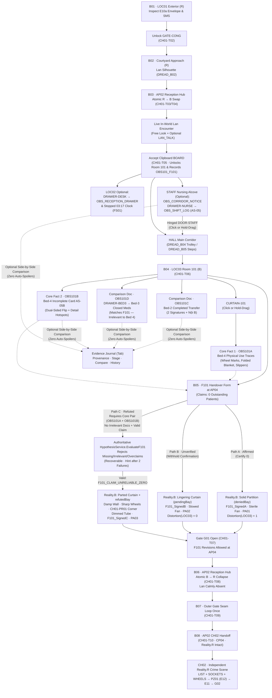

# CH01-R Puzzle Dependency Graph & Investigative Architecture

> **Scope:** *Ca trực cuối cùng* — **CH01 (*Người trở về*)** reconstruction (`CH01-R`) through **CH02 (*Phòng bệnh trống*)** handoff.
> Preserves all canonical gates (`G01–G04`), `LOCK-V22-01..03`, `DEC-CH02`, `LOCK-LOG06`, and `CH01 evidence.Count == 1` (`E10a` only).

---

## 1. Narrative Arc, Nonlinear Exploration Loop & F101 Deduction Flow

---

## 2. Authoritative F101 Epistemic Validation Matrix (`HypothesisService.EvaluateF101`)

| Evidence / Claim Combination | Decision | Authoritative Outcome | Rationale |
| --- | --- | --- | --- |
| Any observed state (including 0 clues) | `Affirmed` | **`Valid`** | Player may always certify the printed zero; sets `Distortion(LOC03) = 1` and conceals Bed 4 in Layer B. |
| Any observed state (including 0 clues) | `Unverified` | **`Valid`** | Responsible epistemic restraint — never penalized and never blocks `G01` or CH01 completion. |
| `OBS101A` + `OBS101B` + `F101_CLAIM_UNRELIABLE_ZERO` | `Refuted` | **`Valid`** | Complementary physical trace + incomplete record establish that reported `0` cannot be reliably certified. |
| `OBS101A` + `OBS101B` + `{OBS101C / OBS_SHIFT_LOG / OBS_CORRIDOR_NOTICE / OBS101_F101}` + `F101_CLAIM_UNRELIABLE_ZERO` | `Refuted` | **`Valid`** | Valid core pair corroborated by relevant comparison standard or administrative overflow context. |
| Missing `OBS101A` OR missing `OBS101B` (even with `OBS101C` or `OBS_SHIFT_LOG`) | `Refuted` | **`InsufficientEvidence`** | Single card alone could be leftover stationery; physical trace alone does not prove incomplete handover. |
| Core pair + `OBS101D` (Bed-3 closed medication log) | `Refuted` | **`IrrelevantEvidence`** | Bed 3's closed medication record matches F101 and does not bear on Bed 4's discrepancy. |
| Core pair + `OBS_CLOCK_0317` or `OBS_RECEPTION_DRAWER` | `Refuted` | **`IrrelevantEvidence`** | Atmospheric/institutional context, not direct grounds to refute Room 101's bed count. |
| Core pair + `F101_CLAIM_PATIENT_PRESENT` | `Refuted` | **`UnsupportedConclusion`** | Past use + blank signature do not prove a patient is currently still in Room 101. |
| Core pair + `F101_CLAIM_FALSIFICATION` | `Refuted` | **`UnsupportedConclusion`** | Missing signatures do not prove deliberate falsification or a concealed death. |
| Core pair + `F101_CLAIM_CLERICAL_OK` | `Refuted` | **`ContradictsDecision`** | Conclusion affirms the zero while submitting `Refuted`. |
| Unregistered ID (`"OBS_UNKNOWN_999"`) | `Refuted` | **`UnknownEvidenceId`** | Gameplay logic never trusts unvalidated UI IDs or booleans. |
| Wrong layer/location provenance or `ObservationStage.Discovered` only | `Refuted` | **`InvalidProvenance` / `UnexaminedEvidence`** | Provenance & examination stage verified authoritatively on `ObservationRecord`. |

---

## 3. Observation Lifecycle & Provenance Contract

Every CH01 & CH02 observation is tracked via `ObservationRecord` inside `Investigation` (Save Schema `v4`, backward-compatible with `v1/v2/v3`):

1. **`Discovered` (`0`)**: Registered but not yet inspected (insufficient for formal refutation).
2. **`Examined` (`1`)**: Directly inspected in-world or via `PhysicalInspector` / Large Print in valid layer & location.
3. **`Interpreted` (`2`)**: Reverse side inspected (`Space`/`R` flip) OR key detail callout (`1–3`) / Large-Print full transcript reviewed.
4. **`Corroborated` (`3`)**: Successfully cited inside an accepted `Refuted` F101 deduction submission.

**Canon Preservation Guardrails:**
- `Reality.B` observations NEVER enter `state.evidence` (`CH01 state.evidence.Count == 1`, strictly `"E10a"`).
- `OBS101B` never mentions Bé An, `C01`, `Khu C`, `E11`, or `E12` (`DEC-CH02` / `LOCK-LOG06`).
- `CH01-D16b` and `CH04-D06` remain hard-locked behind `CH04 B06 + H05.verified + PT02.presented` (`LOCK-V22-02`).
- `Reality.R` geometry, `LIST`/`SOCKETS`/`WHEELS`, `PZ01`/`E12`, and `E11` remain completely unaltered regardless of F101's `Affirmed` / `Unverified` / `Refuted` decision.
