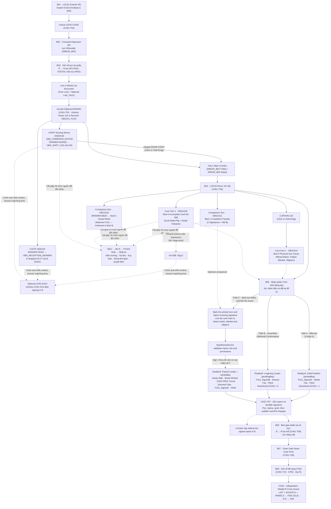

# CH01-R Puzzle Dependency Graph & Investigative Architecture

> **Scope:** *Ca trực cuối cùng* — **CH01 (*Người trở về*)** reconstruction (`CH01-R`) through **CH02 (*Phòng bệnh trống*)** handoff.
> Preserves all canonical gates (`G01–G04`), `LOCK-V22-01..03`, `DEC-CH02`, `LOCK-LOG06`, and `CH01 evidence.Count == 1` (`E10a` only).

---

> Current design: [CH01 walkthrough B01–B08](walkthrough-gameplay-B01-B08-investigation-v1.md), DEC-CH01R-04.

## 1. Narrative Arc, Nonlinear Exploration Loop & F101 Deduction Flow

---

## 2. Authoritative F101 Epistemic Validation Matrix (`HypothesisService.EvaluateF101`)

| Evidence / Claim Combination | Decision | Authoritative Outcome | Rationale |
| --- | --- | --- | --- |
| Any observed state (including 0 clues) | `Affirmed` | **`Valid`** | Player may always certify the printed zero; sets `Distortion(LOC03) = 1` and conceals Bed 4 in Layer B. |
| Any observed state (including 0 clues) | `Unverified` | **`Valid`** | Responsible epistemic restraint — never penalized and never blocks `G01` or CH01 completion. |
| `F101_ZERO` + `OBS101B_SIGN`, with `OBS101B_SIGN → OBS101A_TRACES` and `F101_CLAIM_UNRELIABLE_ZERO` | `Refuted` | **`Valid`** | The observed scene and incomplete card support withholding certification of the reported zero. The Bed 2 transfer is optional. |
| Core pair and supported claim from an existing save | `Refuted` | **`Valid`** | Legacy revisions retain their original evidence and claim. |
| Both source documents and the scene, with an incorrect mark or missing link | `Refuted` | **`InsufficientEvidence`** | The player's notes do not yet support signing the discrepancy. |
| Missing `OBS101A` OR missing `OBS101B` (even with `OBS101C` or `OBS_SHIFT_LOG`) | `Refuted` | **`InsufficientEvidence`** | Single card alone could be leftover stationery; physical trace alone does not prove incomplete handover. |
| Core pair + `OBS101D` (Bed-3 closed medication log) | `Refuted` | **`IrrelevantEvidence`** | Bed 3's closed medication record matches F101 and does not bear on Bed 4's discrepancy. |
| Core pair + `OBS_CLOCK_0317` or `OBS_RECEPTION_DRAWER` | `Refuted` | **`IrrelevantEvidence`** | Atmospheric/institutional context, not direct grounds to refute Room 101's bed count. |
| Core pair + `F101_CLAIM_PATIENT_PRESENT` | `Refuted` | **`UnsupportedConclusion`** | Past use + blank signature do not prove a patient is currently still in Room 101. |
| Core pair + `F101_CLAIM_FALSIFICATION` | `Refuted` | **`UnsupportedConclusion`** | Missing signatures do not prove deliberate falsification or a concealed death. |
| Core pair + `F101_CLAIM_CLERICAL_OK` | `Refuted` | **`ContradictsDecision`** | Conclusion affirms the zero while submitting `Refuted`. |
| Unregistered ID (`"OBS_UNKNOWN_999"`) | `Refuted` | **`UnknownEvidenceId`** | Gameplay logic never trusts unvalidated UI IDs or booleans. |
| Wrong layer/location provenance or `ObservationStage.Discovered` only | `Refuted` | **`InvalidProvenance` / `UnexaminedEvidence`** | Provenance & examination stage verified authoritatively on `ObservationRecord`. |

---

## 3. Observation Lifecycle & Provenance Contract

Save schema v7 loads v1–v6 and keeps F101 drafts/history, authored item locations and backpack contents distinct from observations, notes and evidence. T08 restores B paper to its fixture and retains its memory reference. Each new annotated `Refuted` revision records a separate copy of the signed marks, link and claim. The `ObservationRecord` stages for CH01 and CH02 are:

1. **`Discovered` (`0`)**: Registered but not yet inspected (insufficient for formal refutation).
2. **`Examined` (`1`)**: Directly inspected in-world or via `PhysicalInspector` / Large Print in valid layer & location.
3. **`Interpreted` (`2`)**: Reverse side inspected (`Space`/`R` flip) OR key detail callout (`1–3`) / Large-Print full transcript reviewed.
4. **`Corroborated` (`3`)**: Successfully cited inside an accepted `Refuted` F101 deduction submission.

`CH01-EX01` requires the clock, one source of shift context, and `RAKING_INDENT` specifically on `OBS101B`. Ordinary card inspection, flipping the card, and opening Large Print leave the optional note locked. The player can reveal the impression by tilting the card or selecting **Đọc vết hằn mặt sau** in Large Print. The journal then accepts the matching time. Saves that already contain `CH01-EX01` retain their completed note.

**Canon Preservation Guardrails:**
- `Reality.B` observations NEVER enter `state.evidence` (`CH01 state.evidence.Count == 1`, strictly `"E10a"`).
- `OBS101B` never mentions Bé An, `C01`, `Khu C`, `E11`, or `E12` (`DEC-CH02` / `LOCK-LOG06`).
- `CH01-D16b` and `CH04-D06` remain hard-locked behind `CH04 B06 + H05.verified + PT02.presented` (`LOCK-V22-02`).
- `Reality.R` geometry, `LIST`/`SOCKETS`/`WHEELS`, `PZ01`/`E12`, and `E11` remain completely unaltered regardless of F101's `Affirmed` / `Unverified` / `Refuted` decision.
